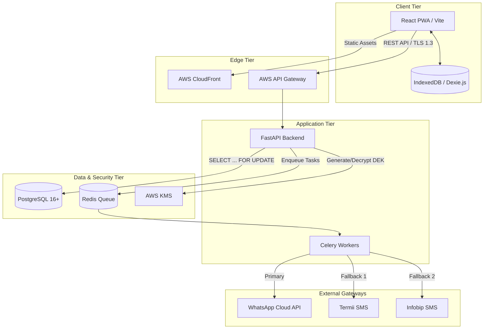
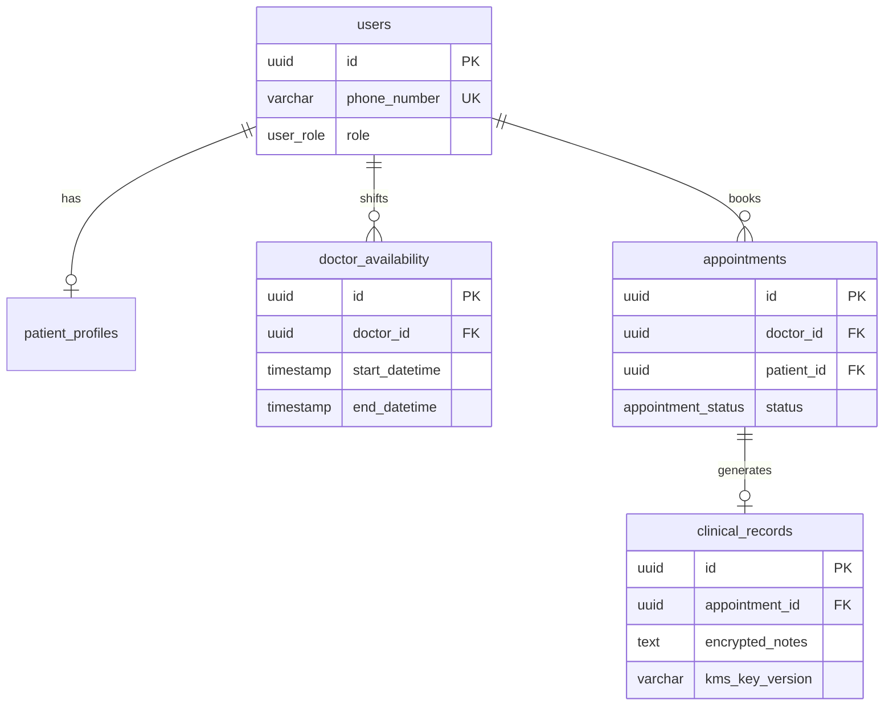

# Clinic Modernization Platform (CMP) — Implementation Plan

**Document Owner:** Principal Software Architect  
**Target Audience:** Engineering Leads, Coding Agents, DevOps, QA  
**Status:** Approved for Execution  

This document serves as the authoritative, step-by-step implementation plan for the Clinic Modernization Platform (CMP). It synthesizes the architectural decisions (ADRs), system requirements (SRD), C4 models, and technical specifications into an actionable engineering roadmap.

---

## 1. High-Level System Architecture & Component Boundaries

The CMP is designed as a decoupled, cloud-native system prioritizing offline resilience, strict data privacy, and transactional integrity.

### 1.1 Component Boundaries
*   **Client Tier (Frontend):** A Progressive Web App (PWA) built with **React + Vite**. It utilizes **Workbox** for Service Worker caching and **Dexie.js** (IndexedDB) to maintain a 2-hour read-only offline cache of daily schedules. Hosted statically on **AWS S3 + CloudFront**.
*   **API Tier (Backend):** An asynchronous **FastAPI (Python 3.12)** application. It handles routing, RBAC, OTP generation, and executes pessimistic database locks for scheduling. Hosted on AWS ECS or App Runner behind an API Gateway.
*   **Data Tier:** **PostgreSQL 16+** (AWS RDS) serves as the primary ACID-compliant datastore.
*   **Background Processing Tier:** **Redis** acts as the message broker for **Celery** workers, which handle the pluggable notification failover engine.
*   **Security & External Integrations:** **AWS KMS** for envelope encryption of clinical records. **WhatsApp Cloud API, Termii, and Infobip** for outbound messaging.

### 1.2 Architecture Diagram



---

## 2. Core Data Models & Database Schemas

The database schema is heavily normalized to support strict scheduling rules and future payment integrations. All migrations will be managed via **Alembic**.

### 2.1 Enumerations
*   `user_role`: `patient`, `receptionist`, `doctor`, `manager`, `admin`, `executive`
*   `appointment_status`: `booked`, `cancelled`, `completed`, `no-show`
*   `payment_status`: `pending`, `deposit_paid`, `fully_paid`, `waived`, `refunded`

### 2.2 Core Tables
1.  **`users`**: Authentication and routing data (plaintext).
2.  **`patient_profiles`**: Confidential demographic data (NDPR protected).
3.  **`doctor_availability`**: Time-bound shift blocks. Includes `CONSTRAINT check_dates CHECK (start_datetime < end_datetime)`.
4.  **`appointments`**: Core scheduling entity. Links doctors, patients, and branches.
5.  **`clinical_records`**: Restricted medical data. **Crucially, `encrypted_notes`, `encrypted_diagnosis`, and `encrypted_prescriptions` are stored as AES-256-GCM ciphertexts.**
6.  **`security_audit_logs`**: Immutable append-only table tracking all clinical reads, writes, and scheduling overrides.
7.  **`verification_otps`**: Tracks channel-agnostic OTP sessions and delivery statuses.

### 2.3 Entity-Relationship Diagram



---

## 3. API Contracts & Inter-Service Communication

Communication between the PWA and FastAPI backend occurs via REST over HTTPS (TLS 1.3). Background tasks communicate via Redis.

### 3.1 Key REST API Contracts

**1. Create Appointment (Booking Engine)**
*   **Endpoint:** `POST /api/v1/appointments`
*   **Auth:** Bearer Token (JWT) - `patient`, `receptionist`, `manager`
*   **Request:**
    ```json
    {
      "doctor_id": "uuid",
      "branch_id": "string",
      "start_datetime": "ISO8601",
      "end_datetime": "ISO8601",
      "booking_source": "patient"
    }
    ```
*   **Response (201 Created):**
    ```json
    {
      "appointment_id": "uuid",
      "status": "booked",
      "payment_state": "pending"
    }
    ```

**2. Write Clinical Record (Encrypted)**
*   **Endpoint:** `POST /api/v1/clinical-records`
*   **Auth:** Bearer Token (JWT) - `doctor` ONLY
*   **Request:**
    ```json
    {
      "appointment_id": "uuid",
      "patient_id": "uuid",
      "notes": "Plaintext notes...",
      "diagnosis": "Plaintext diagnosis..."
    }
    ```
*   **Response (201 Created):** Returns `record_id` and `status: "encrypted_and_stored"`.

### 3.2 Inter-Service Protocols (Notification Failover)
The FastAPI server does *not* wait for external SMS/WhatsApp APIs. It pushes a task to Redis:
```json
{
  "task": "send_notification",
  "payload": {
    "user_id": "uuid",
    "type": "OTP_VERIFICATION",
    "context": {"code": "123456"}
  }
}
```
The Celery worker executes the **Strategy Pattern**:
1. Attempt `WhatsAppCloudAPIClient`. If HTTP 200, exit.
2. If Timeout (>15s) or Error, attempt `TermiiSMSClient`. If HTTP 200, exit.
3. If Error, attempt `InfobipSMSClient`.

---

## 4. Security Policies, Threat Models & Auth/Authz

### 4.1 Threat Model & Mitigations
| Threat | Vector | Mitigation |
| :--- | :--- | :--- |
| **Concurrent Booking Race Condition** | Two users book the same slot simultaneously. | **Pessimistic Locking:** `SELECT ... FOR UPDATE` locks the `doctor_availability` and `appointments` rows during the transaction. |
| **Insider Threat (Data Leak)** | DB Admin accesses the PostgreSQL database. | **Application-Level Encryption:** Clinical notes are encrypted via AES-256-GCM before DB insertion. DB Admins lack AWS KMS decrypt permissions. |
| **Network Interception** | Man-in-the-Middle (MitM) attack on mobile networks. | **TLS 1.3 Enforcement:** All API Gateway traffic requires TLS 1.3. |
| **OTP Brute Force** | Attacker spams the verify endpoint. | **Rate Limiting & Expiry:** Max 3 requests/15 mins. OTPs expire in 10 mins. Max 5 failed attempts per OTP. |

### 4.2 Authentication & Authorization (RBAC)
*   **AuthN:** JWT-based authentication.
*   **AuthZ:** FastAPI `SecurityScopes` enforce role access.
    *   *Patients* can only read/write their own `patient_id`.
    *   *Doctors* can read/write clinical records.
    *   *Receptionists* can override Tier 3 booking restrictions but cannot read clinical records.

### 4.3 Immutable Audit Logging
Any action modifying a clinical record or overriding a scheduling rule triggers a synchronous database insert into `security_audit_logs`. If the audit insert fails, the entire transaction rolls back.

---

## 5. Phased Implementation Strategy

The project will be executed in 6 phases over a 16-week timeline.

### Phase 1: Foundation & Infrastructure (Weeks 1-2)
*   **DevOps:** Provision AWS infrastructure via Terraform (VPC, RDS PostgreSQL 16, ElastiCache Redis, S3, CloudFront, KMS).
*   **Backend:** Initialize FastAPI project, configure Alembic, and define SQLAlchemy/SQLModel schemas.
*   **Frontend:** Initialize Vite + React project, configure TailwindCSS, and set up the PWA manifest.

### Phase 2: Core Backend & Database Engine (Weeks 3-5)
*   **Auth:** Implement JWT generation, RBAC middleware, and the OTP Verification Engine (DB state machine).
*   **Scheduling Engine:** Implement the `POST /appointments` endpoint.
    *   *Critical Task:* Implement the `with_for_update()` pessimistic locking logic for concurrent booking validation.
*   **Penalty Engine:** Implement the rolling 90-day cancellation logic (Tier 1, Tier 2, Tier 3 restrictions).

### Phase 3: Frontend PWA & Offline Capabilities (Weeks 6-9)
*   **UI/UX:** Build responsive layouts for Patient Mobile Portal and Staff Desktop Dashboards.
*   **Offline Caching:** Implement Dexie.js. Create a sync script that downloads the daily schedule on login.
*   **Service Workers:** Configure Workbox to serve the static app shell and intercept API calls to serve IndexedDB data when `navigator.onLine` is false.

### Phase 4: Clinical Records & Cryptography (Weeks 10-11)
*   **KMS Integration:** Implement the `KMSClient` using `boto3`.
*   **Envelope Encryption:** Build the AES-256-GCM encryption/decryption utility.
*   **Audit Trail:** Implement the DB transaction blocks that write to `clinical_records` and `security_audit_logs` atomically.

### Phase 5: Pluggable Notifications & Background Workers (Weeks 12-13)
*   **Workers:** Set up Celery with Redis.
*   **Strategy Pattern:** Implement `NotificationService` interface and concrete classes (`WhatsAppClient`, `TermiiClient`, `InfobipClient`).
*   **Failover Logic:** Write the 15-second timeout and fallback routing logic.

### Phase 6: Testing, UAT & Phased Rollout (Weeks 14-16)
*   **Testing:** Execute `pytest` for locking concurrency. Execute `Cypress` for E2E offline caching tests.
*   **Pilot:** Deploy to Branch A (Week 14).
*   **Scale:** Deploy to Branch B (Week 15) and Branch C (Week 16).

---

## 6. Critical Technical Decisions, Trade-offs & Constraints

1.  **PostgreSQL over NoSQL (ADR-001):**
    *   *Trade-off:* Schema rigidity vs. Transactional safety.
    *   *Decision:* We chose PostgreSQL because preventing double-bookings is a hard business constraint. Native row-level locking (`SELECT ... FOR UPDATE`) provides bulletproof concurrency control without the need for complex distributed lock managers (e.g., Redis Redlock).
2.  **React PWA over Next.js SSR (ADR-002):**
    *   *Trade-off:* SEO/Initial load vs. Offline capabilities & Hosting cost.
    *   *Decision:* Nigerian internet instability mandates offline access (NFR-004). A static PWA allows Service Workers to cache the entire app shell and use IndexedDB for read-only schedules during outages. SSR makes offline hydration highly complex.
3.  **Application-Level Encryption over DB TDE (ADR-003):**
    *   *Trade-off:* Searchability vs. Absolute Privacy.
    *   *Decision:* To meet NDPR and NFR-008, DB admins must be blinded to clinical data. We sacrifice the ability to do SQL `LIKE` searches on clinical notes in exchange for cryptographic guarantees that only authenticated doctors can decrypt the data via AWS KMS.
4.  **Pluggable Notification Failover (ADR-004):**
    *   *Trade-off:* System complexity vs. Delivery reliability.
    *   *Decision:* Relying on a single global provider (like Twilio) fails against Nigerian DND policies. We accept the complexity of maintaining three API integrations (WhatsApp, Termii, Infobip) to guarantee patient reminders are delivered, directly supporting the business goal of reducing no-shows by 30%.