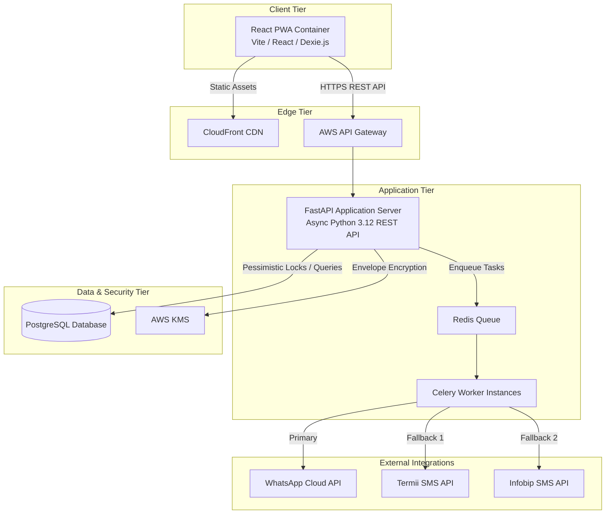
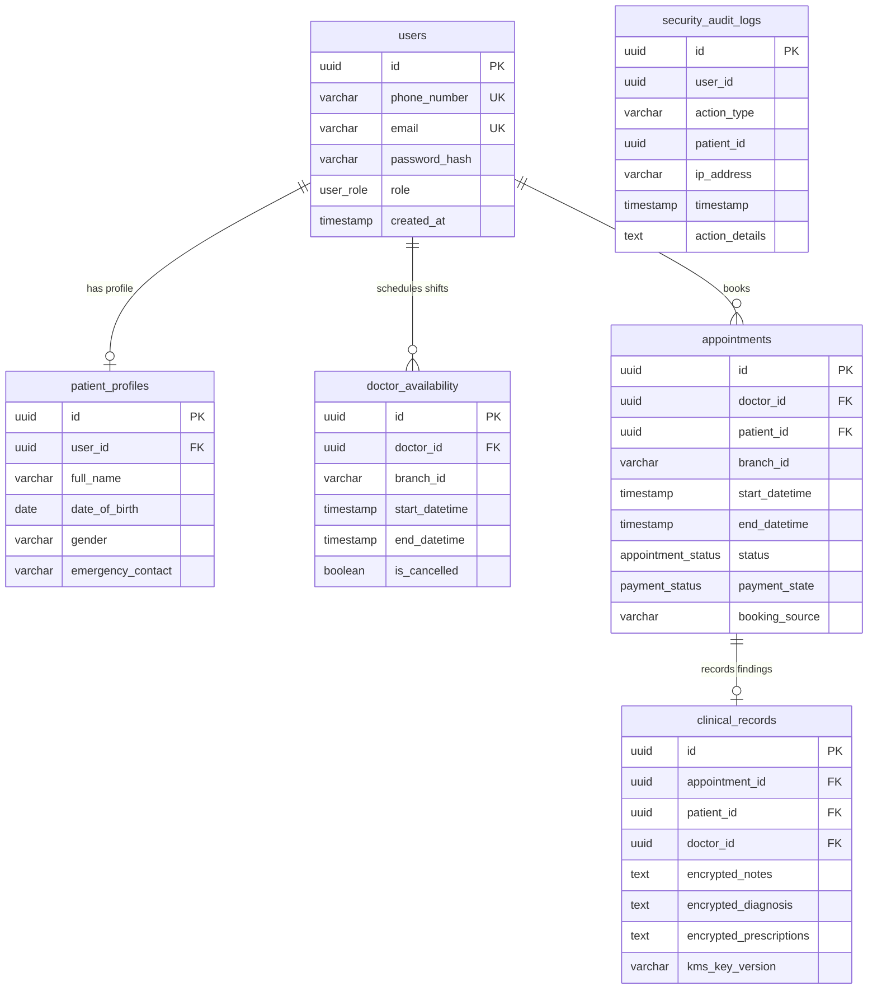
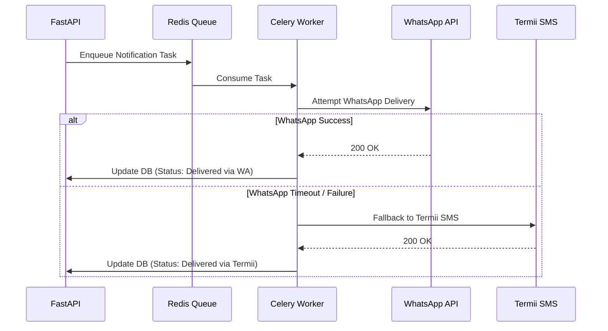

# Clinic Modernization Platform (CMP) — Implementation Plan

**Document Owner:** Principal Software Architect  
**Target Audience:** Engineering Teams, Coding Agents, DevOps, QA  
**Project Timeline:** 4 Months (Phase 1 MVP)  

This document serves as the authoritative, step-by-step Implementation Plan for the Clinic Modernization Platform (CMP). It synthesizes the architectural decisions (ADRs), software requirements (SRD), technical specifications, and UML models into an actionable blueprint for development.

---

## 1. High-Level System Architecture & Component Boundaries

The CMP is designed as a decoupled, cloud-native system optimized for low-bandwidth environments, offline resiliency, and strict data privacy. 

### 1.1 Component Boundaries
*   **Client Tier (Frontend)**: A Progressive Web App (PWA) built with **React + Vite**. It utilizes **Workbox** for Service Worker asset caching and **Dexie.js** (IndexedDB) for offline read-only scheduling data. Hosted statically on AWS S3 and distributed via Amazon CloudFront.
*   **API Tier (Backend)**: An asynchronous REST API built with **FastAPI (Python 3.12)**. It handles routing, RBAC validation, and business logic execution. Hosted on AWS ECS or App Runner behind an API Gateway.
*   **Storage Tier**: **PostgreSQL 16+** (AWS RDS) serves as the primary ACID-compliant datastore. It enforces relational integrity and handles concurrent booking locks.
*   **Background Processing Tier**: **Redis** acts as the message broker for **Celery** background workers, which handle asynchronous tasks like the pluggable notification failover chain.
*   **Security & External Integrations**: **AWS KMS** manages encryption keys for clinical data. External APIs include **WhatsApp Business Cloud**, **Termii** (Primary SMS), and **Infobip** (Fallback SMS).

### 1.2 Container Architecture Diagram

---

## 2. Core Data Models & Database Schemas

The database leverages PostgreSQL to enforce strict relational integrity and support future Phase 2 features (like payments) without schema rewrites.

### 2.1 Entity-Relationship Model

### 2.2 Critical Schema Implementations
*   **Enums**: `user_role`, `appointment_status`, `payment_status` must be defined natively in PostgreSQL.
*   **Encrypted Columns**: `encrypted_notes`, `encrypted_diagnosis`, and `encrypted_prescriptions` in the `clinical_records` table will store Base64-encoded AES-256-GCM ciphertexts (including the IV and Auth Tag).
*   **Audit Trail**: The `security_audit_logs` table is append-only. No `UPDATE` or `DELETE` privileges will be granted to the application user for this table.

---

## 3. API Contracts & Inter-Service Communication

Communication between the PWA and FastAPI backend occurs via REST over TLS 1.3. Background tasks are decoupled via Redis.

### 3.1 Core REST API Endpoints

| Endpoint | Method | Auth Scope | Description |
|---|---|---|---|
| `/api/v1/auth/verify-request` | POST | Public | Initiates OTP generation and triggers the WhatsApp/SMS failover delivery chain. |
| `/api/v1/auth/verify-submit` | POST | Public | Validates OTP and returns JWT access/refresh tokens. |
| `/api/v1/appointments` | POST | Patient, Staff | Books an appointment. Triggers DB pessimistic lock (`SELECT ... FOR UPDATE`). |
| `/api/v1/appointments/{id}/cancel`| POST | Patient, Staff | Cancels appointment. Triggers the Progressive Penalty Engine (Tier 1-3). |
| `/api/v1/clinical-records` | POST | Doctor | Encrypts and saves clinical notes. Generates an immutable audit log. |
| `/api/v1/clinical-records/patient/{id}`| GET | Doctor | Decrypts and retrieves patient history. Logs emergency cross-branch access if applicable. |

### 3.2 Inter-Service Communication (Notification Failover)

The notification system uses the Strategy Pattern and Celery workers to ensure high deliverability.

---

## 4. Security Policies, Threat Models & Auth Strategies

Security is paramount due to NDPR regulations and the sensitive nature of medical data.

### 4.1 Authentication & Authorization
*   **Authentication**: Stateless JWT (JSON Web Tokens) with short-lived access tokens (15 mins) and HTTP-only, secure refresh tokens (7 days).
*   **OTP Verification**: Channel-agnostic OTPs valid for 10 minutes. Max 3 requests per 15 minutes per IP/Phone to prevent SMS pumping attacks.
*   **Authorization (RBAC)**: Enforced via FastAPI `Security` dependencies. Roles: `patient`, `receptionist`, `doctor`, `manager`, `admin`.

### 4.2 Application-Level Column Encryption (ADR-003)
To satisfy **NFR-008** (preventing DB admins from reading clinical data):
1.  FastAPI requests a Data Encryption Key (DEK) from **AWS KMS**.
2.  FastAPI encrypts `notes`, `diagnosis`, and `prescriptions` in memory using **AES-256-GCM**.
3.  Only the ciphertext and the KMS Key Version are stored in PostgreSQL.
4.  **Threat Mitigated**: Database dumps, RDS snapshots, or rogue DB admins cannot expose patient medical records.

### 4.3 Immutable Audit Logging (NFR-007)
Every read, write, or override of clinical data or scheduling restrictions must be wrapped in a database transaction that simultaneously inserts a record into `security_audit_logs`.

---

## 5. Phased Implementation Strategy

The project must be delivered within a strict 4-month timeline. Development will follow a phased, agile approach.

### Phase 1: Foundation & Infrastructure (Weeks 1-2)
*   **DevOps**: Provision AWS infrastructure via Terraform (VPC, RDS PostgreSQL, ElastiCache Redis, KMS, S3, CloudFront).
*   **Backend**: Initialize FastAPI project structure, configure SQLAlchemy/Alembic, and establish CI/CD pipelines (GitHub Actions).
*   **Frontend**: Initialize Vite + React project, configure TailwindCSS, and setup basic routing.

### Phase 2: Core Backend & Security (Weeks 3-5)
*   **Auth**: Implement JWT authentication, RBAC middleware, and the OTP generation state machine.
*   **Cryptography**: Integrate `boto3` with AWS KMS. Build the SQLAlchemy custom types for automatic AES-256-GCM encryption/decryption of clinical fields.
*   **Audit**: Implement the database transaction wrappers for the `security_audit_logs`.

### Phase 3: Scheduling Engine & Locking (Weeks 6-8)
*   **Data Models**: Build `doctor_availability` and `appointments` tables.
*   **Concurrency**: Implement the pessimistic locking logic (`with_for_update()`) in the booking endpoints to satisfy **FR-019**.
*   **Penalty Engine**: Implement the rolling 90-day cancellation penalty logic (Tier 1 Warning, Tier 2 Soft Flag, Tier 3 Restricted) and admin overrides.

### Phase 4: Frontend PWA & Offline Support (Weeks 9-11)
*   **UI Development**: Build responsive dashboards for Patients (Mobile), Receptionists (Desktop), and Doctors (Tablet).
*   **Offline Resiliency**: Integrate **Dexie.js**. Write synchronization scripts to cache the daily schedule on login.
*   **Service Workers**: Configure Vite PWA plugin and Workbox to serve the application shell when offline, displaying the "Offline Mode - Read Only" banner.

### Phase 5: Integrations & Background Workers (Weeks 12-14)
*   **Task Queue**: Setup Celery workers connected to Redis.
*   **Notification Strategy**: Implement the `NotificationService` interface. Build adapters for WhatsApp Cloud API, Termii, and Infobip.
*   **Failover Logic**: Write the retry and fallback logic for the OTP and appointment reminder workflows.

### Phase 6: Testing, UAT & Rollout (Weeks 15-16)
*   **Testing**: Execute E2E tests (Cypress/Playwright), load testing (k6) for the 2.0s search latency target, and concurrency testing for the DB locks.
*   **Pilot Rollout**: Deploy to Branch A. Monitor offline caching behavior and SMS failover rates.
*   **Full Rollout**: Expand to Branches B and C.

---

## 6. Critical Technical Decisions, Trade-offs & Constraints

Coding agents and developers must adhere to the following architectural constraints:

1.  **Database Locking vs. Performance (ADR-001)**: 
    *   *Decision*: We use pessimistic row-level locks (`SELECT ... FOR UPDATE`) for bookings.
    *   *Constraint*: Lock scopes must be extremely narrow. Do not perform external API calls (like sending emails) *inside* the locked database transaction, as this will cause connection pool exhaustion and deadlocks.
2.  **Offline Caching Security (ADR-002)**:
    *   *Decision*: Daily schedules are cached in IndexedDB for offline access.
    *   *Constraint*: Sensitive clinical notes must **never** be cached in IndexedDB. Only basic appointment metadata (Time, Patient Name, Status) is permitted in the local cache. IndexedDB must be purged on logout.
3.  **Search Limitations due to Encryption (ADR-003)**:
    *   *Decision*: Clinical notes are encrypted at the application layer.
    *   *Constraint*: You cannot use SQL `LIKE` or `ILIKE` operators to search clinical notes. All search functionality must rely on unencrypted metadata (e.g., Patient ID, Date, Doctor ID).
4.  **Notification Failover Latency (ADR-004)**:
    *   *Decision*: WhatsApp -> Termii -> Infobip failover.
    *   *Constraint*: The timeout for WhatsApp delivery confirmation must be strictly set to **15 seconds**. If no webhook acknowledgment is received, the worker must immediately trigger the Termii SMS fallback to ensure patients receive OTPs promptly.