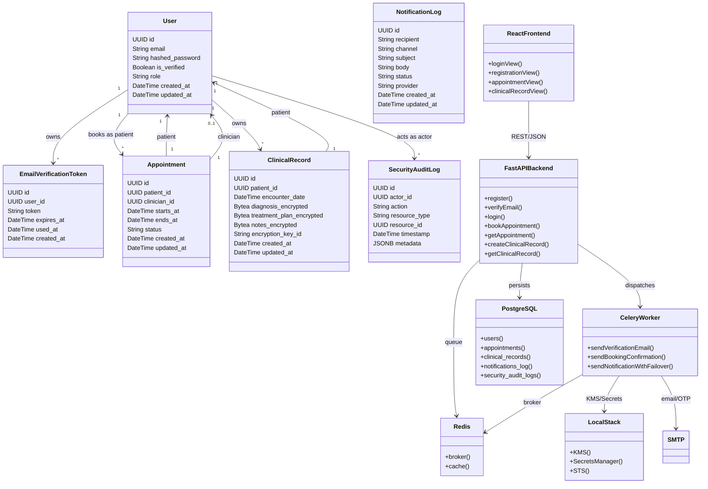
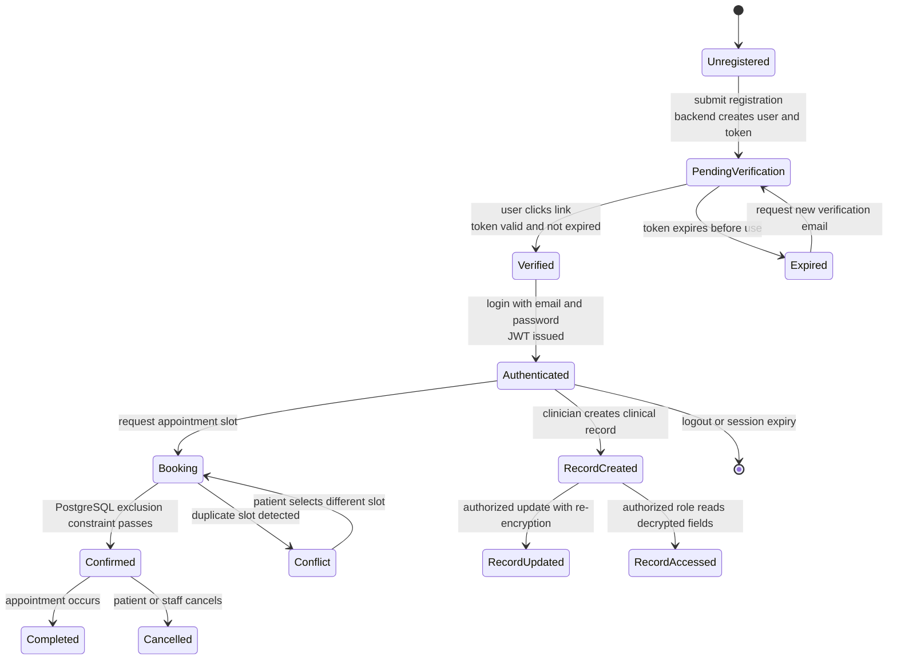
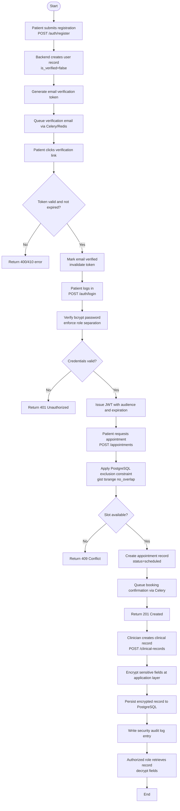
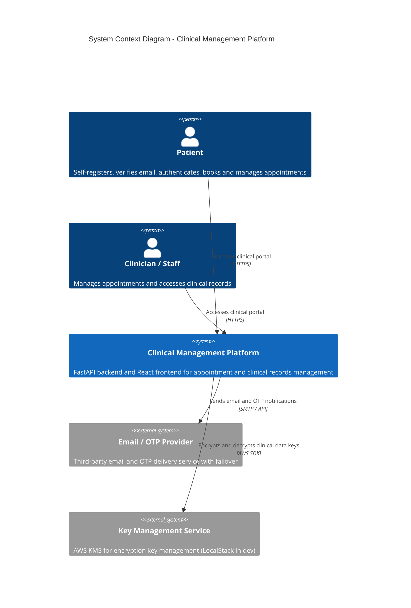
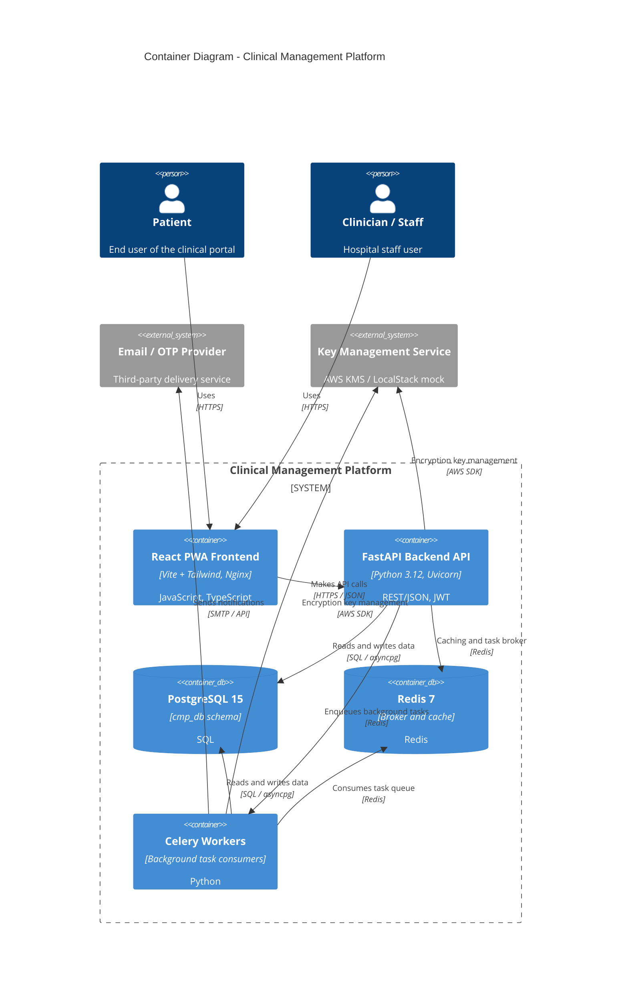
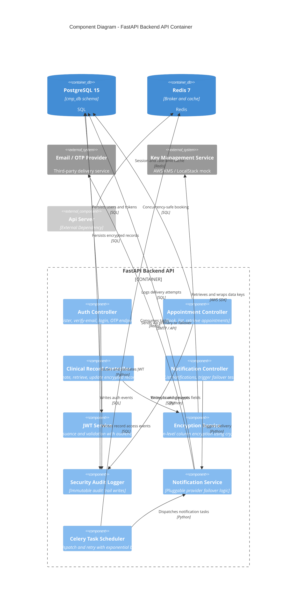
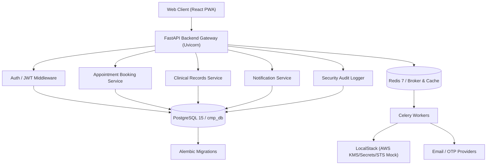

# Frontend Engineer Agent

## Role
You are the Frontend UI Engineer. Your job is to implement the user interface based on `implementation-plan.md`, `task-plan.md`, and the SSOT.

## Context
--- architecture-decisions.md ---
# Architecture Decision Records

## ADR-001: Frontend Framework Selection for Clinical Management Platform
**Status:** Accepted  
**Deciders:** Engineering Team, Product Stakeholders

### Context
The frontend must be a React PWA (per ADR-002) consuming the FastAPI backend via REST/JSON, supporting patient registration, appointment booking, clinical record viewing, and notification receipt. It must pass ESLint and run in a Node container with Nginx per NFR-009 and NFR-008.

### Decision
React (Vite + Tailwind CSS) — mandated by SRD tech stack and ADR-002; best fit for React PWA requirement and existing frontend codebase.

### Rationale
Matches existing SRD tech stack and ADR-002 PWA decision; Vite provides fast HMR and optimized builds; Tailwind enables rapid, consistent UI development; large ecosystem for healthcare UI components; easy integration with REST/JSON APIs.

### Options Considered
| Option | Pros | Cons | Estimated Effort |
|---|---|---|---|
| React (Vite + Tailwind CSS) | Matches existing SRD tech stack and ADR-002 PWA decision; Vite provides fast HMR and optimized builds; Tailwind enables rapid, consistent UI development; large ecosystem for healthcare UI components; easy integration with REST/JSON APIs. | Requires careful state management for complex clinical workflows; PWA offline capabilities need additional service worker configuration; bundle size can grow without strict code splitting. | Low (aligned with existing stack) |
| Vue.js (Vite + Pinia) | Gentle learning curve; excellent documentation; Vite compatibility; reactive data model suits form-heavy clinical interfaces. | Deviates from mandated React stack; smaller ecosystem for specialized healthcare components; team retraining required. | Medium (requires team retraining and stack deviation) |
| Angular | Opinionated structure; built-in HTTP client and form validation; strong typing out of the box. | Heavier bundle size; steeper learning curve; inconsistent with existing React-based frontend and ADR-002. | High (heavier bundle, steeper learning curve, inconsistent with existing codebase) |

### Consequences
- Frontend remains consistent with ADR-002 PWA requirement and SRD-mandated React stack.
- Requires careful state management for complex clinical workflows and additional service worker configuration for PWA offline capabilities.
- Bundle size must be monitored with strict code splitting to prevent growth.

## ADR-002: Backend API Framework Selection
**Status:** Accepted  
**Deciders:** Engineering Team, Architecture Review Board

### Context
Backend API must be FastAPI (Python 3.12) with Uvicorn ASGI server, SQLAlchemy/asyncpg ORM, Alembic migrations, python-jose/passlib/bcrypt authentication, cryptography for application-level encryption, structlog structured logging, and httpx/aiohttp HTTP clients. Must satisfy FR-001 through FR-012 and NFR-001, NFR-006, NFR-007, NFR-008.

### Decision
FastAPI (Python 3.12) — mandated by SRD; best satisfies async performance, OpenAPI generation, and Python 3.12 container constraint.

### Rationale
Explicitly mandated in SRD; native async/await support with asyncpg; automatic OpenAPI/Swagger docs; high performance (Starlette/Pydantic); strong dependency injection for auth/JWT middleware; aligns with NFR-001 p95 200ms latency target.

### Options Considered
| Option | Pros | Cons | Estimated Effort |
|---|---|---|---|
| FastAPI (Python 3.12) | Explicitly mandated in SRD; native async/await support with asyncpg; automatic OpenAPI/Swagger docs; high performance (Starlette/Pydantic); strong dependency injection for auth/JWT middleware; aligns with NFR-001 p95 200ms latency target. | Smaller ecosystem than Django for built-in admin; requires manual assembly of auth, migrations, and encryption components; async learning curve for team. | Low (mandated, existing codebase alignment) |
| Django REST Framework (Python 3.12) | Batteries-included admin, ORM, and authentication; mature ecosystem; robust security defaults. | Not in SRD stack; synchronous by default (requires async adapters); heavier than FastAPI; migration from existing FastAPI codebase would be costly. | High (migration from FastAPI, not in SRD stack) |
| Flask (Python 3.12) | Lightweight and flexible; easy to learn. | Lacks built-in async support and validation; requires many extensions to match FastAPI features; not aligned with SRD. | Medium (requires many extensions, lacks built-in async) |

### Consequences
- Backend aligns with SRD-mandated Python 3.12 and FastAPI stack.
- Requires manual assembly of auth, migrations, and encryption components; team must manage async learning curve.
- Smaller built-in admin ecosystem compared to Django; custom tooling may be needed.

## ADR-003: Asynchronous Task Queue Selection
**Status:** Accepted  
**Deciders:** Engineering Team, DevOps

### Context
Asynchronous task processing via Celery/Redis for notification delivery (email/OTP), booking confirmations, and retryable tasks with exponential backoff per NFR-003. Redis 7 required for broker and rate limiting. LocalStack emulates AWS services in dev/CI.

### Decision
Celery + Redis 7 — mandated by SRD; best supports notification failover retries, exponential backoff, and existing LocalStack/CI configuration.

### Rationale
Explicitly mandated in SRD (Celery 5.3.6, Redis 7); mature Python task queue; supports retries, exponential backoff, chords, and periodic tasks; broad community and operational tooling; integrates cleanly with FastAPI and asyncpg.

### Options Considered
| Option | Pros | Cons | Estimated Effort |
|---|---|---|---|
| Celery + Redis 7 | Explicitly mandated in SRD (Celery 5.3.6, Redis 7); mature Python task queue; supports retries, exponential backoff, chords, and periodic tasks; broad community and operational tooling; integrates cleanly with FastAPI and asyncpg. | Operational overhead of managing workers and beat scheduler; visibility requires Flower or custom monitoring; result backend configuration needed for task state tracking. | Low (mandated, existing CI configuration) |
| Redis Queue (RQ) + Redis 7 | Simpler API and lower operational complexity than Celery; Python-native; easy to inspect queues via redis-cli. | Fewer advanced workflow primitives (chords, chains, scheduling); less mature retry/backoff semantics; deviates from SRD-mandated Celery. | Medium (simpler but deviates from SRD) |
| Dramatiq + Redis 7 | Focus on simplicity and reliability; low latency; predictable message processing. | Smaller ecosystem; fewer integrations; not aligned with SRD tech stack. | Medium (smaller ecosystem, not aligned with SRD) |

### Consequences
- Supports notification failover retries, exponential backoff, and existing LocalStack/CI configuration.
- Introduces operational overhead of managing workers and beat scheduler.
- Requires Flower or custom monitoring for task visibility.

## ADR-004: Database and Storage Selection
**Status:** Accepted  
**Deciders:** Engineering Team, Database Administrators

### Context
PostgreSQL 15 (postgres:15-alpine) as the single-tenant cmp_db database, accessed via SQLAlchemy/asyncpg with Alembic migrations (0001 through 0011). Application-level column-level encryption for sensitive clinical record fields using cryptography 41.0.7 and AWS KMS (LocalStack in dev, AWS KMS in prod) per NFR-004 and FR-008. Must support concurrency-safe scheduling (FR-007) and health checks (FR-012, NFR-002).

### Decision
PostgreSQL 15 + SQLAlchemy/asyncpg + Alembic — mandated by SRD; best satisfies relational integrity, concurrency-safe scheduling, and application-level encryption requirements.

### Rationale
Explicitly mandated in SRD; native JSONB and advanced indexing for clinical records; strong concurrency control via row-level locking and advisory locks for booking concurrency (FR-007); proven encryption integration with application-layer cryptography; Alembic supports schema versioning (FR-011).

### Options Considered
| Option | Pros | Cons | Estimated Effort |
|---|---|---|---|
| PostgreSQL 15 + SQLAlchemy/asyncpg + Alembic | Explicitly mandated in SRD; native JSONB and advanced indexing for clinical records; strong concurrency control via row-level locking and advisory locks for booking concurrency (FR-007); proven encryption integration with application-layer cryptography; Alembic supports schema versioning (FR-011). | Application-level encryption adds key management complexity and query limitations on encrypted columns; no built-in zero-downtime migration strategy evidenced in SRD. | Low (mandated, existing stack) |
| MySQL 8.0 + SQLAlchemy | Wide adoption; good performance; mature replication. | Not in SRD stack; deviates from PostgreSQL 15 constraint; encryption and JSON handling differ from PostgreSQL. | High (deviates from SRD stack) |
| MongoDB + Motor | Flexible schema for evolving clinical records; horizontal scaling. | Not relational; weaker ACID guarantees for financial/clinical consistency; not in SRD stack; conflicts with PostgreSQL 15 constraint. | High (not relational, conflicts with SRD) |

### Consequences
- Satisfies relational integrity, concurrency-safe scheduling, and application-level encryption requirements.
- Application-level encryption adds key management complexity and query limitations on encrypted columns.
- No built-in zero-downtime migration strategy evidenced in SRD; must be addressed in operational planning.

## ADR-005: AI Agent Framework Selection
**Status:** Accepted  
**Deciders:** Engineering Team, Compliance

### Context
No AI/ML frameworks, models, or inference endpoints were detected in the dependency manifests or codebase profile (AI-001). Evaluation is included for completeness only; no AI agent functionality is required for CMP.

### Decision
null / Not Applicable — SRD requirement AI-001 explicitly states no AI/ML frameworks are detected or required.

### Rationale
No additional dependencies, technical debt, or security surface area; aligns with SRD AI-001; reduces compliance scope for healthcare data.

### Options Considered
| Option | Pros | Cons | Estimated Effort |
|---|---|---|---|
| null / Not Applicable | No additional dependencies, technical debt, or security surface area; aligns with SRD AI-001; reduces compliance scope for healthcare data. | null applicable. | null |
| LangChain | Popular orchestration for LLM-based agents if future AI features are added. | Unnecessary for current requirements; introduces model governance and data privacy risks in a healthcare context; not in SRD stack. | Medium (unnecessary, adds PHI exposure considerations) |
| LlamaIndex | Useful for RAG over clinical documents if future requirements emerge. | Not required per AI-001; adds operational complexity and PHI exposure considerations. | Medium (not required, adds operational complexity) |

### Consequences
- No AI/ML dependencies introduced; reduced compliance scope for healthcare data.
- No model governance or PHI exposure risks from AI frameworks.
- Future AI features would require a new ADR and compliance review.

--- uml-design-models.md ---
# UML Design Models

> **Text-Based Design Specification (Diagrams-as-Code):**
> These UML models are generated as declarative Mermaid text code specifications. Separating the model definition from visual rendering prevents model drawing errors, supports Git version control, and allows rendering by diverse compatible tools.


## 1. Class Diagram (Data Entities & Relationships)


> **Diagram Options & Compatible Viewers for *Class Diagram*:**
> - **Online Interactive View:** [Open Diagram in Mermaid Live Editor](https://mermaid.live/edit#base64:eyJjb2RlIjogImNsYXNzRGlhZ3JhbVxuICAgIGNsYXNzIFVzZXIge1xuICAgICAgICBVVUlEIGlkXG4gICAgICAgIFN0cmluZyBlbWFpbFxuICAgICAgICBTdHJpbmcgaGFzaGVkX3Bhc3N3b3JkXG4gICAgICAgIEJvb2xlYW4gaXNfdmVyaWZpZWRcbiAgICAgICAgU3RyaW5nIHJvbGVcbiAgICAgICAgRGF0ZVRpbWUgY3JlYXRlZF9hdFxuICAgICAgICBEYXRlVGltZSB1cGRhdGVkX2F0XG4gICAgfVxuICAgIGNsYXNzIEVtYWlsVmVyaWZpY2F0aW9uVG9rZW4ge1xuICAgICAgICBVVUlEIGlkXG4gICAgICAgIFVVSUQgdXNlcl9pZFxuICAgICAgICBTdHJpbmcgdG9rZW5cbiAgICAgICAgRGF0ZVRpbWUgZXhwaXJlc19hdFxuICAgICAgICBEYXRlVGltZSB1c2VkX2F0XG4gICAgICAgIERhdGVUaW1lIGNyZWF0ZWRfYXRcbiAgICB9XG4gICAgY2xhc3MgQXBwb2ludG1lbnQge1xuICAgICAgICBVVUlEIGlkXG4gICAgICAgIFVVSUQgcGF0aWVudF9pZFxuICAgICAgICBVVUlEIGNsaW5pY2lhbl9pZFxuICAgICAgICBEYXRlVGltZSBzdGFydHNfYXRcbiAgICAgICAgRGF0ZVRpbWUgZW5kc19hdFxuICAgICAgICBTdHJpbmcgc3RhdHVzXG4gICAgICAgIERhdGVUaW1lIGNyZWF0ZWRfYXRcbiAgICAgICAgRGF0ZVRpbWUgdXBkYXRlZF9hdFxuICAgIH1cbiAgICBjbGFzcyBDbGluaWNhbFJlY29yZCB7XG4gICAgICAgIFVVSUQgaWRcbiAgICAgICAgVVVJRCBwYXRpZW50X2lkXG4gICAgICAgIERhdGVUaW1lIGVuY291bnRlcl9kYXRlXG4gICAgICAgIEJ5dGVhIGRpYWdub3Npc19lbmNyeXB0ZWRcbiAgICAgICAgQnl0ZWEgdHJlYXRtZW50X3BsYW5fZW5jcnlwdGVkXG4gICAgICAgIEJ5dGVhIG5vdGVzX2VuY3J5cHRlZFxuICAgICAgICBTdHJpbmcgZW5jcnlwdGlvbl9rZXlfaWRcbiAgICAgICAgRGF0ZVRpbWUgY3JlYXRlZF9hdFxuICAgICAgICBEYXRlVGltZSB1cGRhdGVkX2F0XG4gICAgfVxuICAgIGNsYXNzIE5vdGlmaWNhdGlvbkxvZyB7XG4gICAgICAgIFVVSUQgaWRcbiAgICAgICAgU3RyaW5nIHJlY2lwaWVudFxuICAgICAgICBTdHJpbmcgY2hhbm5lbFxuICAgICAgICBTdHJpbmcgc3ViamVjdFxuICAgICAgICBTdHJpbmcgYm9keVxuICAgICAgICBTdHJpbmcgc3RhdHVzXG4gICAgICAgIFN0cmluZyBwcm92aWRlclxuICAgICAgICBEYXRlVGltZSBjcmVhdGVkX2F0XG4gICAgICAgIERhdGVUaW1lIHVwZGF0ZWRfYXRcbiAgICB9XG4gICAgY2xhc3MgU2VjdXJpdHlBdWRpdExvZyB7XG4gICAgICAgIFVVSUQgaWRcbiAgICAgICAgVVVJRCBhY3Rvcl9pZFxuICAgICAgICBTdHJpbmcgYWN0aW9uXG4gICAgICAgIFN0cmluZyByZXNvdXJjZV90eXBlXG4gICAgICAgIFVVSUQgcmVzb3VyY2VfaWRcbiAgICAgICAgRGF0ZVRpbWUgdGltZXN0YW1wXG4gICAgICAgIEpTT05CIG1ldGFkYXRhXG4gICAgfVxuICAgIGNsYXNzIEZhc3RBUElCYWNrZW5kIHtcbiAgICAgICAgK3JlZ2lzdGVyKClcbiAgICAgICAgK3ZlcmlmeUVtYWlsKClcbiAgICAgICAgK2xvZ2luKClcbiAgICAgICAgK2Jvb2tBcHBvaW50bWVudCgpXG4gICAgICAgICtnZXRBcHBvaW50bWVudCgpXG4gICAgICAgICtjcmVhdGVDbGluaWNhbFJlY29yZCgpXG4gICAgICAgICtnZXRDbGluaWNhbFJlY29yZCgpXG4gICAgfVxuICAgIGNsYXNzIENlbGVyeVdvcmtlciB7XG4gICAgICAgICtzZW5kVmVyaWZpY2F0aW9uRW1haWwoKVxuICAgICAgICArc2VuZEJvb2tpbmdDb25maXJtYXRpb24oKVxuICAgICAgICArc2VuZE5vdGlmaWNhdGlvbldpdGhGYWlsb3ZlcigpXG4gICAgfVxuICAgIGNsYXNzIFJlZGlzIHtcbiAgICAgICAgK2Jyb2tlcigpXG4gICAgICAgICtjYWNoZSgpXG4gICAgfVxuICAgIGNsYXNzIFBvc3RncmVTUUwge1xuICAgICAgICArdXNlcnMoKVxuICAgICAgICArYXBwb2ludG1lbnRzKClcbiAgICAgICAgK2NsaW5pY2FsX3JlY29yZHMoKVxuICAgICAgICArbm90aWZpY2F0aW9uc19sb2coKVxuICAgICAgICArc2VjdXJpdHlfYXVkaXRfbG9ncygpXG4gICAgfVxuICAgIGNsYXNzIExvY2FsU3RhY2sge1xuICAgICAgICArS01TKClcbiAgICAgICAgK1NlY3JldHNNYW5hZ2VyKClcbiAgICAgICAgK1NUUygpXG4gICAgfVxuICAgIGNsYXNzIFJlYWN0RnJvbnRlbmQge1xuICAgICAgICArbG9naW5WaWV3KClcbiAgICAgICAgK3JlZ2lzdHJhdGlvblZpZXcoKVxuICAgICAgICArYXBwb2ludG1lbnRWaWV3KClcbiAgICAgICAgK2NsaW5pY2FsUmVjb3JkVmlldygpXG4gICAgfVxuICAgIFVzZXIgXCIxXCIgLS0-IFwiKlwiIEVtYWlsVmVyaWZpY2F0aW9uVG9rZW4gOiBvd25zXG4gICAgVXNlciBcIjFcIiAtLT4gXCIqXCIgQXBwb2ludG1lbnQgOiBib29rcyBhcyBwYXRpZW50XG4gICAgVXNlciBcIjFcIiAtLT4gXCIqXCIgQ2xpbmljYWxSZWNvcmQgOiBvd25zXG4gICAgVXNlciBcIjFcIiAtLT4gXCIqXCIgU2VjdXJpdHlBdWRpdExvZyA6IGFjdHMgYXMgYWN0b3JcbiAgICBBcHBvaW50bWVudCBcIjFcIiAtLT4gXCIxXCIgVXNlciA6IHBhdGllbnRcbiAgICBBcHBvaW50bWVudCBcIjFcIiAtLT4gXCIwLi4xXCIgVXNlciA6IGNsaW5pY2lhblxuICAgIENsaW5pY2FsUmVjb3JkIFwiMVwiIC0tPiBcIjFcIiBVc2VyIDogcGF0aWVudFxuICAgIEZhc3RBUElCYWNrZW5kIC0tPiBQb3N0Z3JlU1FMIDogcGVyc2lzdHNcbiAgICBGYXN0QVBJQmFja2VuZCAtLT4gUmVkaXMgOiBxdWV1ZVxuICAgIEZhc3RBUElCYWNrZW5kIC0tPiBDZWxlcnlXb3JrZXIgOiBkaXNwYXRjaGVzXG4gICAgQ2VsZXJ5V29ya2VyIC0tPiBSZWRpcyA6IGJyb2tlclxuICAgIENlbGVyeVdvcmtlciAtLT4gTG9jYWxTdGFjayA6IEtNUy9TZWNyZXRzXG4gICAgQ2VsZXJ5V29ya2VyIC0tPiBTTVRQIDogZW1haWwvT1RQXG4gICAgUmVhY3RGcm9udGVuZCAtLT4gRmFzdEFQSUJhY2tlbmQgOiBSRVNUL0pTT04iLCAibWVybWFpZCI6ICJ7XCJ0aGVtZVwiOiBcImRlZmF1bHRcIn0ifQ==) *(pan, zoom, export SVG/PNG)*
> - **Native Markdown Viewers:** Renders automatically in GitHub, GitLab, Obsidian, Notion, Azure DevOps.
> - **VS Code:** Render live with the [Markdown Preview Mermaid Support](https://marketplace.visualstudio.com/items?itemName=bierner.markdown-mermaid) extension.
> - **Local CLI Export:** `npx @mermaid-js/mermaid-cli -i <file>.md -o diagram.svg`

## 2. Sequence Diagram (Workflow Execution)
```mermaid
sequenceDiagram
    autonumber
    participant Patient as React Frontend
    participant API as FastAPI Backend
    participant DB as PostgreSQL 15
    participant Redis as Redis 7
    participant Celery as Celery Worker
    participant LocalStack as LocalStack KMS
    participant Email as Email/OTP Provider
    Patient->>API: POST /auth/register {email, password}<br/>queues verification email
    API->>DB: INSERT users (email, hashed_password, is_verified=false)
    DB-->>API: user_id
    API->>DB: INSERT email_verification_tokens (user_id, token, expires_at)
    DB-->>API: token_id
    API->>Redis: XADD notifications {task: send_verification_email, user_id, token}
    Redis-->>API: queued
    API-->>Patient: 202 Accepted
    Celery->>Redis: XREAD notifications
    Redis-->>Celery: task payload
    Celery->>LocalStack: encrypt/verify key context
    LocalStack-->>Celery: key reference
    Celery->>Email: send verification email with token
    Email-->>Celery: delivery status
    Celery->>DB: INSERT notifications_log (recipient, channel, status, provider)
    Patient->>API: GET /auth/verify-email?token=xxx
    API->>DB: SELECT email_verification_tokens WHERE token=xxx AND expires_at > now()
    DB-->>API: token record
    API->>DB: UPDATE users SET is_verified=true WHERE id=user_id
    API->>DB: UPDATE email_verification_tokens SET used_at=now() WHERE id=token_id
    API-->>Patient: 200 OK email verified
    Patient->>API: POST /auth/login {email, password}
    API->>DB: SELECT hashed_password, role FROM users WHERE email=xxx
    DB-->>API: user credentials
    API->>API: bcrypt verify password
    API->>API: issue python-jose JWT with audience and expiration
    API-->>Patient: 200 OK {access_token}
    Patient->>API: POST /appointments {clinician_id, starts_at, ends_at} Bearer JWT
    API->>API: validate JWT audience and expiration
    API->>DB: INSERT appointments (patient_id, clinician_id, starts_at, ends_at, status=scheduled)<br/>ON CONFLICT exclusion constraint no_overlap
    DB-->>API: appointment_id or exclusion violation
    alt booking success
        API->>Redis: XADD notifications {task: send_booking_confirmation, appointment_id}
        Redis-->>API: queued
        API-->>Patient: 201 Created {appointment_id}
    alt booking conflict
        API-->>Patient: 409 Conflict duplicate slot
    end
    Celery->>Redis: XREAD notifications
    Redis-->>Celery: booking confirmation task
    Celery->>Email: send booking confirmation
    Email-->>Celery: delivery status
    Celery->>DB: INSERT notifications_log (recipient, channel, status, provider)
    Patient->>API: POST /clinical-records {patient_id, encounter_date, diagnosis, treatment_plan, notes} Bearer JWT
    API->>API: validate authorized role
    API->>LocalStack: generate data key for encryption
    LocalStack-->>API: encrypted data key and plaintext key
    API->>API: encrypt diagnosis, treatment_plan, notes with cryptography
    API->>DB: INSERT clinical_records (patient_id, encounter_date, diagnosis_encrypted, treatment_plan_encrypted, notes_encrypted, encryption_key_id)
    DB-->>API: record_id
    API->>DB: INSERT security_audit_logs (actor_id, action=CREATE_CLINICAL_RECORD, resource_type=clinical_record, resource_id=record_id, metadata)
    API-->>Patient: 201 Created {record_id}
    Patient->>API: GET /clinical-records/{id} Bearer JWT
    API->>API: validate authorized role for decryption
    API->>DB: SELECT clinical_records WHERE id={id}
    DB-->>API: encrypted fields
    API->>LocalStack: decrypt data key
    LocalStack-->>API: plaintext key
    API->>API: decrypt sensitive fields
    API->>DB: INSERT security_audit_logs (actor_id, action=READ_CLINICAL_RECORD, resource_type=clinical_record, resource_id={id}, metadata)
    API-->>Patient: 200 OK {decrypted clinical record}
```

> **Diagram Options & Compatible Viewers for *Sequence Diagram*:**
> - **Online Interactive View:** [Open Diagram in Mermaid Live Editor](https://mermaid.live/edit#base64:eyJjb2RlIjogInNlcXVlbmNlRGlhZ3JhbVxuICAgIGF1dG9udW1iZXJcbiAgICBwYXJ0aWNpcGFudCBQYXRpZW50IGFzIFJlYWN0IEZyb250ZW5kXG4gICAgcGFydGljaXBhbnQgQVBJIGFzIEZhc3RBUEkgQmFja2VuZFxuICAgIHBhcnRpY2lwYW50IERCIGFzIFBvc3RncmVTUUwgMTVcbiAgICBwYXJ0aWNpcGFudCBSZWRpcyBhcyBSZWRpcyA3XG4gICAgcGFydGljaXBhbnQgQ2VsZXJ5IGFzIENlbGVyeSBXb3JrZXJcbiAgICBwYXJ0aWNpcGFudCBMb2NhbFN0YWNrIGFzIExvY2FsU3RhY2sgS01TXG4gICAgcGFydGljaXBhbnQgRW1haWwgYXMgRW1haWwvT1RQIFByb3ZpZGVyXG4gICAgUGF0aWVudC0-PkFQSTogUE9TVCAvYXV0aC9yZWdpc3RlciB7ZW1haWwsIHBhc3N3b3JkfTxici8-cXVldWVzIHZlcmlmaWNhdGlvbiBlbWFpbFxuICAgIEFQSS0-PkRCOiBJTlNFUlQgdXNlcnMgKGVtYWlsLCBoYXNoZWRfcGFzc3dvcmQsIGlzX3ZlcmlmaWVkPWZhbHNlKVxuICAgIERCLS0-PkFQSTogdXNlcl9pZFxuICAgIEFQSS0-PkRCOiBJTlNFUlQgZW1haWxfdmVyaWZpY2F0aW9uX3Rva2VucyAodXNlcl9pZCwgdG9rZW4sIGV4cGlyZXNfYXQpXG4gICAgREItLT4-QVBJOiB0b2tlbl9pZFxuICAgIEFQSS0-PlJlZGlzOiBYQUREIG5vdGlmaWNhdGlvbnMge3Rhc2s6IHNlbmRfdmVyaWZpY2F0aW9uX2VtYWlsLCB1c2VyX2lkLCB0b2tlbn1cbiAgICBSZWRpcy0tPj5BUEk6IHF1ZXVlZFxuICAgIEFQSS0tPj5QYXRpZW50OiAyMDIgQWNjZXB0ZWRcbiAgICBDZWxlcnktPj5SZWRpczogWFJFQUQgbm90aWZpY2F0aW9uc1xuICAgIFJlZGlzLS0-PkNlbGVyeTogdGFzayBwYXlsb2FkXG4gICAgQ2VsZXJ5LT4-TG9jYWxTdGFjazogZW5jcnlwdC92ZXJpZnkga2V5IGNvbnRleHRcbiAgICBMb2NhbFN0YWNrLS0-PkNlbGVyeToga2V5IHJlZmVyZW5jZVxuICAgIENlbGVyeS0-PkVtYWlsOiBzZW5kIHZlcmlmaWNhdGlvbiBlbWFpbCB3aXRoIHRva2VuXG4gICAgRW1haWwtLT4-Q2VsZXJ5OiBkZWxpdmVyeSBzdGF0dXNcbiAgICBDZWxlcnktPj5EQjogSU5TRVJUIG5vdGlmaWNhdGlvbnNfbG9nIChyZWNpcGllbnQsIGNoYW5uZWwsIHN0YXR1cywgcHJvdmlkZXIpXG4gICAgUGF0aWVudC0-PkFQSTogR0VUIC9hdXRoL3ZlcmlmeS1lbWFpbD90b2tlbj14eHhcbiAgICBBUEktPj5EQjogU0VMRUNUIGVtYWlsX3ZlcmlmaWNhdGlvbl90b2tlbnMgV0hFUkUgdG9rZW49eHh4IEFORCBleHBpcmVzX2F0ID4gbm93KClcbiAgICBEQi0tPj5BUEk6IHRva2VuIHJlY29yZFxuICAgIEFQSS0-PkRCOiBVUERBVEUgdXNlcnMgU0VUIGlzX3ZlcmlmaWVkPXRydWUgV0hFUkUgaWQ9dXNlcl9pZFxuICAgIEFQSS0-PkRCOiBVUERBVEUgZW1haWxfdmVyaWZpY2F0aW9uX3Rva2VucyBTRVQgdXNlZF9hdD1ub3coKSBXSEVSRSBpZD10b2tlbl9pZFxuICAgIEFQSS0tPj5QYXRpZW50OiAyMDAgT0sgZW1haWwgdmVyaWZpZWRcbiAgICBQYXRpZW50LT4-QVBJOiBQT1NUIC9hdXRoL2xvZ2luIHtlbWFpbCwgcGFzc3dvcmR9XG4gICAgQVBJLT4-REI6IFNFTEVDVCBoYXNoZWRfcGFzc3dvcmQsIHJvbGUgRlJPTSB1c2VycyBXSEVSRSBlbWFpbD14eHhcbiAgICBEQi0tPj5BUEk6IHVzZXIgY3JlZGVudGlhbHNcbiAgICBBUEktPj5BUEk6IGJjcnlwdCB2ZXJpZnkgcGFzc3dvcmRcbiAgICBBUEktPj5BUEk6IGlzc3VlIHB5dGhvbi1qb3NlIEpXVCB3aXRoIGF1ZGllbmNlIGFuZCBleHBpcmF0aW9uXG4gICAgQVBJLS0-PlBhdGllbnQ6IDIwMCBPSyB7YWNjZXNzX3Rva2VufVxuICAgIFBhdGllbnQtPj5BUEk6IFBPU1QgL2FwcG9pbnRtZW50cyB7Y2xpbmljaWFuX2lkLCBzdGFydHNfYXQsIGVuZHNfYXR9IEJlYXJlciBKV1RcbiAgICBBUEktPj5BUEk6IHZhbGlkYXRlIEpXVCBhdWRpZW5jZSBhbmQgZXhwaXJhdGlvblxuICAgIEFQSS0-PkRCOiBJTlNFUlQgYXBwb2ludG1lbnRzIChwYXRpZW50X2lkLCBjbGluaWNpYW5faWQsIHN0YXJ0c19hdCwgZW5kc19hdCwgc3RhdHVzPXNjaGVkdWxlZCk8YnIvPk9OIENPTkZMSUNUIGV4Y2x1c2lvbiBjb25zdHJhaW50IG5vX292ZXJsYXBcbiAgICBEQi0tPj5BUEk6IGFwcG9pbnRtZW50X2lkIG9yIGV4Y2x1c2lvbiB2aW9sYXRpb25cbiAgICBhbHQgYm9va2luZyBzdWNjZXNzXG4gICAgICAgIEFQSS0-PlJlZGlzOiBYQUREIG5vdGlmaWNhdGlvbnMge3Rhc2s6IHNlbmRfYm9va2luZ19jb25maXJtYXRpb24sIGFwcG9pbnRtZW50X2lkfVxuICAgICAgICBSZWRpcy0tPj5BUEk6IHF1ZXVlZFxuICAgICAgICBBUEktLT4-UGF0aWVudDogMjAxIENyZWF0ZWQge2FwcG9pbnRtZW50X2lkfVxuICAgIGFsdCBib29raW5nIGNvbmZsaWN0XG4gICAgICAgIEFQSS0tPj5QYXRpZW50OiA0MDkgQ29uZmxpY3QgZHVwbGljYXRlIHNsb3RcbiAgICBlbmRcbiAgICBDZWxlcnktPj5SZWRpczogWFJFQUQgbm90aWZpY2F0aW9uc1xuICAgIFJlZGlzLS0-PkNlbGVyeTogYm9va2luZyBjb25maXJtYXRpb24gdGFza1xuICAgIENlbGVyeS0-PkVtYWlsOiBzZW5kIGJvb2tpbmcgY29uZmlybWF0aW9uXG4gICAgRW1haWwtLT4-Q2VsZXJ5OiBkZWxpdmVyeSBzdGF0dXNcbiAgICBDZWxlcnktPj5EQjogSU5TRVJUIG5vdGlmaWNhdGlvbnNfbG9nIChyZWNpcGllbnQsIGNoYW5uZWwsIHN0YXR1cywgcHJvdmlkZXIpXG4gICAgUGF0aWVudC0-PkFQSTogUE9TVCAvY2xpbmljYWwtcmVjb3JkcyB7cGF0aWVudF9pZCwgZW5jb3VudGVyX2RhdGUsIGRpYWdub3NpcywgdHJlYXRtZW50X3BsYW4sIG5vdGVzfSBCZWFyZXIgSldUXG4gICAgQVBJLT4-QVBJOiB2YWxpZGF0ZSBhdXRob3JpemVkIHJvbGVcbiAgICBBUEktPj5Mb2NhbFN0YWNrOiBnZW5lcmF0ZSBkYXRhIGtleSBmb3IgZW5jcnlwdGlvblxuICAgIExvY2FsU3RhY2stLT4-QVBJOiBlbmNyeXB0ZWQgZGF0YSBrZXkgYW5kIHBsYWludGV4dCBrZXlcbiAgICBBUEktPj5BUEk6IGVuY3J5cHQgZGlhZ25vc2lzLCB0cmVhdG1lbnRfcGxhbiwgbm90ZXMgd2l0aCBjcnlwdG9ncmFwaHlcbiAgICBBUEktPj5EQjogSU5TRVJUIGNsaW5pY2FsX3JlY29yZHMgKHBhdGllbnRfaWQsIGVuY291bnRlcl9kYXRlLCBkaWFnbm9zaXNfZW5jcnlwdGVkLCB0cmVhdG1lbnRfcGxhbl9lbmNyeXB0ZWQsIG5vdGVzX2VuY3J5cHRlZCwgZW5jcnlwdGlvbl9rZXlfaWQpXG4gICAgREItLT4-QVBJOiByZWNvcmRfaWRcbiAgICBBUEktPj5EQjogSU5TRVJUIHNlY3VyaXR5X2F1ZGl0X2xvZ3MgKGFjdG9yX2lkLCBhY3Rpb249Q1JFQVRFX0NMSU5JQ0FMX1JFQ09SRCwgcmVzb3VyY2VfdHlwZT1jbGluaWNhbF9yZWNvcmQsIHJlc291cmNlX2lkPXJlY29yZF9pZCwgbWV0YWRhdGEpXG4gICAgQVBJLS0-PlBhdGllbnQ6IDIwMSBDcmVhdGVkIHtyZWNvcmRfaWR9XG4gICAgUGF0aWVudC0-PkFQSTogR0VUIC9jbGluaWNhbC1yZWNvcmRzL3tpZH0gQmVhcmVyIEpXVFxuICAgIEFQSS0-PkFQSTogdmFsaWRhdGUgYXV0aG9yaXplZCByb2xlIGZvciBkZWNyeXB0aW9uXG4gICAgQVBJLT4-REI6IFNFTEVDVCBjbGluaWNhbF9yZWNvcmRzIFdIRVJFIGlkPXtpZH1cbiAgICBEQi0tPj5BUEk6IGVuY3J5cHRlZCBmaWVsZHNcbiAgICBBUEktPj5Mb2NhbFN0YWNrOiBkZWNyeXB0IGRhdGEga2V5XG4gICAgTG9jYWxTdGFjay0tPj5BUEk6IHBsYWludGV4dCBrZXlcbiAgICBBUEktPj5BUEk6IGRlY3J5cHQgc2Vuc2l0aXZlIGZpZWxkc1xuICAgIEFQSS0-PkRCOiBJTlNFUlQgc2VjdXJpdHlfYXVkaXRfbG9ncyAoYWN0b3JfaWQsIGFjdGlvbj1SRUFEX0NMSU5JQ0FMX1JFQ09SRCwgcmVzb3VyY2VfdHlwZT1jbGluaWNhbF9yZWNvcmQsIHJlc291cmNlX2lkPXtpZH0sIG1ldGFkYXRhKVxuICAgIEFQSS0tPj5QYXRpZW50OiAyMDAgT0sge2RlY3J5cHRlZCBjbGluaWNhbCByZWNvcmR9IiwgIm1lcm1haWQiOiAie1widGhlbWVcIjogXCJkZWZhdWx0XCJ9In0=) *(pan, zoom, export SVG/PNG)*
> - **Native Markdown Viewers:** Renders automatically in GitHub, GitLab, Obsidian, Notion, Azure DevOps.
> - **VS Code:** Render live with the [Markdown Preview Mermaid Support](https://marketplace.visualstudio.com/items?itemName=bierner.markdown-mermaid) extension.
> - **Local CLI Export:** `npx @mermaid-js/mermaid-cli -i <file>.md -o diagram.svg`

## 3. State Machine Diagram


> **Diagram Options & Compatible Viewers for *State Machine Diagram*:**
> - **Online Interactive View:** [Open Diagram in Mermaid Live Editor](https://mermaid.live/edit#base64:eyJjb2RlIjogInN0YXRlRGlhZ3JhbS12MlxuICAgIFsqXSAtLT4gVW5yZWdpc3RlcmVkXG4gICAgVW5yZWdpc3RlcmVkIC0tPiBQZW5kaW5nVmVyaWZpY2F0aW9uIDogc3VibWl0IHJlZ2lzdHJhdGlvbjxici8-YmFja2VuZCBjcmVhdGVzIHVzZXIgYW5kIHRva2VuXG4gICAgUGVuZGluZ1ZlcmlmaWNhdGlvbiAtLT4gVmVyaWZpZWQgOiB1c2VyIGNsaWNrcyBsaW5rPGJyLz50b2tlbiB2YWxpZCBhbmQgbm90IGV4cGlyZWRcbiAgICBQZW5kaW5nVmVyaWZpY2F0aW9uIC0tPiBFeHBpcmVkIDogdG9rZW4gZXhwaXJlcyBiZWZvcmUgdXNlXG4gICAgRXhwaXJlZCAtLT4gUGVuZGluZ1ZlcmlmaWNhdGlvbiA6IHJlcXVlc3QgbmV3IHZlcmlmaWNhdGlvbiBlbWFpbFxuICAgIFZlcmlmaWVkIC0tPiBBdXRoZW50aWNhdGVkIDogbG9naW4gd2l0aCBlbWFpbCBhbmQgcGFzc3dvcmQ8YnIvPkpXVCBpc3N1ZWRcbiAgICBBdXRoZW50aWNhdGVkIC0tPiBCb29raW5nIDogcmVxdWVzdCBhcHBvaW50bWVudCBzbG90XG4gICAgQm9va2luZyAtLT4gQ29uZmlybWVkIDogUG9zdGdyZVNRTCBleGNsdXNpb24gY29uc3RyYWludCBwYXNzZXNcbiAgICBCb29raW5nIC0tPiBDb25mbGljdCA6IGR1cGxpY2F0ZSBzbG90IGRldGVjdGVkXG4gICAgQ29uZmxpY3QgLS0-IEJvb2tpbmcgOiBwYXRpZW50IHNlbGVjdHMgZGlmZmVyZW50IHNsb3RcbiAgICBDb25maXJtZWQgLS0-IENvbXBsZXRlZCA6IGFwcG9pbnRtZW50IG9jY3Vyc1xuICAgIENvbmZpcm1lZCAtLT4gQ2FuY2VsbGVkIDogcGF0aWVudCBvciBzdGFmZiBjYW5jZWxzXG4gICAgQXV0aGVudGljYXRlZCAtLT4gUmVjb3JkQ3JlYXRlZCA6IGNsaW5pY2lhbiBjcmVhdGVzIGNsaW5pY2FsIHJlY29yZFxuICAgIFJlY29yZENyZWF0ZWQgLS0-IFJlY29yZFVwZGF0ZWQgOiBhdXRob3JpemVkIHVwZGF0ZSB3aXRoIHJlLWVuY3J5cHRpb25cbiAgICBSZWNvcmRDcmVhdGVkIC0tPiBSZWNvcmRBY2Nlc3NlZCA6IGF1dGhvcml6ZWQgcm9sZSByZWFkcyBkZWNyeXB0ZWQgZmllbGRzXG4gICAgQXV0aGVudGljYXRlZCAtLT4gWypdIDogbG9nb3V0IG9yIHNlc3Npb24gZXhwaXJ5IiwgIm1lcm1haWQiOiAie1widGhlbWVcIjogXCJkZWZhdWx0XCJ9In0=) *(pan, zoom, export SVG/PNG)*
> - **Native Markdown Viewers:** Renders automatically in GitHub, GitLab, Obsidian, Notion, Azure DevOps.
> - **VS Code:** Render live with the [Markdown Preview Mermaid Support](https://marketplace.visualstudio.com/items?itemName=bierner.markdown-mermaid) extension.
> - **Local CLI Export:** `npx @mermaid-js/mermaid-cli -i <file>.md -o diagram.svg`

## 4. Activity Diagram (Workflow Flowchart)


> **Diagram Options & Compatible Viewers for *Activity Diagram*:**
> - **Online Interactive View:** [Open Diagram in Mermaid Live Editor](https://mermaid.live/edit#base64:eyJjb2RlIjogImZsb3djaGFydCBURFxuICAgIEEoW1N0YXJ0XSkgLS0-IEJbUGF0aWVudCBzdWJtaXRzIHJlZ2lzdHJhdGlvbjxici8-UE9TVCAvYXV0aC9yZWdpc3Rlcl1cbiAgICBCIC0tPiBDW0JhY2tlbmQgY3JlYXRlcyB1c2VyIHJlY29yZDxici8-aXNfdmVyaWZpZWQ9ZmFsc2VdXG4gICAgQyAtLT4gRFtHZW5lcmF0ZSBlbWFpbCB2ZXJpZmljYXRpb24gdG9rZW5dXG4gICAgRCAtLT4gRVtRdWV1ZSB2ZXJpZmljYXRpb24gZW1haWwgdmlhIENlbGVyeS9SZWRpc11cbiAgICBFIC0tPiBGW1BhdGllbnQgY2xpY2tzIHZlcmlmaWNhdGlvbiBsaW5rXVxuICAgIEYgLS0-IEd7VG9rZW4gdmFsaWQgYW5kIG5vdCBleHBpcmVkP31cbiAgICBHIC0tPnxOb3wgSFtSZXR1cm4gNDAwLzQxMCBlcnJvcl1cbiAgICBHIC0tPnxZZXN8IElbTWFyayBlbWFpbCB2ZXJpZmllZDxici8-aW52YWxpZGF0ZSB0b2tlbl1cbiAgICBJIC0tPiBKW1BhdGllbnQgbG9ncyBpbjxici8-UE9TVCAvYXV0aC9sb2dpbl1cbiAgICBKIC0tPiBLW1ZlcmlmeSBiY3J5cHQgcGFzc3dvcmQ8YnIvPmVuZm9yY2Ugcm9sZSBzZXBhcmF0aW9uXVxuICAgIEsgLS0-IEx7Q3JlZGVudGlhbHMgdmFsaWQ_fVxuICAgIEwgLS0-fE5vfCBNW1JldHVybiA0MDEgVW5hdXRob3JpemVkXVxuICAgIEwgLS0-fFllc3wgTltJc3N1ZSBKV1Qgd2l0aCBhdWRpZW5jZSBhbmQgZXhwaXJhdGlvbl1cbiAgICBOIC0tPiBPW1BhdGllbnQgcmVxdWVzdHMgYXBwb2ludG1lbnQ8YnIvPlBPU1QgL2FwcG9pbnRtZW50c11cbiAgICBPIC0tPiBQW0FwcGx5IFBvc3RncmVTUUwgZXhjbHVzaW9uIGNvbnN0cmFpbnQ8YnIvPmdpc3QgdHNyYW5nZSBub19vdmVybGFwXVxuICAgIFAgLS0-IFF7U2xvdCBhdmFpbGFibGU_fVxuICAgIFEgLS0-fE5vfCBSW1JldHVybiA0MDkgQ29uZmxpY3RdXG4gICAgUSAtLT58WWVzfCBTW0NyZWF0ZSBhcHBvaW50bWVudCByZWNvcmQ8YnIvPnN0YXR1cz1zY2hlZHVsZWRdXG4gICAgUyAtLT4gVFtRdWV1ZSBib29raW5nIGNvbmZpcm1hdGlvbiB2aWEgQ2VsZXJ5XVxuICAgIFQgLS0-IFVbUmV0dXJuIDIwMSBDcmVhdGVkXVxuICAgIFUgLS0-IFZbQ2xpbmljaWFuIGNyZWF0ZXMgY2xpbmljYWwgcmVjb3JkPGJyLz5QT1NUIC9jbGluaWNhbC1yZWNvcmRzXVxuICAgIFYgLS0-IFdbRW5jcnlwdCBzZW5zaXRpdmUgZmllbGRzIGF0IGFwcGxpY2F0aW9uIGxheWVyXVxuICAgIFcgLS0-IFhbUGVyc2lzdCBlbmNyeXB0ZWQgcmVjb3JkIHRvIFBvc3RncmVTUUxdXG4gICAgWCAtLT4gWVtXcml0ZSBzZWN1cml0eSBhdWRpdCBsb2cgZW50cnldXG4gICAgWSAtLT4gWltBdXRob3JpemVkIHJvbGUgcmV0cmlldmVzIHJlY29yZDxici8-ZGVjcnlwdCBmaWVsZHNdXG4gICAgWiAtLT4gQUFbRW5kXSIsICJtZXJtYWlkIjogIntcInRoZW1lXCI6IFwiZGVmYXVsdFwifSJ9) *(pan, zoom, export SVG/PNG)*
> - **Native Markdown Viewers:** Renders automatically in GitHub, GitLab, Obsidian, Notion, Azure DevOps.
> - **VS Code:** Render live with the [Markdown Preview Mermaid Support](https://marketplace.visualstudio.com/items?itemName=bierner.markdown-mermaid) extension.
> - **Local CLI Export:** `npx @mermaid-js/mermaid-cli -i <file>.md -o diagram.svg`

--- srd.md ---
# Software Requirements Document

## 1. Executive Summary
The CMP (Clinical Management Platform) is a brownfield healthcare appointment and clinical records management system. It provides patient authentication, appointment booking/scheduling, clinical record management with application-level column encryption, multi-channel notifications (email/OTP), and audit logging. The system is designed as a decoupled backend/frontend architecture with asynchronous task processing via Celery/Redis and local AWS service emulation via LocalStack for development and testing.\n\nTech Stack Summary:\n- Backend API: FastAPI (Python) 0.109.0\n- ASGI Server: Uvicorn 0.27.0\n- Database: PostgreSQL 15\n- ORM / Migrations: SQLAlchemy / Alembic 2.0.25 / 1.13.1\n- Async DB Driver: asyncpg 0.29.0\n- Cache / Broker: Redis 7\n- Task Queue: Celery 5.3.6\n- Frontend: React (Vite + Tailwind)\\n- Authentication: python-jose, passlib/bcrypt 3.3.0 / 4.1.2\n- Encryption: cryptography 41.0.7\n- AWS Integration: boto3 / botocore 1.34.25\n- HTTP Client: httpx / aiohttp 0.26.0 / 3.9.3\n- Logging: structlog 23.3.0\n- Testing: pytest, pytest-asyncio 7.4.4 / 0.23.3\n- Linting / Typing: ruff, mypy 0.1.14 / 1.8.0\n\nDomain Overview: The system operates in the clinical/healthcare domain. Core domain concepts include Users / Patients, Appointments / Booking, Clinical Records, Notifications, and Security & Audit.

## 2. Project Goals
### 2.1 Business Goals
- **BG-001**: Enable patients to self-register, verify email, and authenticate into a clinical portal.
- **BG-002**: Allow patients to book, view, and manage appointments with concurrency-safe scheduling.
- **BG-003**: Persist clinical records with application-level column-level encryption for sensitive health data.
- **BG-004**: Provide reliable, multi-channel notifications (email, OTP) with failover capability.
- **BG-005**: Maintain immutable security audit trails for access and data changes.
- **BG-006**: Support local development and CI/CD via Docker Compose with PostgreSQL, Redis, and LocalStack (AWS KMS/Secrets/STS mocking).

### 2.2 User Goals
- **UG-001**: Patient: Register account, verify email, log in securely, book appointments, view clinical records, receive OTP/email notifications.
- **UG-002**: Clinician / Staff: (Inferred) Access patient appointments and clinical records, manage scheduling.
- **UG-003**: System Administrator: Monitor audit logs, manage notification providers, configure encryption/KMS integration.

### 2.3 Non-Goals
- Payment processing or insurance billing (no evidence in migrations or dependencies).
- Multi-tenancy or organization-level isolation (single `cmp_db` database implied).
- Real-time video telehealth (no WebRTC or video dependencies detected).
- Mobile native applications (frontend is a React PWA per ADR-002).

## 3. Stakeholders & Users
| Role | Description | Interaction |
|---|---|---|
| Patient | End user | Registration, authentication, appointment booking, clinical record access, notification receipt |
| Clinical Staff | End user | Appointment management, clinical record viewing, scheduling |
| System Administrator | Operator | Database migrations, Redis/Celery monitoring, LocalStack/KMS configuration, audit log review |
| Developer / QA | Engineering | Test suite execution (`pytest`), Docker Compose environments, Alembic migrations, CI/CD pipelines |
| Product Owner | Business | Feature prioritization, semantic versioning compliance, SLA adherence |

## 4. Requirements
### 4.1 Functional Requirements
| ID | Requirement | Priority | Acceptance Criteria |
|---|---|---|---|
| FR-001 | User Registration | High | Given: A new user submits a valid email and password via the registration endpoint. When: The registration request is processed. Then: A user record is created in the `users` table, an email verification token is generated (`0007_email_verification_tokens.py`, `0008_add_email_verification_to_users.py`), and a verification email is queued for delivery. |
| FR-002 | Email Verification | High | Given: A registered user clicks an email verification link containing a valid token. When: The verification endpoint is invoked with a non-expired token. Then: The user's email is marked as verified (`0009_make_email_not_null_in_users.py`), the verification token is invalidated, and the user gains access to authenticated endpoints. |
| FR-003 | User Authentication (JWT) | High | Given: A verified user submits valid email and password credentials. When: The login endpoint is called. Then: A JWT access token is issued (`python-jose`, `test_jwt_audience.py`), the token includes the expected audience claim, and the token is required for subsequent authenticated requests. |
| FR-004 | Login Separation | High | Given: A user attempts to authenticate. When: The authentication flow executes. Then: The system enforces separation between patient and staff login contexts (`test_login_separation.py`), preventing role escalation via the patient login path. |
| FR-005 | OTP Delivery | High | Given: A user requests an OTP (e.g., for password reset or step-up authentication). When: The OTP generation endpoint is invoked. Then: A time-limited OTP is generated, delivered via the configured notification provider (`test_otp_delivery.py`, `test_otp_delivery_fix.py`), and the OTP delivery is logged in the notifications log (`0003_notifications_log.py`). |
| FR-006 | Appointment Booking | High | Given: An authenticated patient requests an appointment slot. When: The booking endpoint is called with valid scheduling parameters. Then: An appointment record is created (`booking.py`, `booking_service.py`, `booking_repository.py`), the slot is marked as reserved, and a booking confirmation is queued as a notification. |
| FR-007 | Scheduling Concurrency Control | High | Given: Two concurrent requests attempt to book the same appointment slot. When: Both requests are processed simultaneously. Then: Only one booking succeeds; the second request receives a conflict error (`test_scheduling_concurrency.py`, `test_concurrency.py`). |
| FR-008 | Clinical Record Management | High | Given: A clinical record is created or updated for a patient. When: The record is persisted to the database. Then: Sensitive fields are encrypted at the application level before storage (`0005_clinical_records.py`, ADR-003, `test_clinical_encryption.py`), and only authorized roles can decrypt/view them. |
| FR-009 | Notification Delivery & Failover | High | Given: A notification (email, OTP, booking confirmation) must be sent. When: The primary notification provider fails. Then: The system fails over to a secondary provider (`ADR-004 — pluggable notification failover`), and the delivery attempt is logged (`0003_notifications_log.py`, `test_notification.py`, `test_email_provider.py`). |
| FR-010 | Security Audit Logging | High | Given: A security-relevant event occurs (login, record access, permission change). When: The event is processed by the application. Then: An immutable audit log entry is written (`0006_security_audit_logs.py`) containing actor, action, timestamp, and affected resource. |
| FR-011 | Database Migrations | High | Given: The application is deployed to a new or existing environment. When: Alembic migrations are run. Then: The database schema is advanced to the latest version (`0001_initial_empty.py` through `0011_add_timestamps_to_notif_log.py`) without data loss. |
| FR-012 | Health & Readiness Checks | High | Given: The backend service starts. When: Docker Compose health checks or Kubernetes probes are executed. Then: PostgreSQL (`pg_isready`) and Redis (`redis-cli ping`) are verified healthy before the backend accepts traffic (`docker-compose.yml` healthcheck configuration). |

### 4.2 Non-Functional Requirements
| ID | Requirement | Target |
|---|---|---|
| NFR-001 | Performance (API Latency) | Authenticated API endpoints shall respond within 200 ms (p95) under normal load, as validated by `test_load_performance.py`. |
| NFR-002 | Reliability (Database Availability) | The system shall depend on a healthy PostgreSQL instance before accepting requests, enforced via Docker Compose `condition: service_healthy`. |
| NFR-003 | Reliability (Message Broker) | Celery workers shall connect to Redis for task distribution; if Redis is unavailable, notification tasks shall be retried with exponential backoff. |
| NFR-004 | Security (Encryption at Rest) | Sensitive clinical record columns shall be encrypted using application-level encryption prior to persistence (`cryptography` library, ADR-003), independent of PostgreSQL native encryption. |
| NFR-005 | Security (Password Storage) | User passwords shall be hashed using bcrypt via `passlib`, never stored in plaintext. |
| NFR-006 | Security (JWT Validation) | JWTs shall be validated using `python-jose[cryptography]` with audience enforcement (`test_jwt_audience.py`) and expiration checks. |
| NFR-007 | Observability (Structured Logging) | All application logs shall be emitted in structured JSON format via `structlog` and `python-json-logger` for aggregation and alerting. |
| NFR-008 | Maintainability (Code Quality) | Python code shall pass `ruff` linting and `mypy` static type checking; frontend code shall pass ESLint (`eslint.config.js`, `.eslintrc.json`). |
| NFR-009 | Portability (Containerization) | The backend shall run in a Python 3.12-slim container; frontend shall run in a Node container with Nginx; orchestration via Docker Compose (`docker-compose.yml`, `docker-compose.prod.yml`). |
| NFR-010 | Testability | The system shall be covered by automated tests including auth, booking flow, clinical encryption, email registration, notification, OTP delivery, concurrency, and load performance tests located in `/tests/`. |

### 4.3 AI Requirements
| ID | Requirement | Detail |
|---|---|---|
| AI-001 | Not applicable | No AI/ML frameworks, models, or inference endpoints were detected in the dependency manifests or codebase profile. |

## 5. System Interfaces & Integrations
| ID | External System | Type | Direction | Requirement |
|---|---|---|---|---|
| INT-001 | PostgreSQL | Database | Outbound | `postgresql+asyncpg: |

## 6. Data Requirements
| ID | Requirement | Detail |
|---|---|---|

## 7. Assumptions & Constraints
### 7.1 Assumptions
- The frontend is a React PWA (per ADR-002) consuming the FastAPI backend via REST/JSON.
- LocalStack is used exclusively for local development and CI; production will use real AWS KMS/Secrets Manager/STS.
- The system is single-tenant with one PostgreSQL database (`cmp_db`).
- Alembic migrations are run automatically or manually as part of deployment; no zero-downtime migration strategy is currently evidenced.

### 7.2 Constraints
- **Technology**: Python 3.12 is required (Dockerfile `FROM python:3.12-slim`).
- **Database**: PostgreSQL 15 is the minimum supported database version (`postgres:15-alpine`).
- **Cache**: Redis 7 is required for Celery and rate limiting.
- **Security**: Application-level encryption keys must be managed via KMS (LocalStack in dev, AWS KMS in prod).
- **Architecture**: No authentication middleware was explicitly visible in the provided file sample; authentication is assumed to be implemented via FastAPI dependencies/JWT middleware in `main.py` or route modules.

## 8. Open Questions
| ID | Question | Impact |
|---|---|---|

--- c4-architecture-models.md ---
# C4 Architecture Models

> **Text-Based Architecture Specification (Diagrams-as-Code):**
> These diagrams are generated as declarative Mermaid text code specifications. Separating the architectural definition from visual rendering prevents model drawing errors, supports Git version control, and allows rendering by diverse compatible tools.


## 1. System Context Diagram (C4 Level 1)


> **Diagram Options & Compatible Viewers for *System Context Diagram*:**
> - **Online Interactive View:** [Open Diagram in Mermaid Live Editor](https://mermaid.live/edit#base64:eyJjb2RlIjogIkM0Q29udGV4dFxuXG50aXRsZSBTeXN0ZW0gQ29udGV4dCBEaWFncmFtIC0gQ2xpbmljYWwgTWFuYWdlbWVudCBQbGF0Zm9ybVxuXG5QZXJzb24ocGF0aWVudCwgXCJQYXRpZW50XCIsIFwiU2VsZi1yZWdpc3RlcnMsIHZlcmlmaWVzIGVtYWlsLCBhdXRoZW50aWNhdGVzLCBib29rcyBhbmQgbWFuYWdlcyBhcHBvaW50bWVudHNcIilcblBlcnNvbihzdGFmZiwgXCJDbGluaWNpYW4gLyBTdGFmZlwiLCBcIk1hbmFnZXMgYXBwb2ludG1lbnRzIGFuZCBhY2Nlc3NlcyBjbGluaWNhbCByZWNvcmRzXCIpXG5cblN5c3RlbShjbXAsIFwiQ2xpbmljYWwgTWFuYWdlbWVudCBQbGF0Zm9ybVwiLCBcIkZhc3RBUEkgYmFja2VuZCBhbmQgUmVhY3QgZnJvbnRlbmQgZm9yIGFwcG9pbnRtZW50IGFuZCBjbGluaWNhbCByZWNvcmRzIG1hbmFnZW1lbnRcIilcblxuU3lzdGVtX0V4dChub3RpZmljYXRpb25fcHJvdmlkZXIsIFwiRW1haWwgLyBPVFAgUHJvdmlkZXJcIiwgXCJUaGlyZC1wYXJ0eSBlbWFpbCBhbmQgT1RQIGRlbGl2ZXJ5IHNlcnZpY2Ugd2l0aCBmYWlsb3ZlclwiKVxuU3lzdGVtX0V4dChrbXMsIFwiS2V5IE1hbmFnZW1lbnQgU2VydmljZVwiLCBcIkFXUyBLTVMgZm9yIGVuY3J5cHRpb24ga2V5IG1hbmFnZW1lbnQgKExvY2FsU3RhY2sgaW4gZGV2KVwiKVxuXG5SZWwocGF0aWVudCwgY21wLCBcIkFjY2Vzc2VzIGNsaW5pY2FsIHBvcnRhbFwiLCBcIkhUVFBTXCIpXG5SZWwoc3RhZmYsIGNtcCwgXCJBY2Nlc3NlcyBjbGluaWNhbCBwb3J0YWxcIiwgXCJIVFRQU1wiKVxuUmVsKGNtcCwgbm90aWZpY2F0aW9uX3Byb3ZpZGVyLCBcIlNlbmRzIGVtYWlsIGFuZCBPVFAgbm90aWZpY2F0aW9uc1wiLCBcIlNNVFAgLyBBUElcIilcblJlbChjbXAsIGttcywgXCJFbmNyeXB0cyBhbmQgZGVjcnlwdHMgY2xpbmljYWwgZGF0YSBrZXlzXCIsIFwiQVdTIFNES1wiKSIsICJtZXJtYWlkIjogIntcInRoZW1lXCI6IFwiZGVmYXVsdFwifSJ9) *(pan, zoom, export SVG/PNG)*
> - **Native Markdown Viewers:** Renders automatically in GitHub, GitLab, Obsidian, Notion, Azure DevOps.
> - **VS Code:** Render live with the [Markdown Preview Mermaid Support](https://marketplace.visualstudio.com/items?itemName=bierner.markdown-mermaid) extension.
> - **Local CLI Export:** `npx @mermaid-js/mermaid-cli -i <file>.md -o diagram.svg`

## 2. Container Diagram (C4 Level 2)


> **Diagram Options & Compatible Viewers for *Container Diagram*:**
> - **Online Interactive View:** [Open Diagram in Mermaid Live Editor](https://mermaid.live/edit#base64:eyJjb2RlIjogIkM0Q29udGFpbmVyXG5cbnRpdGxlIENvbnRhaW5lciBEaWFncmFtIC0gQ2xpbmljYWwgTWFuYWdlbWVudCBQbGF0Zm9ybVxuXG5QZXJzb24ocGF0aWVudCwgXCJQYXRpZW50XCIsIFwiRW5kIHVzZXIgb2YgdGhlIGNsaW5pY2FsIHBvcnRhbFwiKVxuUGVyc29uKHN0YWZmLCBcIkNsaW5pY2lhbiAvIFN0YWZmXCIsIFwiSG9zcGl0YWwgc3RhZmYgdXNlclwiKVxuXG5TeXN0ZW1fQm91bmRhcnkoY21wX2JvdW5kYXJ5LCBcIkNsaW5pY2FsIE1hbmFnZW1lbnQgUGxhdGZvcm1cIikge1xuICAgIENvbnRhaW5lcih3ZWJfY2xpZW50LCBcIlJlYWN0IFBXQSBGcm9udGVuZFwiLCBcIlZpdGUgKyBUYWlsd2luZCwgTmdpbnhcIiwgXCJKYXZhU2NyaXB0LCBUeXBlU2NyaXB0XCIpXG4gICAgQ29udGFpbmVyKGFwaV9zZXJ2ZXIsIFwiRmFzdEFQSSBCYWNrZW5kIEFQSVwiLCBcIlB5dGhvbiAzLjEyLCBVdmljb3JuXCIsIFwiUkVTVC9KU09OLCBKV1RcIilcbiAgICBDb250YWluZXJEYihkYXRhYmFzZSwgXCJQb3N0Z3JlU1FMIDE1XCIsIFwiY21wX2RiIHNjaGVtYVwiLCBcIlNRTFwiKVxuICAgIENvbnRhaW5lckRiKGNhY2hlX2Jyb2tlciwgXCJSZWRpcyA3XCIsIFwiQnJva2VyIGFuZCBjYWNoZVwiLCBcIlJlZGlzXCIpXG4gICAgQ29udGFpbmVyKGNlbGVyeV93b3JrZXIsIFwiQ2VsZXJ5IFdvcmtlcnNcIiwgXCJCYWNrZ3JvdW5kIHRhc2sgY29uc3VtZXJzXCIsIFwiUHl0aG9uXCIpXG59XG5cblN5c3RlbV9FeHQobm90aWZpY2F0aW9uX3Byb3ZpZGVyLCBcIkVtYWlsIC8gT1RQIFByb3ZpZGVyXCIsIFwiVGhpcmQtcGFydHkgZGVsaXZlcnkgc2VydmljZVwiKVxuU3lzdGVtX0V4dChrbXMsIFwiS2V5IE1hbmFnZW1lbnQgU2VydmljZVwiLCBcIkFXUyBLTVMgLyBMb2NhbFN0YWNrIG1vY2tcIilcblxuUmVsKHBhdGllbnQsIHdlYl9jbGllbnQsIFwiVXNlc1wiLCBcIkhUVFBTXCIpXG5SZWwoc3RhZmYsIHdlYl9jbGllbnQsIFwiVXNlc1wiLCBcIkhUVFBTXCIpXG5SZWwod2ViX2NsaWVudCwgYXBpX3NlcnZlciwgXCJNYWtlcyBBUEkgY2FsbHNcIiwgXCJIVFRQUyAvIEpTT05cIilcblJlbChhcGlfc2VydmVyLCBkYXRhYmFzZSwgXCJSZWFkcyBhbmQgd3JpdGVzIGRhdGFcIiwgXCJTUUwgLyBhc3luY3BnXCIpXG5SZWwoYXBpX3NlcnZlciwgY2FjaGVfYnJva2VyLCBcIkNhY2hpbmcgYW5kIHRhc2sgYnJva2VyXCIsIFwiUmVkaXNcIilcblJlbChhcGlfc2VydmVyLCBjZWxlcnlfd29ya2VyLCBcIkVucXVldWVzIGJhY2tncm91bmQgdGFza3NcIiwgXCJSZWRpc1wiKVxuUmVsKGNlbGVyeV93b3JrZXIsIGRhdGFiYXNlLCBcIlJlYWRzIGFuZCB3cml0ZXMgZGF0YVwiLCBcIlNRTCAvIGFzeW5jcGdcIilcblJlbChjZWxlcnlfd29ya2VyLCBjYWNoZV9icm9rZXIsIFwiQ29uc3VtZXMgdGFzayBxdWV1ZVwiLCBcIlJlZGlzXCIpXG5SZWwoY2VsZXJ5X3dvcmtlciwgbm90aWZpY2F0aW9uX3Byb3ZpZGVyLCBcIlNlbmRzIG5vdGlmaWNhdGlvbnNcIiwgXCJTTVRQIC8gQVBJXCIpXG5SZWwoYXBpX3NlcnZlciwga21zLCBcIkVuY3J5cHRpb24ga2V5IG1hbmFnZW1lbnRcIiwgXCJBV1MgU0RLXCIpXG5SZWwoY2VsZXJ5X3dvcmtlciwga21zLCBcIkVuY3J5cHRpb24ga2V5IG1hbmFnZW1lbnRcIiwgXCJBV1MgU0RLXCIpIiwgIm1lcm1haWQiOiAie1widGhlbWVcIjogXCJkZWZhdWx0XCJ9In0=) *(pan, zoom, export SVG/PNG)*
> - **Native Markdown Viewers:** Renders automatically in GitHub, GitLab, Obsidian, Notion, Azure DevOps.
> - **VS Code:** Render live with the [Markdown Preview Mermaid Support](https://marketplace.visualstudio.com/items?itemName=bierner.markdown-mermaid) extension.
> - **Local CLI Export:** `npx @mermaid-js/mermaid-cli -i <file>.md -o diagram.svg`

## 3. Component Diagram (C4 Level 3)


> **Diagram Options & Compatible Viewers for *Component Diagram*:**
> - **Online Interactive View:** [Open Diagram in Mermaid Live Editor](https://mermaid.live/edit#base64:eyJjb2RlIjogIkM0Q29tcG9uZW50XG5cbnRpdGxlIENvbXBvbmVudCBEaWFncmFtIC0gRmFzdEFQSSBCYWNrZW5kIEFQSSBDb250YWluZXJcblxuQ29udGFpbmVyX0JvdW5kYXJ5KGFwaV9ib3VuZGFyeSwgXCJGYXN0QVBJIEJhY2tlbmQgQVBJXCIpIHtcbiAgICBDb21wb25lbnQoYXV0aF9jb250cm9sbGVyLCBcIkF1dGggQ29udHJvbGxlclwiLCBcIlJlZ2lzdGVyLCB2ZXJpZnktZW1haWwsIGxvZ2luLCBPVFAgZW5kcG9pbnRzXCIpXG4gICAgQ29tcG9uZW50KGFwcG9pbnRtZW50X2NvbnRyb2xsZXIsIFwiQXBwb2ludG1lbnQgQ29udHJvbGxlclwiLCBcIkJvb2ssIGxpc3QsIHJldHJpZXZlIGFwcG9pbnRtZW50c1wiKVxuICAgIENvbXBvbmVudChjbGluaWNhbF9yZWNvcmRfY29udHJvbGxlciwgXCJDbGluaWNhbCBSZWNvcmQgQ29udHJvbGxlclwiLCBcIkNyZWF0ZSwgcmV0cmlldmUsIHVwZGF0ZSBlbmNyeXB0ZWQgcmVjb3Jkc1wiKVxuICAgIENvbXBvbmVudChub3RpZmljYXRpb25fY29udHJvbGxlciwgXCJOb3RpZmljYXRpb24gQ29udHJvbGxlclwiLCBcIkxpc3Qgbm90aWZpY2F0aW9ucywgdHJpZ2dlciBmYWlsb3ZlciB0ZXN0XCIpXG4gICAgQ29tcG9uZW50KGp3dF9zZXJ2aWNlLCBcIkpXVCBTZXJ2aWNlXCIsIFwiVG9rZW4gaXNzdWFuY2UgYW5kIHZhbGlkYXRpb24gd2l0aCBhdWRpZW5jZSBjbGFpbXNcIilcbiAgICBDb21wb25lbnQoZW5jcnlwdGlvbl9zZXJ2aWNlLCBcIkVuY3J5cHRpb24gU2VydmljZVwiLCBcIkFwcGxpY2F0aW9uLWxldmVsIGNvbHVtbiBlbmNyeXB0aW9uIHVzaW5nIGNyeXB0b2dyYXBoeVwiKVxuICAgIENvbXBvbmVudChhdWRpdF9sb2dnZXIsIFwiU2VjdXJpdHkgQXVkaXQgTG9nZ2VyXCIsIFwiSW1tdXRhYmxlIGF1ZGl0IHRyYWlsIHdyaXRlc1wiKVxuICAgIENvbXBvbmVudChub3RpZmljYXRpb25fc2VydmljZSwgXCJOb3RpZmljYXRpb24gU2VydmljZVwiLCBcIlBsdWdnYWJsZSBwcm92aWRlciBmYWlsb3ZlciBsb2dpY1wiKVxuICAgIENvbXBvbmVudChzY2hlZHVsZXIsIFwiQ2VsZXJ5IFRhc2sgU2NoZWR1bGVyXCIsIFwiVGFzayBkaXNwYXRjaCBhbmQgcmV0cnkgd2l0aCBleHBvbmVudGlhbCBiYWNrb2ZmXCIpXG59XG5cbkNvbnRhaW5lckRiKGRhdGFiYXNlLCBcIlBvc3RncmVTUUwgMTVcIiwgXCJjbXBfZGIgc2NoZW1hXCIsIFwiU1FMXCIpXG5Db250YWluZXJEYihjYWNoZV9icm9rZXIsIFwiUmVkaXMgN1wiLCBcIkJyb2tlciBhbmQgY2FjaGVcIiwgXCJSZWRpc1wiKVxuU3lzdGVtX0V4dChub3RpZmljYXRpb25fcHJvdmlkZXIsIFwiRW1haWwgLyBPVFAgUHJvdmlkZXJcIiwgXCJUaGlyZC1wYXJ0eSBkZWxpdmVyeSBzZXJ2aWNlXCIpXG5TeXN0ZW1fRXh0KGttcywgXCJLZXkgTWFuYWdlbWVudCBTZXJ2aWNlXCIsIFwiQVdTIEtNUyAvIExvY2FsU3RhY2sgbW9ja1wiKVxuXG4gICAgJSUgQXV0by1kZWNsYXJlZCBib3VuZGFyaWVzIHRvIHByZXZlbnQgRGFncmUgdW5kZWZpbmVkIGxheW91dCBjcmFzaFxuICAgIENvbXBvbmVudF9FeHQoYXBpX3NlcnZlciwgXCJBcGkgU2VydmVyXCIsIFwiRXh0ZXJuYWwgRGVwZW5kZW5jeVwiKVxuXG5SZWwoYXV0aF9jb250cm9sbGVyLCBkYXRhYmFzZSwgXCJQZXJzaXN0cyB1c2VycyBhbmQgdG9rZW5zXCIsIFwiU1FMXCIpXG5SZWwoYXV0aF9jb250cm9sbGVyLCBqd3Rfc2VydmljZSwgXCJJc3N1ZXMgYW5kIHZhbGlkYXRlcyBKV1RcIiwgXCJQeXRob25cIilcblJlbChhdXRoX2NvbnRyb2xsZXIsIGF1ZGl0X2xvZ2dlciwgXCJXcml0ZXMgYXV0aCBldmVudHNcIiwgXCJTUUxcIilcblJlbChhcHBvaW50bWVudF9jb250cm9sbGVyLCBkYXRhYmFzZSwgXCJDb25jdXJyZW5jeS1zYWZlIGJvb2tpbmdcIiwgXCJTUUxcIilcblJlbChhcHBvaW50bWVudF9jb250cm9sbGVyLCBhdWRpdF9sb2dnZXIsIFwiV3JpdGVzIGJvb2tpbmcgZXZlbnRzXCIsIFwiU1FMXCIpXG5SZWwoY2xpbmljYWxfcmVjb3JkX2NvbnRyb2xsZXIsIGRhdGFiYXNlLCBcIlBlcnNpc3RzIGVuY3J5cHRlZCByZWNvcmRzXCIsIFwiU1FMXCIpXG5SZWwoY2xpbmljYWxfcmVjb3JkX2NvbnRyb2xsZXIsIGVuY3J5cHRpb25fc2VydmljZSwgXCJFbmNyeXB0cyBhbmQgZGVjcnlwdHMgZmllbGRzXCIsIFwiUHl0aG9uXCIpXG5SZWwoY2xpbmljYWxfcmVjb3JkX2NvbnRyb2xsZXIsIGF1ZGl0X2xvZ2dlciwgXCJXcml0ZXMgcmVjb3JkIGFjY2VzcyBldmVudHNcIiwgXCJTUUxcIilcblJlbChub3RpZmljYXRpb25fY29udHJvbGxlciwgbm90aWZpY2F0aW9uX3NlcnZpY2UsIFwiVHJpZ2dlcnMgZGVsaXZlcnlcIiwgXCJQeXRob25cIilcblJlbChub3RpZmljYXRpb25fc2VydmljZSwgbm90aWZpY2F0aW9uX3Byb3ZpZGVyLCBcIlNlbmRzIHZpYSBwcmltYXJ5IG9yIGZhaWxvdmVyXCIsIFwiU01UUCAvIEFQSVwiKVxuUmVsKG5vdGlmaWNhdGlvbl9zZXJ2aWNlLCBkYXRhYmFzZSwgXCJMb2dzIGRlbGl2ZXJ5IGF0dGVtcHRzXCIsIFwiU1FMXCIpXG5SZWwoc2NoZWR1bGVyLCBjYWNoZV9icm9rZXIsIFwiQ29uc3VtZXMgdGFza3NcIiwgXCJSZWRpc1wiKVxuUmVsKHNjaGVkdWxlciwgbm90aWZpY2F0aW9uX3NlcnZpY2UsIFwiRGlzcGF0Y2hlcyBub3RpZmljYXRpb24gdGFza3NcIiwgXCJQeXRob25cIilcblJlbChlbmNyeXB0aW9uX3NlcnZpY2UsIGttcywgXCJSZXRyaWV2ZXMgYW5kIHdyYXBzIGRhdGEga2V5c1wiLCBcIkFXUyBTREtcIilcblJlbChhcGlfc2VydmVyLCBjYWNoZV9icm9rZXIsIFwiU2Vzc2lvbiBhbmQgcmF0ZS1saW1pdCBjYWNoZVwiLCBcIlJlZGlzXCIpIiwgIm1lcm1haWQiOiAie1widGhlbWVcIjogXCJkZWZhdWx0XCJ9In0=) *(pan, zoom, export SVG/PNG)*
> - **Native Markdown Viewers:** Renders automatically in GitHub, GitLab, Obsidian, Notion, Azure DevOps.
> - **VS Code:** Render live with the [Markdown Preview Mermaid Support](https://marketplace.visualstudio.com/items?itemName=bierner.markdown-mermaid) extension.
> - **Local CLI Export:** `npx @mermaid-js/mermaid-cli -i <file>.md -o diagram.svg`

--- security-assessment.md ---
# Security Assessment

## Executive Summary
The Clinical Management Platform (CMP) implements a defense-in-depth security architecture for handling protected health information (PHI) and personally identifiable information (PII). Key controls include application-level column-level encryption for sensitive clinical fields, bcrypt password hashing, JWT authentication with audience enforcement, role-based access control, immutable security audit logging, and pluggable notification failover. The system is containerized via Docker Compose with PostgreSQL 15, Redis 7, and LocalStack for development/CI, transitioning to AWS KMS and Secrets Manager in production. While the platform addresses core healthcare security requirements, risks remain around key management, encryption scope, async task reliability, and audit log integrity.

## Data Classification
PHI (Protected Health Information): clinical record fields (diagnosis, treatment plan, notes), appointment details, and patient identifiers are classified as PHI and require encryption at rest and in transit. PII: user email addresses, names, and contact information are classified as PII and require encryption at rest and strict access controls. Authentication credentials: hashed passwords and JWT tokens are classified as high-sensitivity secrets. Audit logs: security audit logs and notification logs are classified as sensitive operational data requiring integrity protection and restricted access. Public data: non-sensitive metadata such as API health status and aggregated operational metrics may be classified as low sensitivity.

## Authentication & Authorization
Patient self-registration with email verification via time-limited tokens. Passwords are hashed using bcrypt via passlib and never stored in plaintext. Authentication issues python-jose JWT access tokens with audience claims and expiration, enforcing separation between patient and staff login contexts. Role-based access control restricts clinical record decryption and appointment management to authorized roles (patient, staff). Email verification tokens are single-use and invalidated after verification. OTP delivery supports multi-channel notifications with failover. All authentication and authorization events are recorded in immutable security audit logs.

## Infrastructure Security
Infrastructure is orchestrated via Docker Compose with PostgreSQL 15-alpine, Redis 7, and LocalStack for AWS service emulation in development and CI. Docker Compose health checks (pg_isready, redis-cli ping) prevent the FastAPI backend from accepting traffic until dependencies are healthy. Application-level column-level encryption uses the cryptography library with AWS KMS (LocalStack mock in dev, AWS KMS in prod) for key management; no plaintext keys exist in application code or logs. Structured JSON logging via structlog avoids leaking PHI. Celery workers use Redis as broker with exponential backoff retries. Production rollout replaces LocalStack with real AWS KMS, Secrets Manager, and STS, with IAM policies and key rotation monitored.

## Risks & Mitigations
| Risk | Impact | Mitigation |
|---|---|---|
| KMS key inaccessible or compromised leading to inability to encrypt/decrypt clinical records or exposure of plaintext PHI. | Clinical record encryption/decryption fails, potentially denying care access or forcing storage of unencrypted sensitive health data if fallback logic is misconfigured. | Use AWS KMS with strict IAM policies, enable key rotation, monitor key accessibility, and ensure the application fails closed by returning errors rather than storing plaintext. Use LocalStack mock KMS in dev only. |
| Application-level column-level encryption covers only diagnosis, treatment plan, and notes, while other fields (patient_id, encounter_date, metadata) may remain visible in plaintext. | Partial exposure of PHI through database logs, backups, or unauthorized queries on unencrypted columns. | Classify all clinical record fields as PHI, evaluate encryption for additional sensitive columns, enforce database-level column privileges, and encrypt database backups and logs. |
| Security audit logs are mutable if database access is compromised, undermining immutability and non-repudiation. | Attackers could conceal unauthorized access to clinical records or appointment manipulation. | Implement append-only audit logging, restrict write access to audit tables, ship logs to immutable external storage (e.g., WORM S3), and integrate with SIEM for alerting. |
| Stolen or intercepted JWT access tokens can be used to impersonate patients or staff until expiration. | Unauthorized access to clinical records, appointment booking, and personal data. | Enforce short JWT expirations, use HTTPS/TLS in transit, implement audience and issuer validation, refresh token rotation, and monitor for anomalous token usage. |
| Primary and secondary notification provider failure could delay OTPs or appointment confirmations, or misroute PHI to incorrect recipients. | Account takeover via intercepted OTPs, missed appointments, or accidental disclosure of health information. | Pluggable failover per ADR-004, exponential backoff retries, full logging in notifications_log, recipient validation before sending, and avoid embedding PHI in notification bodies where possible. |
| Despite PostgreSQL exclusion constraints, application-level race conditions or constraint misconfiguration could allow duplicate or overlapping bookings. | Scheduling conflicts, clinician overbooking, and degraded patient experience. | Maintain PostgreSQL gist exclusion constraint on tsrange, handle HTTP 409 conflicts gracefully, and test concurrency under load. |
| Using LocalStack mock AWS services and development credentials in CI/CD pipelines could accidentally expose mock keys or configurations to production. | Unauthorized access to production KMS or secrets if dev configurations are promoted. | Strict environment separation, docker-compose.prod.yml for production, secret injection via CI/CD secrets management, and no hardcoded credentials. |

--- technical-evaluation.md ---
# Technical Evaluation

## Executive Summary
This Technical Evaluation assesses frontend, backend, task queue, database/storage, and AI framework options for the Clinical Management Platform (CMP), a brownfield healthcare appointment and clinical records system. The evaluation aligns with the Software Requirements Document, which mandates Python 3.12, FastAPI, PostgreSQL 15, Redis 7, Celery, React (Vite + Tailwind), application-level column encryption, JWT authentication, and immutable audit logging. No AI/ML capabilities are required per requirement AI-001.

## Frontend Framework
**Requirement:** The frontend must be a React PWA (per ADR-002) consuming the FastAPI backend via REST/JSON, supporting patient registration, appointment booking, clinical record viewing, and notification receipt. It must pass ESLint and run in a Node container with Nginx per NFR-009 and NFR-008.

### Options Considered
#### React (Vite + Tailwind CSS)
- **Pros:** Matches existing SRD tech stack and ADR-002 PWA decision; Vite provides fast HMR and optimized builds; Tailwind enables rapid, consistent UI development; large ecosystem for healthcare UI components; easy integration with REST/JSON APIs.
- **Cons:** Requires careful state management for complex clinical workflows; PWA offline capabilities need additional service worker configuration; bundle size can grow without strict code splitting.
#### Vue.js (Vite + Pinia)
- **Pros:** Gentle learning curve; excellent documentation; Vite compatibility; reactive data model suits form-heavy clinical interfaces.
- **Cons:** Deviates from mandated React stack; smaller ecosystem for specialized healthcare components; team retraining required.
#### Angular
- **Pros:** Opinionated structure; built-in HTTP client and form validation; strong typing out of the box.
- **Cons:** Heavier bundle size; steeper learning curve; inconsistent with existing React-based frontend and ADR-002.

### Decision
React (Vite + Tailwind CSS) — mandated by SRD tech stack and ADR-002; best fit for React PWA requirement and existing frontend codebase.

## Backend API
**Requirement:** Backend API must be FastAPI (Python 3.12) with Uvicorn ASGI server, SQLAlchemy/asyncpg ORM, Alembic migrations, python-jose/passlib/bcrypt authentication, cryptography for application-level encryption, structlog structured logging, and httpx/aiohttp HTTP clients. Must satisfy FR-001 through FR-012 and NFR-001, NFR-006, NFR-007, NFR-008.

### Options Considered
#### FastAPI (Python 3.12)
- **Pros:** Explicitly mandated in SRD; native async/await support with asyncpg; automatic OpenAPI/Swagger docs; high performance (Starlette/Pydantic); strong dependency injection for auth/JWT middleware; aligns with NFR-001 p95 200ms latency target.
- **Cons:** Smaller ecosystem than Django for built-in admin; requires manual assembly of auth, migrations, and encryption components; async learning curve for team.
#### Django REST Framework (Python 3.12)
- **Pros:** Batteries-included admin, ORM, and authentication; mature ecosystem; robust security defaults.
- **Cons:** Not in SRD stack; synchronous by default (requires async adapters); heavier than FastAPI; migration from existing FastAPI codebase would be costly.
#### Flask (Python 3.12)
- **Pros:** Lightweight and flexible; easy to learn.
- **Cons:** Lacks built-in async support and validation; requires many extensions to match FastAPI features; not aligned with SRD.

### Decision
FastAPI (Python 3.12) — mandated by SRD; best satisfies async performance, OpenAPI generation, and Python 3.12 container constraint.

## Async Task Queue
**Requirement:** Asynchronous task processing via Celery/Redis for notification delivery (email/OTP), booking confirmations, and retryable tasks with exponential backoff per NFR-003. Redis 7 required for broker and rate limiting. LocalStack emulates AWS services in dev/CI.

### Options Considered
#### Celery + Redis 7
- **Pros:** Explicitly mandated in SRD (Celery 5.3.6, Redis 7); mature Python task queue; supports retries, exponential backoff, chords, and periodic tasks; broad community and operational tooling; integrates cleanly with FastAPI and asyncpg.
- **Cons:** Operational overhead of managing workers and beat scheduler; visibility requires Flower or custom monitoring; result backend configuration needed for task state tracking.
#### Redis Queue (RQ) + Redis 7
- **Pros:** Simpler API and lower operational complexity than Celery; Python-native; easy to inspect queues via redis-cli.
- **Cons:** Fewer advanced workflow primitives (chords, chains, scheduling); less mature retry/backoff semantics; deviates from SRD-mandated Celery.
#### Dramatiq + Redis 7
- **Pros:** Focus on simplicity and reliability; low latency; predictable message processing.
- **Cons:** Smaller ecosystem; fewer integrations; not aligned with SRD tech stack.

### Decision
Celery + Redis 7 — mandated by SRD; best supports notification failover retries, exponential backoff, and existing LocalStack/CI configuration.

## Database & Storage
**Requirement:** PostgreSQL 15 (postgres:15-alpine) as the single-tenant cmp_db database, accessed via SQLAlchemy/asyncpg with Alembic migrations (0001 through 0011). Application-level column-level encryption for sensitive clinical record fields using cryptography 41.0.7 and AWS KMS (LocalStack in dev, AWS KMS in prod) per NFR-004 and FR-008. Must support concurrency-safe scheduling (FR-007) and health checks (FR-012, NFR-002).

### Options Considered
#### PostgreSQL 15 + SQLAlchemy/asyncpg + Alembic
- **Pros:** Explicitly mandated in SRD; native JSONB and advanced indexing for clinical records; strong concurrency control via row-level locking and advisory locks for booking concurrency (FR-007); proven encryption integration with application-layer cryptography; Alembic supports schema versioning (FR-011).
- **Cons:** Application-level encryption adds key management complexity and query limitations on encrypted columns; no built-in zero-downtime migration strategy evidenced in SRD.
#### MySQL 8.0 + SQLAlchemy
- **Pros:** Wide adoption; good performance; mature replication.
- **Cons:** Not in SRD stack; deviates from PostgreSQL 15 constraint; encryption and JSON handling differ from PostgreSQL.
#### MongoDB + Motor
- **Pros:** Flexible schema for evolving clinical records; horizontal scaling.
- **Cons:** Not relational; weaker ACID guarantees for financial/clinical consistency; not in SRD stack; conflicts with PostgreSQL 15 constraint.

### Decision
PostgreSQL 15 + SQLAlchemy/asyncpg + Alembic — mandated by SRD; best satisfies relational integrity, concurrency-safe scheduling, and application-level encryption requirements.

## AI Agent Framework
**Requirement:** No AI/ML frameworks, models, or inference endpoints were detected in the dependency manifests or codebase profile (AI-001). Evaluation is included for completeness only; no AI agent functionality is required for CMP.

### Options Considered
#### null / Not Applicable
- **Pros:** No additional dependencies, technical debt, or security surface area; aligns with SRD AI-001; reduces compliance scope for healthcare data.
- **Cons:** null applicable.
#### LangChain
- **Pros:** Popular orchestration for LLM-based agents if future AI features are added.
- **Cons:** Unnecessary for current requirements; introduces model governance and data privacy risks in a healthcare context; not in SRD stack.
#### LlamaIndex
- **Pros:** Useful for RAG over clinical documents if future requirements emerge.
- **Cons:** Not required per AI-001; adds operational complexity and PHI exposure considerations.

### Decision
null / Not Applicable — SRD requirement AI-001 explicitly states no AI/ML frameworks are detected or required.

--- technical-specification.md ---
# Technical Specification

## 1. Summary
The Clinical Management Platform (CMP) is a brownfield healthcare appointment and clinical records management system built with FastAPI (Python 3.12), PostgreSQL 15, Redis 7, Celery, and a React (Vite + Tailwind) frontend. It provides patient registration, email verification, JWT authentication, concurrency-safe appointment booking, application-level column-level encryption for clinical records, multi-channel notifications with failover, and immutable security audit logging. The system is containerized with Docker Compose and uses LocalStack for AWS service emulation in development and CI.

## 2. Goals
- Enable patients to self-register, verify email, and authenticate into a clinical portal.
- Allow patients to book, view, and manage appointments with concurrency-safe scheduling.
- Persist clinical records with application-level column-level encryption for sensitive health data.
- Provide reliable, multi-channel notifications (email, OTP) with failover capability.
- Maintain immutable security audit trails for access and data changes.
- Support local development and CI/CD via Docker Compose with PostgreSQL, Redis, and LocalStack.

## 3. Non-Goals
- Payment processing or insurance billing.
- Multi-tenancy or organization-level isolation.
- Real-time video telehealth.
- Mobile native applications.

## 4. Architecture Overview
Decoupled backend/frontend architecture. Backend: FastAPI (Python 3.12) on Uvicorn ASGI server, SQLAlchemy/asyncpg ORM with Alembic migrations, PostgreSQL 15 database. Async task queue: Celery 5.3.6 with Redis 7 broker and cache. Authentication: python-jose JWT with audience enforcement, passlib/bcrypt password hashing. Encryption: cryptography 41.0.7 for application-level column encryption, AWS KMS (LocalStack in dev, AWS KMS in prod) for key management. Notifications: pluggable providers with failover, logged to notifications_log. Frontend: React PWA (Vite + Tailwind) consuming REST/JSON. Infrastructure: Docker Compose orchestration with health checks for PostgreSQL and Redis before backend accepts traffic.



> **Diagram Options & Compatible Viewers for *Architecture Flowchart*:**
> - **Online Interactive View:** [Open Diagram in Mermaid Live Editor](https://mermaid.live/edit#base64:eyJjb2RlIjogImZsb3djaGFydCBURFxuICAgIGNsaWVudFtcIldlYiBDbGllbnQgKFJlYWN0IFBXQSlcIl0gLS0-IGFwaVtcIkZhc3RBUEkgQmFja2VuZCBHYXRld2F5IChVdmljb3JuKVwiXVxuICAgIGFwaSAtLT4gYXV0aFtcIkF1dGggLyBKV1QgTWlkZGxld2FyZVwiXVxuICAgIGFwaSAtLT4gYm9va2luZ1tcIkFwcG9pbnRtZW50IEJvb2tpbmcgU2VydmljZVwiXVxuICAgIGFwaSAtLT4gcmVjb3Jkc1tcIkNsaW5pY2FsIFJlY29yZHMgU2VydmljZVwiXVxuICAgIGFwaSAtLT4gbm90aWZpY2F0aW9uc1tcIk5vdGlmaWNhdGlvbiBTZXJ2aWNlXCJdXG4gICAgYXBpIC0tPiBhdWRpdFtcIlNlY3VyaXR5IEF1ZGl0IExvZ2dlclwiXVxuICAgIGF1dGggLS0-IGRiWyhQb3N0Z3JlU1FMIDE1IC8gY21wX2RiKV1cbiAgICBib29raW5nIC0tPiBkYlxuICAgIHJlY29yZHMgLS0-IGRiXG4gICAgbm90aWZpY2F0aW9ucyAtLT4gZGJcbiAgICBhdWRpdCAtLT4gZGJcbiAgICBhcGkgLS0-IHJlZGlzWyhSZWRpcyA3IC8gQnJva2VyICYgQ2FjaGUpXVxuICAgIHJlZGlzIC0tPiBjZWxlcnlbXCJDZWxlcnkgV29ya2Vyc1wiXVxuICAgIGNlbGVyeSAtLT4gbG9jYWxzdGFja1tcIkxvY2FsU3RhY2sgKEFXUyBLTVMvU2VjcmV0cy9TVFMgTW9jaylcIl1cbiAgICBjZWxlcnkgLS0-IHNtdHBbXCJFbWFpbCAvIE9UUCBQcm92aWRlcnNcIl1cbiAgICBkYiAtLT4gbWlncmF0aW9uc1tcIkFsZW1iaWMgTWlncmF0aW9uc1wiXSIsICJtZXJtYWlkIjogIntcInRoZW1lXCI6IFwiZGVmYXVsdFwifSJ9) *(pan, zoom, export SVG/PNG)*
> - **Native Markdown Viewers:** Renders automatically in GitHub, GitLab, Obsidian, Notion, Azure DevOps.
> - **VS Code:** Render live with the [Markdown Preview Mermaid Support](https://marketplace.visualstudio.com/items?itemName=bierner.markdown-mermaid) extension.
> - **Local CLI Export:** `npx @mermaid-js/mermaid-cli -i <file>.md -o diagram.svg`

## 5. Data Model
```sql
-- Users
CREATE TABLE users (
    id UUID PRIMARY KEY DEFAULT gen_random_uuid(),
    email VARCHAR(255) NOT NULL UNIQUE,
    hashed_password VARCHAR(255) NOT NULL,
    is_verified BOOLEAN DEFAULT FALSE,
    role VARCHAR(50) DEFAULT 'patient',
    created_at TIMESTAMP WITH TIME ZONE DEFAULT NOW(),
    updated_at TIMESTAMP WITH TIME ZONE DEFAULT NOW()
);

-- Email Verification Tokens
CREATE TABLE email_verification_tokens (
    id UUID PRIMARY KEY DEFAULT gen_random_uuid(),
    user_id UUID NOT NULL REFERENCES users(id) ON DELETE CASCADE,
    token VARCHAR(255) NOT NULL UNIQUE,
    expires_at TIMESTAMP WITH TIME ZONE NOT NULL,
    used_at TIMESTAMP WITH TIME ZONE,
    created_at TIMESTAMP WITH TIME ZONE DEFAULT NOW()
);

-- Appointments / Bookings
CREATE TABLE appointments (
    id UUID PRIMARY KEY DEFAULT gen_random_uuid(),
    patient_id UUID NOT NULL REFERENCES users(id),
    clinician_id UUID REFERENCES users(id),
    starts_at TIMESTAMP WITH TIME ZONE NOT NULL,
    ends_at TIMESTAMP WITH TIME ZONE NOT NULL,
    status VARCHAR(50) DEFAULT 'scheduled',
    created_at TIMESTAMP WITH TIME ZONE DEFAULT NOW(),
    updated_at TIMESTAMP WITH TIME ZONE DEFAULT NOW(),
    CONSTRAINT no_overlap EXCLUDE USING gist (patient_id WITH =, tsrange(starts_at, ends_at) WITH &&)
);

-- Clinical Records
CREATE TABLE clinical_records (
    id UUID PRIMARY KEY DEFAULT gen_random_uuid(),
    patient_id UUID NOT NULL REFERENCES users(id),
    encounter_date TIMESTAMP WITH TIME ZONE NOT NULL,
    diagnosis_encrypted BYTEA,
    treatment_plan_encrypted BYTEA,
    notes_encrypted BYTEA,
    encryption_key_id VARCHAR(255),
    created_at TIMESTAMP WITH TIME ZONE DEFAULT NOW(),
    updated_at TIMESTAMP WITH TIME ZONE DEFAULT NOW()
);

-- Notifications Log
CREATE TABLE notifications_log (
    id UUID PRIMARY KEY DEFAULT gen_random_uuid(),
    recipient VARCHAR(255) NOT NULL,
    channel VARCHAR(50) NOT NULL,
    subject VARCHAR(255),
    body TEXT,
    status VARCHAR(50) NOT NULL,
    provider VARCHAR(100),
    created_at TIMESTAMP WITH TIME ZONE DEFAULT NOW(),
    updated_at TIMESTAMP WITH TIME ZONE DEFAULT NOW()
);

-- Security Audit Logs
CREATE TABLE security_audit_logs (
    id UUID PRIMARY KEY DEFAULT gen_random_uuid(),
    actor_id UUID REFERENCES users(id),
    action VARCHAR(100) NOT NULL,
    resource_type VARCHAR(100),
    resource_id UUID,
    timestamp TIMESTAMP WITH TIME ZONE DEFAULT NOW(),
    metadata JSONB
);
```

## 6. API Design
REST/JSON API served by FastAPI with automatic OpenAPI/Swagger documentation.

Authentication:
- POST /auth/register - patient self-registration, queues verification email
- POST /auth/verify-email - validates token, marks email verified
- POST /auth/login - JWT access token issuance with audience claim, enforces patient/staff login separation
- POST /auth/otp - generates and delivers time-limited OTP via notification provider

Appointments:
- POST /appointments - concurrency-safe booking, slot reservation, confirmation queued
- GET /appointments - list patient or staff appointments
- GET /appointments/{id} - retrieve appointment details

Clinical Records:
- POST /clinical-records - create record with application-level encrypted sensitive fields
- GET /clinical-records/{id} - retrieve record, decryption restricted to authorized roles
- PUT /clinical-records/{id} - update record, re-encrypt sensitive fields

Notifications:
- GET /notifications - list delivery attempts and statuses
- POST /notifications/test - trigger failover test between providers

System:
- GET /health - readiness check verifying PostgreSQL (pg_isready) and Redis (redis-cli ping)
- GET /metrics - operational metrics for Celery workers and API latency

## 7. Workflow Design
Patient Registration and Authentication: User submits registration via frontend; backend creates user record, generates email verification token, and queues verification email through Celery/Redis. User clicks verification link; backend validates token, marks email verified, invalidates token, and enables authenticated access. User logs in with email and password; backend verifies bcrypt hash, enforces login separation, issues python-jose JWT with audience and expiration.

Appointment Booking: Authenticated patient requests a slot; backend applies PostgreSQL exclusion constraint (gist tsrange) for concurrency-safe scheduling. On success, appointment record is created, slot marked reserved, and booking confirmation notification is queued to Celery. Concurrent duplicate requests receive a conflict error.

Clinical Record Management: Clinician or system creates/updates clinical record. Sensitive columns (diagnosis, treatment plan, notes) are encrypted at the application layer using cryptography before persistence. Encryption key ID references AWS KMS (LocalStack in dev). Only authorized roles can decrypt/view fields. Access events are written to immutable security_audit_logs.

Notification Delivery with Failover: Notification tasks are dispatched to Celery workers using Redis broker. Primary provider attempts delivery; on failure, system fails over to secondary provider per ADR-004. All attempts are logged in notifications_log with timestamps and status. Retries use exponential backoff.

Audit and Operations: Security-relevant events (login, record access, permission changes) generate immutable audit log entries containing actor, action, timestamp, and affected resource. Alembic migrations manage schema versioning. Docker Compose health checks ensure PostgreSQL and Redis are healthy before backend accepts traffic.

## 8. Failure Modes
| Failure Mode | Expected Behavior & Recovery |
|---|---|
| Primary notification provider failure | System fails over to secondary notification provider per ADR-004 pluggable failover. Delivery attempt and failover are logged in notifications_log. Celery task retries with exponential backoff if both providers fail. |
| Redis broker unavailable | Celery workers cannot distribute tasks. Notification tasks are retried with exponential backoff once Redis recovers. API remains operational for synchronous requests but async notifications are delayed. |
| PostgreSQL unhealthy or unavailable | Docker Compose condition: service_healthy and health checks (pg_isready) prevent backend from accepting traffic until database recovers. In-flight transactions are rolled back; clients receive connection errors and should retry. |
| Concurrent duplicate appointment booking | PostgreSQL exclusion constraint ensures only one booking succeeds for the same slot and time range. Second request receives HTTP 409 conflict error. No partial or duplicate bookings persist. |
| KMS key inaccessible | Application-level encryption/decryption for clinical records fails. System returns error rather than storing plaintext sensitive data. In LocalStack dev, mock KMS is used; in production, AWS KMS IAM policies and key rotation must be monitored. |

## 9. Security Considerations
- Application-level column-level encryption for sensitive clinical record fields using cryptography 41.0.7, independent of PostgreSQL native encryption.
- User passwords hashed with bcrypt via passlib; never stored in plaintext.
- JWT validation using python-jose[cryptography] with audience enforcement and expiration checks.
- Immutable security audit logging for login, record access, and permission changes.
- AWS KMS (LocalStack in dev, AWS KMS in prod) manages encryption keys; no plaintext keys in application code or logs.
- Structured JSON logging via structlog for aggregation and alerting without leaking PHI.
- Role-based access control enforcing separation between patient and staff login contexts.

## 10. Rollout Plan
- Provision Docker Compose environment with PostgreSQL 15-alpine, Redis 7, and LocalStack for AWS service emulation.
- Run Alembic migrations (0001 through 0011) to initialize cmp_db schema.
- Deploy FastAPI backend on Uvicorn with Python 3.12-slim container; configure health checks for PostgreSQL and Redis.
- Start Celery workers and beat scheduler connected to Redis broker.
- Deploy React PWA frontend (Vite + Tailwind) in Node container with Nginx; configure CORS to backend.
- Execute automated test suite (pytest, pytest-asyncio) covering auth, booking flow, clinical encryption, email registration, notifications, OTP delivery, concurrency, and load performance.
- Conduct load/performance validation targeting p95 API latency under 200 ms.
- Promote to production by replacing LocalStack with real AWS KMS/Secrets Manager/STS and updating docker-compose.prod.yml.

--- WEB_GRAPH_CONTEXT.md ---
{
  "nodes": [
    {
      "id": "961eebea-afa3-4952-83f0-8de29dcde889",
      "name": "srd.md",
      "type": "SRD",
      "version": 1
    },
    {
      "id": "7df6c677-071f-4c04-bf4f-53e840fea975",
      "name": "technical-evaluation.md",
      "type": "TECHNICAL_EVALUATION",
      "version": 1
    },
    {
      "id": "5066f314-a1a8-4751-8b8a-a94264a5d19b",
      "name": "architecture-decisions.md",
      "type": "ADR",
      "version": 1
    },
    {
      "id": "47ecb081-fc81-4fbb-9b74-3a21e0beb7b9",
      "name": "technical-specification.md",
      "type": "TECHNICAL_SPEC",
      "version": 1
    },
    {
      "id": "c5b8d2d5-0425-44bd-89fd-4bc501f8959c",
      "name": "uml-design-models.md",
      "type": "UML",
      "version": 1
    },
    {
      "id": "7e1a8290-a7e6-44ac-b9de-6ec88b89eae2",
      "name": "c4-architecture-models.md",
      "type": "C4_DIAGRAM",
      "version": 1
    },
    {
      "id": "f914f1e9-f9a1-4110-9c97-bdc4647ea0f9",
      "name": "security-assessment.md",
      "type": "SECURITY_ASSESSMENT",
      "version": 1
    },
    {
      "id": "ee080ac7-0126-4197-a6cf-ea7cd9309988",
      "name": "test-specification.md",
      "type": "TEST_SPEC",
      "version": 1
    }
  ],
  "edges": [
    {
      "id": "527f7f11-21de-4eae-85ba-88e314ab0bd1",
      "source": "961eebea-afa3-4952-83f0-8de29dcde889",
      "target": "7df6c677-071f-4c04-bf4f-53e840fea975",
      "type": "GOVERNS"
    },
    {
      "id": "0a7944a9-99f3-463a-a149-2b72dabb242c",
      "source": "961eebea-afa3-4952-83f0-8de29dcde889",
      "target": "5066f314-a1a8-4751-8b8a-a94264a5d19b",
      "type": "GOVERNS"
    },
    {
      "id": "b28312cf-2be6-4c47-90c7-95cfc351859c",
      "source": "961eebea-afa3-4952-83f0-8de29dcde889",
      "target": "47ecb081-fc81-4fbb-9b74-3a21e0beb7b9",
      "type": "GOVERNS"
    },
    {
      "id": "b90e00c7-49a6-4b79-b6f9-c23ff40edc79",
      "source": "961eebea-afa3-4952-83f0-8de29dcde889",
      "target": "c5b8d2d5-0425-44bd-89fd-4bc501f8959c",
      "type": "GOVERNS"
    },
    {
      "id": "66c24de2-0f72-4de7-81e3-8f44e88cd881",
      "source": "961eebea-afa3-4952-83f0-8de29dcde889",
      "target": "7e1a8290-a7e6-44ac-b9de-6ec88b89eae2",
      "type": "GOVERNS"
    },
    {
      "id": "5ebd63cf-5eac-4285-8100-41e01b55f47c",
      "source": "961eebea-afa3-4952-83f0-8de29dcde889",
      "target": "f914f1e9-f9a1-4110-9c97-bdc4647ea0f9",
      "type": "GOVERNS"
    },
    {
      "id": "340cd6d4-ff70-400c-88e7-c3aa3c332ed6",
      "source": "961eebea-afa3-4952-83f0-8de29dcde889",
      "target": "ee080ac7-0126-4197-a6cf-ea7cd9309988",
      "type": "VALIDATED_BY"
    }
  ]
}

--- test-specification.md ---
# Test Specification

## 1. Purpose
Define an end-to-end test specification for the Clinical Management Platform (CMP), tracing test scenarios and cases to functional, non-functional, integration, and business requirements from the Software Requirements Document and Technical Specification.

## 2. Scope
Covers patient registration, email verification, JWT authentication with patient/staff login separation, OTP delivery, concurrency-safe appointment booking, clinical record creation and retrieval with application-level column encryption, multi-channel notification delivery with failover, security audit logging, database migrations, health and readiness checks, and infrastructure reliability across local Docker Compose and CI environments using PostgreSQL 15, Redis 7, Celery, and LocalStack AWS service emulation.

## 3. Reference Documents
- Software Requirements Document (SRD)
- Technical Specification (Tech Spec)
- ADR-002 React PWA Frontend
- ADR-003 Application-Level Encryption
- ADR-004 Pluggable Notification Failover
- Alembic Migrations 0001 through 0011
- docker-compose.yml
- docker-compose.prod.yml
- test_jwt_audience.py
- test_login_separation.py
- test_otp_delivery.py
- test_otp_delivery_fix.py
- test_scheduling_concurrency.py
- test_concurrency.py
- test_clinical_encryption.py
- test_notification.py
- test_email_provider.py
- test_load_performance.py

## 4. Testing Levels
Component, integration, and end-to-end testing executed via pytest and pytest-asyncio against the FastAPI backend, React PWA frontend, PostgreSQL 15 database, Redis 7 cache and broker, Celery workers, and LocalStack AWS KMS/Secrets Manager/STS emulation.

## 5. Test Environments
Local development and CI via Docker Compose with postgres:15-alpine, Redis 7, LocalStack, FastAPI backend on Python 3.12-slim, React PWA frontend on Node with Nginx; production-like validation using docker-compose.prod.yml with real AWS KMS/Secrets Manager/STS.

## 6. Tools & Frameworks
pytest, pytest-asyncio, FastAPI, SQLAlchemy, asyncpg, Alembic, python-jose, passlib/bcrypt, cryptography, boto3/botocore, Celery, Redis, structlog, ruff, mypy, Docker Compose, LocalStack, React Vite, Tailwind, Nginx.

## 7. Test Scenarios

### Patient Registration and Email Verification
| ID | Title | Status | Type | Preconditions | Steps | Expected Result | Traceability |
|---|---|---|---|---|---|---|---|
| TC-001 | Successful patient registration queues verification email | Draft | Functional | Docker Compose environment is running; PostgreSQL 15, Redis 7, and LocalStack are healthy; Alembic migrations 0001 through 0011 have been applied; FastAPI backend is accepting requests. | 1. Send POST /auth/register with valid unique email and strong password.<br>2. Assert HTTP 202 Accepted is returned.<br>3. Query users table to confirm a user record exists with is_verified=false.<br>4. Query email_verification_tokens table to confirm a token exists for the user with expires_at in the future.<br>5. Verify a notification task was enqueued in Redis for send_verification_email. | A user record is created in the users table, an email verification token is generated, and a verification email is queued for delivery via Celery/Redis. | FR-001, UG-001, BG-001, 0007_email_verification_tokens.py, 0008_add_email_verification_to_users.py |
| TC-002 | Registration with duplicate email is rejected | Draft | Functional | A verified user already exists in the users table with email patient@example.com. | 1. Send POST /auth/register with email patient@example.com and a valid password.<br>2. Assert HTTP 400 or 409 Conflict is returned.<br>3. Confirm no duplicate user record was created. | The system rejects duplicate registration and does not create a second user record. | FR-001, users table unique email constraint |
| TC-003 | Valid email verification token marks user as verified | Draft | Functional | A user exists with is_verified=false and a valid, unexpired email verification token exists in email_verification_tokens. | 1. Send GET /auth/verify-email?token=<valid_token>.<br>2. Assert HTTP 200 OK is returned.<br>3. Query users table to confirm is_verified=true for the user.<br>4. Query email_verification_tokens to confirm used_at is populated. | The user's email is marked as verified, the verification token is invalidated, and the user gains access to authenticated endpoints. | FR-002, 0009_make_email_not_null_in_users.py, UG-001 |
| TC-004 | Expired or invalid email verification token is rejected | Draft | Functional | An email verification token exists with expires_at in the past, or a random invalid token string is used. | 1. Send GET /auth/verify-email?token=<expired_or_invalid_token>.<br>2. Assert HTTP 400 or 410 is returned.<br>3. Confirm the user's is_verified remains false. | The system returns an error and does not mark the email as verified. | FR-002 |

### User Authentication and Login Separation
| ID | Title | Status | Type | Preconditions | Steps | Expected Result | Traceability |
|---|---|---|---|---|---|---|---|
| TC-005 | Verified user logs in and receives JWT with audience claim | Draft | Functional | A verified user exists with a bcrypt-hashed password. | 1. Send POST /auth/login with valid email and password.<br>2. Assert HTTP 200 OK is returned with an access_token.<br>3. Decode the JWT and assert it contains the expected audience claim and expiration.<br>4. Use the token in an Authorization header for a subsequent authenticated request and assert success. | A JWT access token is issued with audience enforcement and expiration checks, and the token is required for subsequent authenticated requests. | FR-003, NFR-006, python-jose, test_jwt_audience.py |
| TC-006 | Login with invalid credentials is rejected | Draft | Functional | A user exists in the system. | 1. Send POST /auth/login with valid email and incorrect password.<br>2. Assert HTTP 401 Unauthorized is returned.<br>3. Confirm no JWT is issued. | Invalid credentials result in authentication failure with no token issued. | FR-003, NFR-005 |
| TC-007 | Patient login path prevents staff role escalation | Draft | Functional | A staff user exists with role=clinician or role=staff. | 1. Send POST /auth/login using the patient login endpoint with staff credentials.<br>2. Assert HTTP 403 Forbidden or 401 Unauthorized is returned.<br>3. Confirm no JWT with staff privileges is issued via the patient path. | The system enforces separation between patient and staff login contexts, preventing role escalation via the patient login path. | FR-004, test_login_separation.py, UG-001, UG-002 |
| TC-008 | Passwords are hashed with bcrypt and never stored plaintext | Draft | Security | A new user registers via POST /auth/register. | 1. Query the users table for the newly created user.<br>2. Assert hashed_password is not equal to the plaintext password submitted.<br>3. Assert the hash format is compatible with passlib/bcrypt. | User passwords are hashed using bcrypt via passlib and never stored in plaintext. | NFR-005, passlib/bcrypt 4.1.2 |

### OTP Delivery
| ID | Title | Status | Type | Preconditions | Steps | Expected Result | Traceability |
|---|---|---|---|---|---|---|---|
| TC-009 | OTP generation and delivery is logged | Draft | Functional | A verified user exists; notification provider is configured; Celery worker is running. | 1. Send POST /auth/otp with a valid user identifier.<br>2. Assert HTTP 202 Accepted is returned.<br>3. Confirm a time-limited OTP was generated.<br>4. Query notifications_log to confirm a delivery attempt record exists with channel=OTP.<br>5. Confirm Celery task retries with exponential backoff if provider fails. | A time-limited OTP is generated, delivered via the configured notification provider, and the OTP delivery is logged in the notifications_log. | FR-005, 0003_notifications_log.py, test_otp_delivery.py, test_otp_delivery_fix.py, BG-004 |

### Appointment Booking and Concurrency Control
| ID | Title | Status | Type | Preconditions | Steps | Expected Result | Traceability |
|---|---|---|---|---|---|---|---|
| TC-010 | Authenticated patient books an available appointment slot | Draft | Functional | A verified patient is authenticated with a valid JWT; a clinician and time slot are available. | 1. Send POST /appointments with valid clinician_id, starts_at, and ends_at using a Bearer JWT.<br>2. Assert HTTP 201 Created is returned with appointment_id.<br>3. Query appointments table to confirm the record exists with status=scheduled.<br>4. Confirm a booking confirmation notification task was enqueued. | An appointment record is created, the slot is marked as reserved, and a booking confirmation is queued as a notification. | FR-006, booking.py, booking_service.py, booking_repository.py, BG-002 |
| TC-011 | Concurrent duplicate booking results in single success and conflict error | Draft | Functional | Two authenticated requests are prepared simultaneously for the same patient, clinician, and overlapping time range. | 1. Send two concurrent POST /appointments requests with identical scheduling parameters.<br>2. Assert exactly one request receives HTTP 201 Created.<br>3. Assert the second request receives HTTP 409 Conflict.<br>4. Query appointments table to confirm only one appointment record exists for the slot. | Only one booking succeeds; the second request receives a conflict error. No partial or duplicate bookings persist. | FR-007, test_scheduling_concurrency.py, test_concurrency.py, no_overlap exclusion constraint |
| TC-012 | Unauthenticated appointment booking is rejected | Draft | Security | No JWT is provided. | 1. Send POST /appointments without an Authorization header.<br>2. Assert HTTP 401 Unauthorized is returned. | Authenticated endpoints require a valid JWT; unauthenticated requests are rejected. | FR-006, NFR-006 |

### Clinical Record Management and Encryption
| ID | Title | Status | Type | Preconditions | Steps | Expected Result | Traceability |
|---|---|---|---|---|---|---|---|
| TC-013 | Clinical record creation encrypts sensitive fields at application layer | Draft | Security | An authorized clinician is authenticated; LocalStack KMS or AWS KMS is accessible; encryption key is available. | 1. Send POST /clinical-records with patient_id, encounter_date, diagnosis, treatment_plan, and notes using a Bearer JWT.<br>2. Assert HTTP 201 Created is returned with record_id.<br>3. Query clinical_records table and assert diagnosis_encrypted, treatment_plan_encrypted, and notes_encrypted are stored as BYTEA ciphertext, not plaintext.<br>4. Confirm encryption_key_id references the KMS key.<br>5. Confirm a security_audit_logs entry exists for CREATE_CLINICAL_RECORD. | Sensitive fields are encrypted at the application level before storage, and only authorized roles can decrypt/view them. | FR-008, NFR-004, 0005_clinical_records.py, ADR-003, test_clinical_encryption.py, BG-003 |
| TC-014 | Authorized role retrieves and decrypts clinical record | Draft | Functional | A clinical record exists with encrypted sensitive fields; the requesting user has an authorized role. | 1. Send GET /clinical-records/{id} with a valid Bearer JWT for an authorized role.<br>2. Assert HTTP 200 OK is returned.<br>3. Assert the response contains decrypted diagnosis, treatment_plan, and notes.<br>4. Confirm a security_audit_logs entry exists for READ_CLINICAL_RECORD. | Authorized roles can decrypt and view sensitive clinical record fields; access is audited. | FR-008, security_audit_logs |
| TC-015 | Unauthorized role cannot decrypt clinical record | Draft | Security | A clinical record exists; the requesting user has an unauthorized role (e.g., patient attempting to view another patient's record without authorization). | 1. Send GET /clinical-records/{id} with a Bearer JWT for an unauthorized role.<br>2. Assert HTTP 403 Forbidden is returned.<br>3. Confirm no plaintext sensitive data is returned. | Only authorized roles can decrypt/view sensitive clinical record fields. | FR-008, NFR-004 |

### Notification Delivery and Failover
| ID | Title | Status | Type | Preconditions | Steps | Expected Result | Traceability |
|---|---|---|---|---|---|---|---|
| TC-016 | Primary provider failure triggers failover to secondary provider | Draft | Functional | Primary and secondary notification providers are configured per ADR-004; primary provider is simulated as unavailable. | 1. Trigger a notification task (e.g., booking confirmation or verification email).<br>2. Confirm the primary provider attempt fails.<br>3. Confirm the system fails over to the secondary provider.<br>4. Query notifications_log to confirm both delivery attempts are logged with status and provider.<br>5. Confirm final delivery status reflects success or failure after failover. | The system fails over to a secondary provider, and the delivery attempt is logged in notifications_log. | FR-009, ADR-004, test_notification.py, test_email_provider.py, 0003_notifications_log.py |
| TC-017 | Notification task retries with exponential backoff when Redis is unavailable | Draft | Reliability | Redis broker is temporarily stopped; Celery workers are running. | 1. Enqueue a notification task.<br>2. Stop Redis.<br>3. Confirm the task is not lost and is retried with exponential backoff once Redis recovers.<br>4. Restart Redis and confirm task processing resumes. | If Redis is unavailable, notification tasks are retried with exponential backoff once Redis recovers. | NFR-003, Celery 5.3.6, Redis 7 |

### Security Audit Logging
| ID | Title | Status | Type | Preconditions | Steps | Expected Result | Traceability |
|---|---|---|---|---|---|---|---|
| TC-018 | Security-relevant events produce immutable audit log entries | Draft | Security | security_audit_logs table exists; application is running. | 1. Perform a login, clinical record access, and appointment booking.<br>2. Query security_audit_logs for entries corresponding to these events.<br>3. Assert each entry contains actor_id, action, timestamp, resource_type, and resource_id.<br>4. Attempt to delete or modify an audit log entry and assert the operation is prevented or not supported. | An immutable audit log entry is written for each security-relevant event containing actor, action, timestamp, and affected resource. | FR-010, 0006_security_audit_logs.py, BG-005 |

### Database Migrations and Schema Initialization
| ID | Title | Status | Type | Preconditions | Steps | Expected Result | Traceability |
|---|---|---|---|---|---|---|---|
| TC-019 | Alembic migrations advance schema to latest version without data loss | Draft | Integration | A clean database or an existing cmp_db schema; Alembic is configured. | 1. Run alembic upgrade head.<br>2. Confirm all migrations 0001_initial_empty.py through 0011_add_timestamps_to_notif_log.py are applied.<br>3. Query alembic_version table to confirm the latest version.<br>4. Confirm existing data is preserved when migrating an existing schema. | The database schema is advanced to the latest version without data loss. | FR-011, Alembic 2.0.25 / 1.13.1 |
| TC-020 | Fresh database initialization creates all required tables | Draft | Integration | An empty PostgreSQL 15 database named cmp_db. | 1. Run alembic upgrade head on the empty database.<br>2. Query information_schema.tables to confirm users, email_verification_tokens, appointments, clinical_records, notifications_log, and security_audit_logs exist.<br>3. Confirm column constraints match the data model (e.g., email UNIQUE, is_verified DEFAULT FALSE). | All required tables and constraints are created in cmp_db. | FR-011, data_model_sql |

### Health and Readiness Checks
| ID | Title | Status | Type | Preconditions | Steps | Expected Result | Traceability |
|---|---|---|---|---|---|---|---|
| TC-021 | Backend health check verifies PostgreSQL and Redis readiness | Draft | Reliability | Docker Compose is running; backend service is starting. | 1. Send GET /health.<br>2. Assert HTTP 200 OK is returned only after pg_isready and redis-cli ping succeed.<br>3. Stop PostgreSQL and confirm /health reports unhealthy or backend does not accept traffic.<br>4. Restart PostgreSQL and confirm /health recovers. | PostgreSQL and Redis are verified healthy before the backend accepts traffic. | FR-012, NFR-002, docker-compose.yml healthcheck configuration |
| TC-022 | Backend rejects traffic when database is unhealthy | Draft | Reliability | PostgreSQL is stopped or unhealthy. | 1. Attempt an authenticated API request.<br>2. Assert the request fails with a connection error or the service is not ready.<br>3. Confirm no partial transactions are persisted. | Docker Compose condition: service_healthy and health checks prevent backend from accepting traffic until the database recovers. | NFR-002 |

### Staff and Administrator Operations
| ID | Title | Status | Type | Preconditions | Steps | Expected Result | Traceability |
|---|---|---|---|---|---|---|---|
| TC-023 | Clinician or staff can view patient appointments and clinical records | Draft | Functional | A staff user with role=clinician is authenticated; appointments and clinical records exist. | 1. Send GET /appointments with a staff Bearer JWT.<br>2. Assert HTTP 200 OK is returned with appointment list.<br>3. Send GET /clinical-records/{id} with a staff Bearer JWT.<br>4. Assert HTTP 200 OK is returned with decrypted record if authorized. | Clinical staff can access patient appointments and clinical records and manage scheduling. | UG-002, FR-006, FR-008 |
| TC-024 | System administrator monitors audit logs and configures KMS integration | Draft | Functional | An administrator user is authenticated; LocalStack or AWS KMS is configured. | 1. Send GET /security-audit-logs (or equivalent admin endpoint) and assert audit entries are returned.<br>2. Verify KMS key management operations succeed via LocalStack in dev or AWS KMS in prod.<br>3. Confirm no plaintext keys appear in application logs. | System administrators can monitor audit logs and manage notification providers and encryption/KMS integration. | UG-003, FR-010, NFR-004 |

### End-to-End Patient Journey
| ID | Title | Status | Type | Preconditions | Steps | Expected Result | Traceability |
|---|---|---|---|---|---|---|---|
| TC-025 | Complete patient flow from registration to appointment confirmation | Draft | End-to-End | Full Docker Compose stack is running; frontend can reach backend API. | 1. Register a new patient via POST /auth/register.<br>2. Verify email via GET /auth/verify-email.<br>3. Log in via POST /auth/login and receive JWT.<br>4. Book an appointment via POST /appointments.<br>5. Confirm booking confirmation notification is logged in notifications_log.<br>6. Retrieve the appointment via GET /appointments/{id}.<br>7. Confirm security audit log entries exist for registration, login, and booking. | The patient can self-register, verify email, authenticate, book an appointment, and receive notification confirmation with full audit trail. | FR-001, FR-002, FR-003, FR-006, FR-009, FR-010, UG-001, BG-001, BG-002, BG-004, BG-005 |

## 8. Non-Functional Tests
| ID | Title | Description | Status |
|---|---|---|---|
| NFT-001 | API latency p95 under 200 ms | Authenticated API endpoints shall respond within 200 ms (p95) under normal load, as validated by test_load_performance.py. | Draft |
| NFT-002 | Database availability via health checks | The system shall depend on a healthy PostgreSQL instance before accepting requests, enforced via Docker Compose condition: service_healthy. | Draft |
| NFT-003 | Redis broker reliability with retry backoff | Celery workers shall connect to Redis for task distribution; if Redis is unavailable, notification tasks shall be retried with exponential backoff. | Draft |
| NFT-004 | Encryption at rest for clinical records | Sensitive clinical record columns shall be encrypted using application-level encryption prior to persistence (cryptography library, ADR-003), independent of PostgreSQL native encryption. | Draft |
| NFT-005 | Password storage with bcrypt | User passwords shall be hashed using bcrypt via passlib, never stored in plaintext. | Draft |
| NFT-006 | JWT validation with audience enforcement | JWTs shall be validated using python-jose[cryptography] with audience enforcement and expiration checks. | Draft |
| NFT-007 | Structured JSON logging | All application logs shall be emitted in structured JSON format via structlog and python-json-logger for aggregation and alerting. | Draft |
| NFT-008 | Code quality linting and type checking | Python code shall pass ruff linting and mypy static type checking; frontend code shall pass ESLint. | Draft |
| NFT-009 | Containerization and portability | The backend shall run in a Python 3.12-slim container; frontend shall run in a Node container with Nginx; orchestration via Docker Compose. | Draft |
| NFT-010 | Automated test coverage | The system shall be covered by automated tests including auth, booking flow, clinical encryption, email registration, notification, OTP delivery, concurrency, and load performance tests located in /tests/. | Draft |

## 9. Risk Assessment
| Risk | Mitigation |
|---|---|
| Primary notification provider failure | System fails over to secondary notification provider per ADR-004 pluggable failover. Delivery attempt and failover are logged in notifications_log. Celery task retries with exponential backoff if both providers fail. |
| Redis broker unavailable | Celery workers cannot distribute tasks. Notification tasks are retried with exponential backoff once Redis recovers. API remains operational for synchronous requests but async notifications are delayed. |
| PostgreSQL unhealthy or unavailable | Docker Compose condition: service_healthy and health checks (pg_isready) prevent backend from accepting traffic until database recovers. In-flight transactions are rolled back; clients receive connection errors and should retry. |
| Concurrent duplicate appointment booking | PostgreSQL exclusion constraint ensures only one booking succeeds for the same slot and time range. Second request receives HTTP 409 conflict error. No partial or duplicate bookings persist. |
| KMS key inaccessible | Application-level encryption/decryption for clinical records fails. System returns error rather than storing plaintext sensitive data. In LocalStack dev, mock KMS is used; in production, AWS KMS IAM policies and key rotation must be monitored. |
