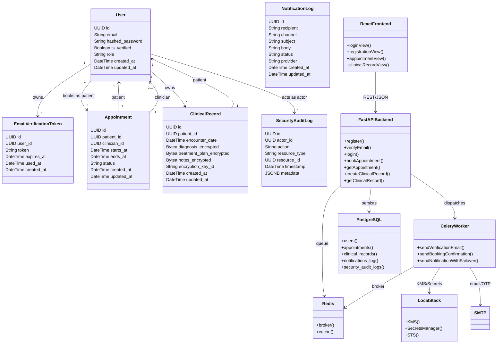
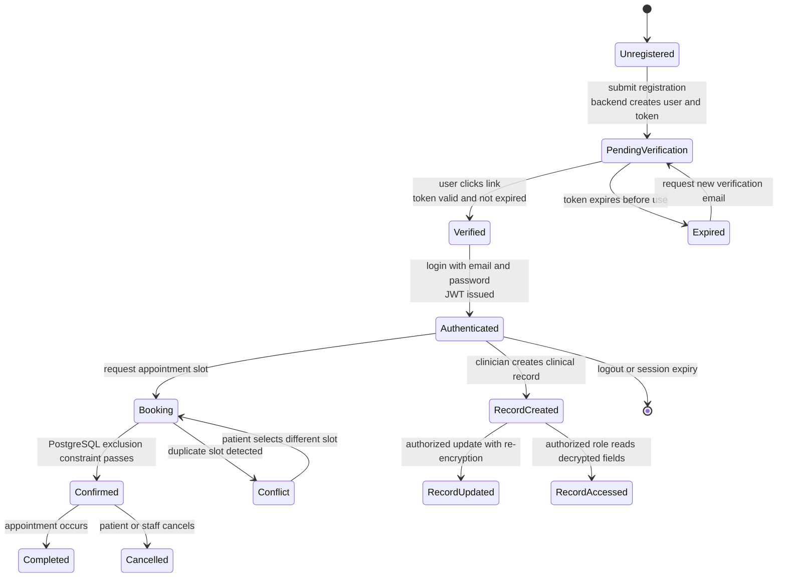
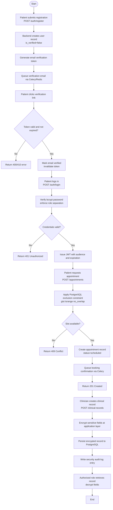

# UML Design Models

> **Text-Based Design Specification (Diagrams-as-Code):**
> These UML models are generated as declarative Mermaid text code specifications. Separating the model definition from visual rendering prevents model drawing errors, supports Git version control, and allows rendering by diverse compatible tools.


## 1. Class Diagram (Data Entities & Relationships)


> **Diagram Options & Compatible Viewers for *Class Diagram*:**
> - **Online Interactive View:** [Open Diagram in Mermaid Live Editor](https://mermaid.live/edit#base64:eyJjb2RlIjogImNsYXNzRGlhZ3JhbVxuICAgIGNsYXNzIFVzZXIge1xuICAgICAgICBVVUlEIGlkXG4gICAgICAgIFN0cmluZyBlbWFpbFxuICAgICAgICBTdHJpbmcgaGFzaGVkX3Bhc3N3b3JkXG4gICAgICAgIEJvb2xlYW4gaXNfdmVyaWZpZWRcbiAgICAgICAgU3RyaW5nIHJvbGVcbiAgICAgICAgRGF0ZVRpbWUgY3JlYXRlZF9hdFxuICAgICAgICBEYXRlVGltZSB1cGRhdGVkX2F0XG4gICAgfVxuICAgIGNsYXNzIEVtYWlsVmVyaWZpY2F0aW9uVG9rZW4ge1xuICAgICAgICBVVUlEIGlkXG4gICAgICAgIFVVSUQgdXNlcl9pZFxuICAgICAgICBTdHJpbmcgdG9rZW5cbiAgICAgICAgRGF0ZVRpbWUgZXhwaXJlc19hdFxuICAgICAgICBEYXRlVGltZSB1c2VkX2F0XG4gICAgICAgIERhdGVUaW1lIGNyZWF0ZWRfYXRcbiAgICB9XG4gICAgY2xhc3MgQXBwb2ludG1lbnQge1xuICAgICAgICBVVUlEIGlkXG4gICAgICAgIFVVSUQgcGF0aWVudF9pZFxuICAgICAgICBVVUlEIGNsaW5pY2lhbl9pZFxuICAgICAgICBEYXRlVGltZSBzdGFydHNfYXRcbiAgICAgICAgRGF0ZVRpbWUgZW5kc19hdFxuICAgICAgICBTdHJpbmcgc3RhdHVzXG4gICAgICAgIERhdGVUaW1lIGNyZWF0ZWRfYXRcbiAgICAgICAgRGF0ZVRpbWUgdXBkYXRlZF9hdFxuICAgIH1cbiAgICBjbGFzcyBDbGluaWNhbFJlY29yZCB7XG4gICAgICAgIFVVSUQgaWRcbiAgICAgICAgVVVJRCBwYXRpZW50X2lkXG4gICAgICAgIERhdGVUaW1lIGVuY291bnRlcl9kYXRlXG4gICAgICAgIEJ5dGVhIGRpYWdub3Npc19lbmNyeXB0ZWRcbiAgICAgICAgQnl0ZWEgdHJlYXRtZW50X3BsYW5fZW5jcnlwdGVkXG4gICAgICAgIEJ5dGVhIG5vdGVzX2VuY3J5cHRlZFxuICAgICAgICBTdHJpbmcgZW5jcnlwdGlvbl9rZXlfaWRcbiAgICAgICAgRGF0ZVRpbWUgY3JlYXRlZF9hdFxuICAgICAgICBEYXRlVGltZSB1cGRhdGVkX2F0XG4gICAgfVxuICAgIGNsYXNzIE5vdGlmaWNhdGlvbkxvZyB7XG4gICAgICAgIFVVSUQgaWRcbiAgICAgICAgU3RyaW5nIHJlY2lwaWVudFxuICAgICAgICBTdHJpbmcgY2hhbm5lbFxuICAgICAgICBTdHJpbmcgc3ViamVjdFxuICAgICAgICBTdHJpbmcgYm9keVxuICAgICAgICBTdHJpbmcgc3RhdHVzXG4gICAgICAgIFN0cmluZyBwcm92aWRlclxuICAgICAgICBEYXRlVGltZSBjcmVhdGVkX2F0XG4gICAgICAgIERhdGVUaW1lIHVwZGF0ZWRfYXRcbiAgICB9XG4gICAgY2xhc3MgU2VjdXJpdHlBdWRpdExvZyB7XG4gICAgICAgIFVVSUQgaWRcbiAgICAgICAgVVVJRCBhY3Rvcl9pZFxuICAgICAgICBTdHJpbmcgYWN0aW9uXG4gICAgICAgIFN0cmluZyByZXNvdXJjZV90eXBlXG4gICAgICAgIFVVSUQgcmVzb3VyY2VfaWRcbiAgICAgICAgRGF0ZVRpbWUgdGltZXN0YW1wXG4gICAgICAgIEpTT05CIG1ldGFkYXRhXG4gICAgfVxuICAgIGNsYXNzIEZhc3RBUElCYWNrZW5kIHtcbiAgICAgICAgK3JlZ2lzdGVyKClcbiAgICAgICAgK3ZlcmlmeUVtYWlsKClcbiAgICAgICAgK2xvZ2luKClcbiAgICAgICAgK2Jvb2tBcHBvaW50bWVudCgpXG4gICAgICAgICtnZXRBcHBvaW50bWVudCgpXG4gICAgICAgICtjcmVhdGVDbGluaWNhbFJlY29yZCgpXG4gICAgICAgICtnZXRDbGluaWNhbFJlY29yZCgpXG4gICAgfVxuICAgIGNsYXNzIENlbGVyeVdvcmtlciB7XG4gICAgICAgICtzZW5kVmVyaWZpY2F0aW9uRW1haWwoKVxuICAgICAgICArc2VuZEJvb2tpbmdDb25maXJtYXRpb24oKVxuICAgICAgICArc2VuZE5vdGlmaWNhdGlvbldpdGhGYWlsb3ZlcigpXG4gICAgfVxuICAgIGNsYXNzIFJlZGlzIHtcbiAgICAgICAgK2Jyb2tlcigpXG4gICAgICAgICtjYWNoZSgpXG4gICAgfVxuICAgIGNsYXNzIFBvc3RncmVTUUwge1xuICAgICAgICArdXNlcnMoKVxuICAgICAgICArYXBwb2ludG1lbnRzKClcbiAgICAgICAgK2NsaW5pY2FsX3JlY29yZHMoKVxuICAgICAgICArbm90aWZpY2F0aW9uc19sb2coKVxuICAgICAgICArc2VjdXJpdHlfYXVkaXRfbG9ncygpXG4gICAgfVxuICAgIGNsYXNzIExvY2FsU3RhY2sge1xuICAgICAgICArS01TKClcbiAgICAgICAgK1NlY3JldHNNYW5hZ2VyKClcbiAgICAgICAgK1NUUygpXG4gICAgfVxuICAgIGNsYXNzIFJlYWN0RnJvbnRlbmQge1xuICAgICAgICArbG9naW5WaWV3KClcbiAgICAgICAgK3JlZ2lzdHJhdGlvblZpZXcoKVxuICAgICAgICArYXBwb2ludG1lbnRWaWV3KClcbiAgICAgICAgK2NsaW5pY2FsUmVjb3JkVmlldygpXG4gICAgfVxuICAgIFVzZXIgXCIxXCIgLS0-IFwiKlwiIEVtYWlsVmVyaWZpY2F0aW9uVG9rZW4gOiBvd25zXG4gICAgVXNlciBcIjFcIiAtLT4gXCIqXCIgQXBwb2ludG1lbnQgOiBib29rcyBhcyBwYXRpZW50XG4gICAgVXNlciBcIjFcIiAtLT4gXCIqXCIgQ2xpbmljYWxSZWNvcmQgOiBvd25zXG4gICAgVXNlciBcIjFcIiAtLT4gXCIqXCIgU2VjdXJpdHlBdWRpdExvZyA6IGFjdHMgYXMgYWN0b3JcbiAgICBBcHBvaW50bWVudCBcIjFcIiAtLT4gXCIxXCIgVXNlciA6IHBhdGllbnRcbiAgICBBcHBvaW50bWVudCBcIjFcIiAtLT4gXCIwLi4xXCIgVXNlciA6IGNsaW5pY2lhblxuICAgIENsaW5pY2FsUmVjb3JkIFwiMVwiIC0tPiBcIjFcIiBVc2VyIDogcGF0aWVudFxuICAgIEZhc3RBUElCYWNrZW5kIC0tPiBQb3N0Z3JlU1FMIDogcGVyc2lzdHNcbiAgICBGYXN0QVBJQmFja2VuZCAtLT4gUmVkaXMgOiBxdWV1ZVxuICAgIEZhc3RBUElCYWNrZW5kIC0tPiBDZWxlcnlXb3JrZXIgOiBkaXNwYXRjaGVzXG4gICAgQ2VsZXJ5V29ya2VyIC0tPiBSZWRpcyA6IGJyb2tlclxuICAgIENlbGVyeVdvcmtlciAtLT4gTG9jYWxTdGFjayA6IEtNUy9TZWNyZXRzXG4gICAgQ2VsZXJ5V29ya2VyIC0tPiBTTVRQIDogZW1haWwvT1RQXG4gICAgUmVhY3RGcm9udGVuZCAtLT4gRmFzdEFQSUJhY2tlbmQgOiBSRVNUL0pTT04iLCAibWVybWFpZCI6ICJ7XCJ0aGVtZVwiOiBcImRlZmF1bHRcIn0ifQ==) *(pan, zoom, export SVG/PNG)*
> - **Native Markdown Viewers:** Renders automatically in GitHub, GitLab, Obsidian, Notion, Azure DevOps.
> - **VS Code:** Render live with the [Markdown Preview Mermaid Support](https://marketplace.visualstudio.com/items?itemName=bierner.markdown-mermaid) extension.
> - **Local CLI Export:** `npx @mermaid-js/mermaid-cli -i <file>.md -o diagram.svg`

## 2. Sequence Diagram (Workflow Execution)
```mermaid
sequenceDiagram
    autonumber
    participant Patient as React Frontend
    participant API as FastAPI Backend
    participant DB as PostgreSQL 15
    participant Redis as Redis 7
    participant Celery as Celery Worker
    participant LocalStack as LocalStack KMS
    participant Email as Email/OTP Provider
    Patient->>API: POST /auth/register {email, password}<br/>queues verification email
    API->>DB: INSERT users (email, hashed_password, is_verified=false)
    DB-->>API: user_id
    API->>DB: INSERT email_verification_tokens (user_id, token, expires_at)
    DB-->>API: token_id
    API->>Redis: XADD notifications {task: send_verification_email, user_id, token}
    Redis-->>API: queued
    API-->>Patient: 202 Accepted
    Celery->>Redis: XREAD notifications
    Redis-->>Celery: task payload
    Celery->>LocalStack: encrypt/verify key context
    LocalStack-->>Celery: key reference
    Celery->>Email: send verification email with token
    Email-->>Celery: delivery status
    Celery->>DB: INSERT notifications_log (recipient, channel, status, provider)
    Patient->>API: GET /auth/verify-email?token=xxx
    API->>DB: SELECT email_verification_tokens WHERE token=xxx AND expires_at > now()
    DB-->>API: token record
    API->>DB: UPDATE users SET is_verified=true WHERE id=user_id
    API->>DB: UPDATE email_verification_tokens SET used_at=now() WHERE id=token_id
    API-->>Patient: 200 OK email verified
    Patient->>API: POST /auth/login {email, password}
    API->>DB: SELECT hashed_password, role FROM users WHERE email=xxx
    DB-->>API: user credentials
    API->>API: bcrypt verify password
    API->>API: issue python-jose JWT with audience and expiration
    API-->>Patient: 200 OK {access_token}
    Patient->>API: POST /appointments {clinician_id, starts_at, ends_at} Bearer JWT
    API->>API: validate JWT audience and expiration
    API->>DB: INSERT appointments (patient_id, clinician_id, starts_at, ends_at, status=scheduled)<br/>ON CONFLICT exclusion constraint no_overlap
    DB-->>API: appointment_id or exclusion violation
    alt booking success
        API->>Redis: XADD notifications {task: send_booking_confirmation, appointment_id}
        Redis-->>API: queued
        API-->>Patient: 201 Created {appointment_id}
    alt booking conflict
        API-->>Patient: 409 Conflict duplicate slot
    end
    Celery->>Redis: XREAD notifications
    Redis-->>Celery: booking confirmation task
    Celery->>Email: send booking confirmation
    Email-->>Celery: delivery status
    Celery->>DB: INSERT notifications_log (recipient, channel, status, provider)
    Patient->>API: POST /clinical-records {patient_id, encounter_date, diagnosis, treatment_plan, notes} Bearer JWT
    API->>API: validate authorized role
    API->>LocalStack: generate data key for encryption
    LocalStack-->>API: encrypted data key and plaintext key
    API->>API: encrypt diagnosis, treatment_plan, notes with cryptography
    API->>DB: INSERT clinical_records (patient_id, encounter_date, diagnosis_encrypted, treatment_plan_encrypted, notes_encrypted, encryption_key_id)
    DB-->>API: record_id
    API->>DB: INSERT security_audit_logs (actor_id, action=CREATE_CLINICAL_RECORD, resource_type=clinical_record, resource_id=record_id, metadata)
    API-->>Patient: 201 Created {record_id}
    Patient->>API: GET /clinical-records/{id} Bearer JWT
    API->>API: validate authorized role for decryption
    API->>DB: SELECT clinical_records WHERE id={id}
    DB-->>API: encrypted fields
    API->>LocalStack: decrypt data key
    LocalStack-->>API: plaintext key
    API->>API: decrypt sensitive fields
    API->>DB: INSERT security_audit_logs (actor_id, action=READ_CLINICAL_RECORD, resource_type=clinical_record, resource_id={id}, metadata)
    API-->>Patient: 200 OK {decrypted clinical record}
```

> **Diagram Options & Compatible Viewers for *Sequence Diagram*:**
> - **Online Interactive View:** [Open Diagram in Mermaid Live Editor](https://mermaid.live/edit#base64:eyJjb2RlIjogInNlcXVlbmNlRGlhZ3JhbVxuICAgIGF1dG9udW1iZXJcbiAgICBwYXJ0aWNpcGFudCBQYXRpZW50IGFzIFJlYWN0IEZyb250ZW5kXG4gICAgcGFydGljaXBhbnQgQVBJIGFzIEZhc3RBUEkgQmFja2VuZFxuICAgIHBhcnRpY2lwYW50IERCIGFzIFBvc3RncmVTUUwgMTVcbiAgICBwYXJ0aWNpcGFudCBSZWRpcyBhcyBSZWRpcyA3XG4gICAgcGFydGljaXBhbnQgQ2VsZXJ5IGFzIENlbGVyeSBXb3JrZXJcbiAgICBwYXJ0aWNpcGFudCBMb2NhbFN0YWNrIGFzIExvY2FsU3RhY2sgS01TXG4gICAgcGFydGljaXBhbnQgRW1haWwgYXMgRW1haWwvT1RQIFByb3ZpZGVyXG4gICAgUGF0aWVudC0-PkFQSTogUE9TVCAvYXV0aC9yZWdpc3RlciB7ZW1haWwsIHBhc3N3b3JkfTxici8-cXVldWVzIHZlcmlmaWNhdGlvbiBlbWFpbFxuICAgIEFQSS0-PkRCOiBJTlNFUlQgdXNlcnMgKGVtYWlsLCBoYXNoZWRfcGFzc3dvcmQsIGlzX3ZlcmlmaWVkPWZhbHNlKVxuICAgIERCLS0-PkFQSTogdXNlcl9pZFxuICAgIEFQSS0-PkRCOiBJTlNFUlQgZW1haWxfdmVyaWZpY2F0aW9uX3Rva2VucyAodXNlcl9pZCwgdG9rZW4sIGV4cGlyZXNfYXQpXG4gICAgREItLT4-QVBJOiB0b2tlbl9pZFxuICAgIEFQSS0-PlJlZGlzOiBYQUREIG5vdGlmaWNhdGlvbnMge3Rhc2s6IHNlbmRfdmVyaWZpY2F0aW9uX2VtYWlsLCB1c2VyX2lkLCB0b2tlbn1cbiAgICBSZWRpcy0tPj5BUEk6IHF1ZXVlZFxuICAgIEFQSS0tPj5QYXRpZW50OiAyMDIgQWNjZXB0ZWRcbiAgICBDZWxlcnktPj5SZWRpczogWFJFQUQgbm90aWZpY2F0aW9uc1xuICAgIFJlZGlzLS0-PkNlbGVyeTogdGFzayBwYXlsb2FkXG4gICAgQ2VsZXJ5LT4-TG9jYWxTdGFjazogZW5jcnlwdC92ZXJpZnkga2V5IGNvbnRleHRcbiAgICBMb2NhbFN0YWNrLS0-PkNlbGVyeToga2V5IHJlZmVyZW5jZVxuICAgIENlbGVyeS0-PkVtYWlsOiBzZW5kIHZlcmlmaWNhdGlvbiBlbWFpbCB3aXRoIHRva2VuXG4gICAgRW1haWwtLT4-Q2VsZXJ5OiBkZWxpdmVyeSBzdGF0dXNcbiAgICBDZWxlcnktPj5EQjogSU5TRVJUIG5vdGlmaWNhdGlvbnNfbG9nIChyZWNpcGllbnQsIGNoYW5uZWwsIHN0YXR1cywgcHJvdmlkZXIpXG4gICAgUGF0aWVudC0-PkFQSTogR0VUIC9hdXRoL3ZlcmlmeS1lbWFpbD90b2tlbj14eHhcbiAgICBBUEktPj5EQjogU0VMRUNUIGVtYWlsX3ZlcmlmaWNhdGlvbl90b2tlbnMgV0hFUkUgdG9rZW49eHh4IEFORCBleHBpcmVzX2F0ID4gbm93KClcbiAgICBEQi0tPj5BUEk6IHRva2VuIHJlY29yZFxuICAgIEFQSS0-PkRCOiBVUERBVEUgdXNlcnMgU0VUIGlzX3ZlcmlmaWVkPXRydWUgV0hFUkUgaWQ9dXNlcl9pZFxuICAgIEFQSS0-PkRCOiBVUERBVEUgZW1haWxfdmVyaWZpY2F0aW9uX3Rva2VucyBTRVQgdXNlZF9hdD1ub3coKSBXSEVSRSBpZD10b2tlbl9pZFxuICAgIEFQSS0tPj5QYXRpZW50OiAyMDAgT0sgZW1haWwgdmVyaWZpZWRcbiAgICBQYXRpZW50LT4-QVBJOiBQT1NUIC9hdXRoL2xvZ2luIHtlbWFpbCwgcGFzc3dvcmR9XG4gICAgQVBJLT4-REI6IFNFTEVDVCBoYXNoZWRfcGFzc3dvcmQsIHJvbGUgRlJPTSB1c2VycyBXSEVSRSBlbWFpbD14eHhcbiAgICBEQi0tPj5BUEk6IHVzZXIgY3JlZGVudGlhbHNcbiAgICBBUEktPj5BUEk6IGJjcnlwdCB2ZXJpZnkgcGFzc3dvcmRcbiAgICBBUEktPj5BUEk6IGlzc3VlIHB5dGhvbi1qb3NlIEpXVCB3aXRoIGF1ZGllbmNlIGFuZCBleHBpcmF0aW9uXG4gICAgQVBJLS0-PlBhdGllbnQ6IDIwMCBPSyB7YWNjZXNzX3Rva2VufVxuICAgIFBhdGllbnQtPj5BUEk6IFBPU1QgL2FwcG9pbnRtZW50cyB7Y2xpbmljaWFuX2lkLCBzdGFydHNfYXQsIGVuZHNfYXR9IEJlYXJlciBKV1RcbiAgICBBUEktPj5BUEk6IHZhbGlkYXRlIEpXVCBhdWRpZW5jZSBhbmQgZXhwaXJhdGlvblxuICAgIEFQSS0-PkRCOiBJTlNFUlQgYXBwb2ludG1lbnRzIChwYXRpZW50X2lkLCBjbGluaWNpYW5faWQsIHN0YXJ0c19hdCwgZW5kc19hdCwgc3RhdHVzPXNjaGVkdWxlZCk8YnIvPk9OIENPTkZMSUNUIGV4Y2x1c2lvbiBjb25zdHJhaW50IG5vX292ZXJsYXBcbiAgICBEQi0tPj5BUEk6IGFwcG9pbnRtZW50X2lkIG9yIGV4Y2x1c2lvbiB2aW9sYXRpb25cbiAgICBhbHQgYm9va2luZyBzdWNjZXNzXG4gICAgICAgIEFQSS0-PlJlZGlzOiBYQUREIG5vdGlmaWNhdGlvbnMge3Rhc2s6IHNlbmRfYm9va2luZ19jb25maXJtYXRpb24sIGFwcG9pbnRtZW50X2lkfVxuICAgICAgICBSZWRpcy0tPj5BUEk6IHF1ZXVlZFxuICAgICAgICBBUEktLT4-UGF0aWVudDogMjAxIENyZWF0ZWQge2FwcG9pbnRtZW50X2lkfVxuICAgIGFsdCBib29raW5nIGNvbmZsaWN0XG4gICAgICAgIEFQSS0tPj5QYXRpZW50OiA0MDkgQ29uZmxpY3QgZHVwbGljYXRlIHNsb3RcbiAgICBlbmRcbiAgICBDZWxlcnktPj5SZWRpczogWFJFQUQgbm90aWZpY2F0aW9uc1xuICAgIFJlZGlzLS0-PkNlbGVyeTogYm9va2luZyBjb25maXJtYXRpb24gdGFza1xuICAgIENlbGVyeS0-PkVtYWlsOiBzZW5kIGJvb2tpbmcgY29uZmlybWF0aW9uXG4gICAgRW1haWwtLT4-Q2VsZXJ5OiBkZWxpdmVyeSBzdGF0dXNcbiAgICBDZWxlcnktPj5EQjogSU5TRVJUIG5vdGlmaWNhdGlvbnNfbG9nIChyZWNpcGllbnQsIGNoYW5uZWwsIHN0YXR1cywgcHJvdmlkZXIpXG4gICAgUGF0aWVudC0-PkFQSTogUE9TVCAvY2xpbmljYWwtcmVjb3JkcyB7cGF0aWVudF9pZCwgZW5jb3VudGVyX2RhdGUsIGRpYWdub3NpcywgdHJlYXRtZW50X3BsYW4sIG5vdGVzfSBCZWFyZXIgSldUXG4gICAgQVBJLT4-QVBJOiB2YWxpZGF0ZSBhdXRob3JpemVkIHJvbGVcbiAgICBBUEktPj5Mb2NhbFN0YWNrOiBnZW5lcmF0ZSBkYXRhIGtleSBmb3IgZW5jcnlwdGlvblxuICAgIExvY2FsU3RhY2stLT4-QVBJOiBlbmNyeXB0ZWQgZGF0YSBrZXkgYW5kIHBsYWludGV4dCBrZXlcbiAgICBBUEktPj5BUEk6IGVuY3J5cHQgZGlhZ25vc2lzLCB0cmVhdG1lbnRfcGxhbiwgbm90ZXMgd2l0aCBjcnlwdG9ncmFwaHlcbiAgICBBUEktPj5EQjogSU5TRVJUIGNsaW5pY2FsX3JlY29yZHMgKHBhdGllbnRfaWQsIGVuY291bnRlcl9kYXRlLCBkaWFnbm9zaXNfZW5jcnlwdGVkLCB0cmVhdG1lbnRfcGxhbl9lbmNyeXB0ZWQsIG5vdGVzX2VuY3J5cHRlZCwgZW5jcnlwdGlvbl9rZXlfaWQpXG4gICAgREItLT4-QVBJOiByZWNvcmRfaWRcbiAgICBBUEktPj5EQjogSU5TRVJUIHNlY3VyaXR5X2F1ZGl0X2xvZ3MgKGFjdG9yX2lkLCBhY3Rpb249Q1JFQVRFX0NMSU5JQ0FMX1JFQ09SRCwgcmVzb3VyY2VfdHlwZT1jbGluaWNhbF9yZWNvcmQsIHJlc291cmNlX2lkPXJlY29yZF9pZCwgbWV0YWRhdGEpXG4gICAgQVBJLS0-PlBhdGllbnQ6IDIwMSBDcmVhdGVkIHtyZWNvcmRfaWR9XG4gICAgUGF0aWVudC0-PkFQSTogR0VUIC9jbGluaWNhbC1yZWNvcmRzL3tpZH0gQmVhcmVyIEpXVFxuICAgIEFQSS0-PkFQSTogdmFsaWRhdGUgYXV0aG9yaXplZCByb2xlIGZvciBkZWNyeXB0aW9uXG4gICAgQVBJLT4-REI6IFNFTEVDVCBjbGluaWNhbF9yZWNvcmRzIFdIRVJFIGlkPXtpZH1cbiAgICBEQi0tPj5BUEk6IGVuY3J5cHRlZCBmaWVsZHNcbiAgICBBUEktPj5Mb2NhbFN0YWNrOiBkZWNyeXB0IGRhdGEga2V5XG4gICAgTG9jYWxTdGFjay0tPj5BUEk6IHBsYWludGV4dCBrZXlcbiAgICBBUEktPj5BUEk6IGRlY3J5cHQgc2Vuc2l0aXZlIGZpZWxkc1xuICAgIEFQSS0-PkRCOiBJTlNFUlQgc2VjdXJpdHlfYXVkaXRfbG9ncyAoYWN0b3JfaWQsIGFjdGlvbj1SRUFEX0NMSU5JQ0FMX1JFQ09SRCwgcmVzb3VyY2VfdHlwZT1jbGluaWNhbF9yZWNvcmQsIHJlc291cmNlX2lkPXtpZH0sIG1ldGFkYXRhKVxuICAgIEFQSS0tPj5QYXRpZW50OiAyMDAgT0sge2RlY3J5cHRlZCBjbGluaWNhbCByZWNvcmR9IiwgIm1lcm1haWQiOiAie1widGhlbWVcIjogXCJkZWZhdWx0XCJ9In0=) *(pan, zoom, export SVG/PNG)*
> - **Native Markdown Viewers:** Renders automatically in GitHub, GitLab, Obsidian, Notion, Azure DevOps.
> - **VS Code:** Render live with the [Markdown Preview Mermaid Support](https://marketplace.visualstudio.com/items?itemName=bierner.markdown-mermaid) extension.
> - **Local CLI Export:** `npx @mermaid-js/mermaid-cli -i <file>.md -o diagram.svg`

## 3. State Machine Diagram


> **Diagram Options & Compatible Viewers for *State Machine Diagram*:**
> - **Online Interactive View:** [Open Diagram in Mermaid Live Editor](https://mermaid.live/edit#base64:eyJjb2RlIjogInN0YXRlRGlhZ3JhbS12MlxuICAgIFsqXSAtLT4gVW5yZWdpc3RlcmVkXG4gICAgVW5yZWdpc3RlcmVkIC0tPiBQZW5kaW5nVmVyaWZpY2F0aW9uIDogc3VibWl0IHJlZ2lzdHJhdGlvbjxici8-YmFja2VuZCBjcmVhdGVzIHVzZXIgYW5kIHRva2VuXG4gICAgUGVuZGluZ1ZlcmlmaWNhdGlvbiAtLT4gVmVyaWZpZWQgOiB1c2VyIGNsaWNrcyBsaW5rPGJyLz50b2tlbiB2YWxpZCBhbmQgbm90IGV4cGlyZWRcbiAgICBQZW5kaW5nVmVyaWZpY2F0aW9uIC0tPiBFeHBpcmVkIDogdG9rZW4gZXhwaXJlcyBiZWZvcmUgdXNlXG4gICAgRXhwaXJlZCAtLT4gUGVuZGluZ1ZlcmlmaWNhdGlvbiA6IHJlcXVlc3QgbmV3IHZlcmlmaWNhdGlvbiBlbWFpbFxuICAgIFZlcmlmaWVkIC0tPiBBdXRoZW50aWNhdGVkIDogbG9naW4gd2l0aCBlbWFpbCBhbmQgcGFzc3dvcmQ8YnIvPkpXVCBpc3N1ZWRcbiAgICBBdXRoZW50aWNhdGVkIC0tPiBCb29raW5nIDogcmVxdWVzdCBhcHBvaW50bWVudCBzbG90XG4gICAgQm9va2luZyAtLT4gQ29uZmlybWVkIDogUG9zdGdyZVNRTCBleGNsdXNpb24gY29uc3RyYWludCBwYXNzZXNcbiAgICBCb29raW5nIC0tPiBDb25mbGljdCA6IGR1cGxpY2F0ZSBzbG90IGRldGVjdGVkXG4gICAgQ29uZmxpY3QgLS0-IEJvb2tpbmcgOiBwYXRpZW50IHNlbGVjdHMgZGlmZmVyZW50IHNsb3RcbiAgICBDb25maXJtZWQgLS0-IENvbXBsZXRlZCA6IGFwcG9pbnRtZW50IG9jY3Vyc1xuICAgIENvbmZpcm1lZCAtLT4gQ2FuY2VsbGVkIDogcGF0aWVudCBvciBzdGFmZiBjYW5jZWxzXG4gICAgQXV0aGVudGljYXRlZCAtLT4gUmVjb3JkQ3JlYXRlZCA6IGNsaW5pY2lhbiBjcmVhdGVzIGNsaW5pY2FsIHJlY29yZFxuICAgIFJlY29yZENyZWF0ZWQgLS0-IFJlY29yZFVwZGF0ZWQgOiBhdXRob3JpemVkIHVwZGF0ZSB3aXRoIHJlLWVuY3J5cHRpb25cbiAgICBSZWNvcmRDcmVhdGVkIC0tPiBSZWNvcmRBY2Nlc3NlZCA6IGF1dGhvcml6ZWQgcm9sZSByZWFkcyBkZWNyeXB0ZWQgZmllbGRzXG4gICAgQXV0aGVudGljYXRlZCAtLT4gWypdIDogbG9nb3V0IG9yIHNlc3Npb24gZXhwaXJ5IiwgIm1lcm1haWQiOiAie1widGhlbWVcIjogXCJkZWZhdWx0XCJ9In0=) *(pan, zoom, export SVG/PNG)*
> - **Native Markdown Viewers:** Renders automatically in GitHub, GitLab, Obsidian, Notion, Azure DevOps.
> - **VS Code:** Render live with the [Markdown Preview Mermaid Support](https://marketplace.visualstudio.com/items?itemName=bierner.markdown-mermaid) extension.
> - **Local CLI Export:** `npx @mermaid-js/mermaid-cli -i <file>.md -o diagram.svg`

## 4. Activity Diagram (Workflow Flowchart)


> **Diagram Options & Compatible Viewers for *Activity Diagram*:**
> - **Online Interactive View:** [Open Diagram in Mermaid Live Editor](https://mermaid.live/edit#base64:eyJjb2RlIjogImZsb3djaGFydCBURFxuICAgIEEoW1N0YXJ0XSkgLS0-IEJbUGF0aWVudCBzdWJtaXRzIHJlZ2lzdHJhdGlvbjxici8-UE9TVCAvYXV0aC9yZWdpc3Rlcl1cbiAgICBCIC0tPiBDW0JhY2tlbmQgY3JlYXRlcyB1c2VyIHJlY29yZDxici8-aXNfdmVyaWZpZWQ9ZmFsc2VdXG4gICAgQyAtLT4gRFtHZW5lcmF0ZSBlbWFpbCB2ZXJpZmljYXRpb24gdG9rZW5dXG4gICAgRCAtLT4gRVtRdWV1ZSB2ZXJpZmljYXRpb24gZW1haWwgdmlhIENlbGVyeS9SZWRpc11cbiAgICBFIC0tPiBGW1BhdGllbnQgY2xpY2tzIHZlcmlmaWNhdGlvbiBsaW5rXVxuICAgIEYgLS0-IEd7VG9rZW4gdmFsaWQgYW5kIG5vdCBleHBpcmVkP31cbiAgICBHIC0tPnxOb3wgSFtSZXR1cm4gNDAwLzQxMCBlcnJvcl1cbiAgICBHIC0tPnxZZXN8IElbTWFyayBlbWFpbCB2ZXJpZmllZDxici8-aW52YWxpZGF0ZSB0b2tlbl1cbiAgICBJIC0tPiBKW1BhdGllbnQgbG9ncyBpbjxici8-UE9TVCAvYXV0aC9sb2dpbl1cbiAgICBKIC0tPiBLW1ZlcmlmeSBiY3J5cHQgcGFzc3dvcmQ8YnIvPmVuZm9yY2Ugcm9sZSBzZXBhcmF0aW9uXVxuICAgIEsgLS0-IEx7Q3JlZGVudGlhbHMgdmFsaWQ_fVxuICAgIEwgLS0-fE5vfCBNW1JldHVybiA0MDEgVW5hdXRob3JpemVkXVxuICAgIEwgLS0-fFllc3wgTltJc3N1ZSBKV1Qgd2l0aCBhdWRpZW5jZSBhbmQgZXhwaXJhdGlvbl1cbiAgICBOIC0tPiBPW1BhdGllbnQgcmVxdWVzdHMgYXBwb2ludG1lbnQ8YnIvPlBPU1QgL2FwcG9pbnRtZW50c11cbiAgICBPIC0tPiBQW0FwcGx5IFBvc3RncmVTUUwgZXhjbHVzaW9uIGNvbnN0cmFpbnQ8YnIvPmdpc3QgdHNyYW5nZSBub19vdmVybGFwXVxuICAgIFAgLS0-IFF7U2xvdCBhdmFpbGFibGU_fVxuICAgIFEgLS0-fE5vfCBSW1JldHVybiA0MDkgQ29uZmxpY3RdXG4gICAgUSAtLT58WWVzfCBTW0NyZWF0ZSBhcHBvaW50bWVudCByZWNvcmQ8YnIvPnN0YXR1cz1zY2hlZHVsZWRdXG4gICAgUyAtLT4gVFtRdWV1ZSBib29raW5nIGNvbmZpcm1hdGlvbiB2aWEgQ2VsZXJ5XVxuICAgIFQgLS0-IFVbUmV0dXJuIDIwMSBDcmVhdGVkXVxuICAgIFUgLS0-IFZbQ2xpbmljaWFuIGNyZWF0ZXMgY2xpbmljYWwgcmVjb3JkPGJyLz5QT1NUIC9jbGluaWNhbC1yZWNvcmRzXVxuICAgIFYgLS0-IFdbRW5jcnlwdCBzZW5zaXRpdmUgZmllbGRzIGF0IGFwcGxpY2F0aW9uIGxheWVyXVxuICAgIFcgLS0-IFhbUGVyc2lzdCBlbmNyeXB0ZWQgcmVjb3JkIHRvIFBvc3RncmVTUUxdXG4gICAgWCAtLT4gWVtXcml0ZSBzZWN1cml0eSBhdWRpdCBsb2cgZW50cnldXG4gICAgWSAtLT4gWltBdXRob3JpemVkIHJvbGUgcmV0cmlldmVzIHJlY29yZDxici8-ZGVjcnlwdCBmaWVsZHNdXG4gICAgWiAtLT4gQUFbRW5kXSIsICJtZXJtYWlkIjogIntcInRoZW1lXCI6IFwiZGVmYXVsdFwifSJ9) *(pan, zoom, export SVG/PNG)*
> - **Native Markdown Viewers:** Renders automatically in GitHub, GitLab, Obsidian, Notion, Azure DevOps.
> - **VS Code:** Render live with the [Markdown Preview Mermaid Support](https://marketplace.visualstudio.com/items?itemName=bierner.markdown-mermaid) extension.
> - **Local CLI Export:** `npx @mermaid-js/mermaid-cli -i <file>.md -o diagram.svg`