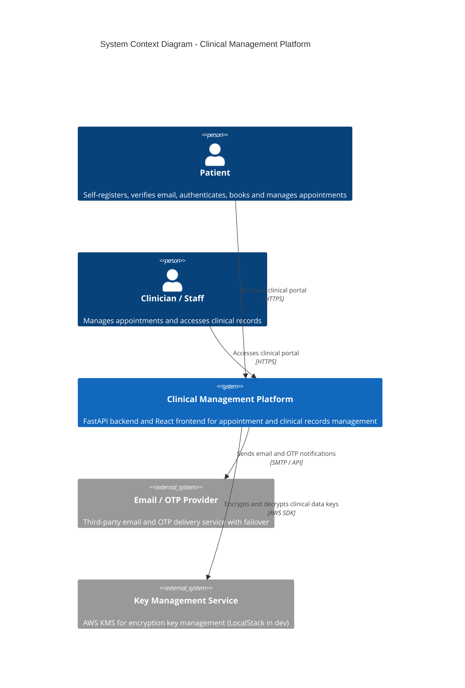
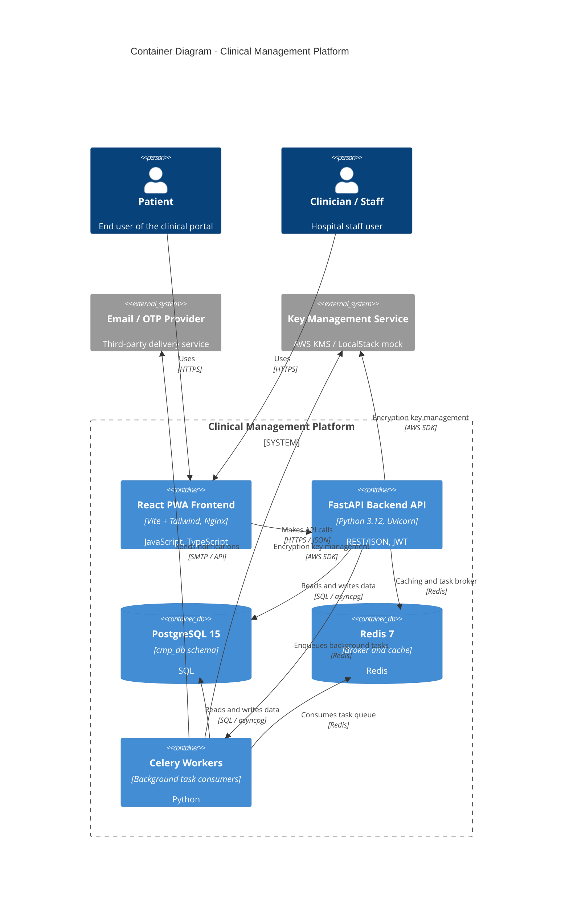
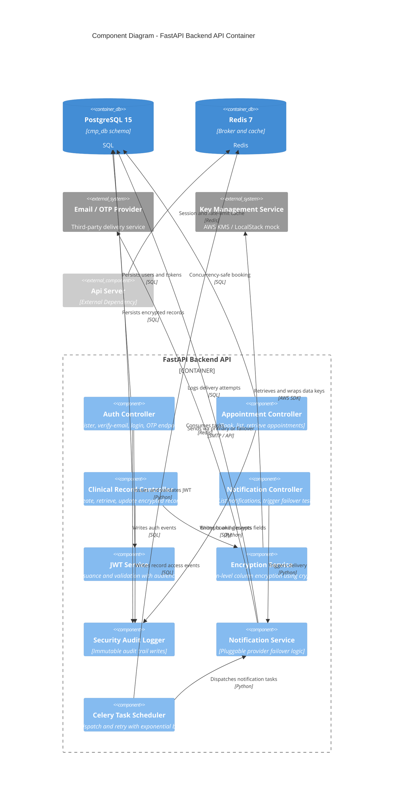

# C4 Architecture Models

> **Text-Based Architecture Specification (Diagrams-as-Code):**
> These diagrams are generated as declarative Mermaid text code specifications. Separating the architectural definition from visual rendering prevents model drawing errors, supports Git version control, and allows rendering by diverse compatible tools.

## 1. System Context Diagram (C4 Level 1)

> **Diagram Options & Compatible Viewers for *System Context Diagram*:**
> - **Online Interactive View:** [Open Diagram in Mermaid Live Editor](https://mermaid.live/edit#base64:eyJjb2RlIjogIkM0Q29udGV4dFxuXG50aXRsZSBTeXN0ZW0gQ29udGV4dCBEaWFncmFtIC0gQ2xpbmljYWwgTWFuYWdlbWVudCBQbGF0Zm9ybVxuXG5QZXJzb24ocGF0aWVudCwgXCJQYXRpZW50XCIsIFwiU2VsZi1yZWdpc3RlcnMsIHZlcmlmaWVzIGVtYWlsLCBhdXRoZW50aWNhdGVzLCBib29rcyBhbmQgbWFuYWdlcyBhcHBvaW50bWVudHNcIilcblBlcnNvbihzdGFmZiwgXCJDbGluaWNpYW4gLyBTdGFmZlwiLCBcIk1hbmFnZXMgYXBwb2ludG1lbnRzIGFuZCBhY2Nlc3NlcyBjbGluaWNhbCByZWNvcmRzXCIpXG5cblN5c3RlbShjbXAsIFwiQ2xpbmljYWwgTWFuYWdlbWVudCBQbGF0Zm9ybVwiLCBcIkZhc3RBUEkgYmFja2VuZCBhbmQgUmVhY3QgZnJvbnRlbmQgZm9yIGFwcG9pbnRtZW50IGFuZCBjbGluaWNhbCByZWNvcmRzIG1hbmFnZW1lbnRcIilcblxuU3lzdGVtX0V4dChub3RpZmljYXRpb25fcHJvdmlkZXIsIFwiRW1haWwgLyBPVFAgUHJvdmlkZXJcIiwgXCJUaGlyZC1wYXJ0eSBlbWFpbCBhbmQgT1RQIGRlbGl2ZXJ5IHNlcnZpY2Ugd2l0aCBmYWlsb3ZlclwiKVxuU3lzdGVtX0V4dChrbXMsIFwiS2V5IE1hbmFnZW1lbnQgU2VydmljZVwiLCBcIkFXUyBLTVMgZm9yIGVuY3J5cHRpb24ga2V5IG1hbmFnZW1lbnQgKExvY2FsU3RhY2sgaW4gZGV2KVwiKVxuXG5SZWwocGF0aWVudCwgY21wLCBcIkFjY2Vzc2VzIGNsaW5pY2FsIHBvcnRhbFwiLCBcIkhUVFBTXCIpXG5SZWwoc3RhZmYsIGNtcCwgXCJBY2Nlc3NlcyBjbGluaWNhbCBwb3J0YWxcIiwgXCJIVFRQU1wiKVxuUmVsKGNtcCwgbm90aWZpY2F0aW9uX3Byb3ZpZGVyLCBcIlNlbmRzIGVtYWlsIGFuZCBPVFAgbm90aWZpY2F0aW9uc1wiLCBcIlNNVFAgLyBBUElcIilcblJlbChjbXAsIGttcywgXCJFbmNyeXB0cyBhbmQgZGVjcnlwdHMgY2xpbmljYWwgZGF0YSBrZXlzXCIsIFwiQVdTIFNES1wiKSIsICJtZXJtYWlkIjogIntcInRoZW1lXCI6IFwiZGVmYXVsdFwifSJ9) *(pan, zoom, export SVG/PNG)*
> - **Native Markdown Viewers:** Renders automatically in GitHub, GitLab, Obsidian, Notion, Azure DevOps.
> - **VS Code:** Render live with the [Markdown Preview Mermaid Support](https://marketplace.visualstudio.com/items?itemName=bierner.markdown-mermaid) extension.
> - **Local CLI Export:** `npx @mermaid-js/mermaid-cli -i <file>.md -o diagram.svg`

## 2. Container Diagram (C4 Level 2)

> **Diagram Options & Compatible Viewers for *Container Diagram*:**
> - **Online Interactive View:** [Open Diagram in Mermaid Live Editor](https://mermaid.live/edit#base64:eyJjb2RlIjogIkM0Q29udGFpbmVyXG5cbnRpdGxlIENvbnRhaW5lciBEaWFncmFtIC0gQ2xpbmljYWwgTWFuYWdlbWVudCBQbGF0Zm9ybVxuXG5QZXJzb24ocGF0aWVudCwgXCJQYXRpZW50XCIsIFwiRW5kIHVzZXIgb2YgdGhlIGNsaW5pY2FsIHBvcnRhbFwiKVxuUGVyc29uKHN0YWZmLCBcIkNsaW5pY2lhbiAvIFN0YWZmXCIsIFwiSG9zcGl0YWwgc3RhZmYgdXNlclwiKVxuXG5TeXN0ZW1fQm91bmRhcnkoY21wX2JvdW5kYXJ5LCBcIkNsaW5pY2FsIE1hbmFnZW1lbnQgUGxhdGZvcm1cIikge1xuICAgIENvbnRhaW5lcih3ZWJfY2xpZW50LCBcIlJlYWN0IFBXQSBGcm9udGVuZFwiLCBcIlZpdGUgKyBUYWlsd2luZCwgTmdpbnhcIiwgXCJKYXZhU2NyaXB0LCBUeXBlU2NyaXB0XCIpXG4gICAgQ29udGFpbmVyKGFwaV9zZXJ2ZXIsIFwiRmFzdEFQSSBCYWNrZW5kIEFQSVwiLCBcIlB5dGhvbiAzLjEyLCBVdmljb3JuXCIsIFwiUkVTVC9KU09OLCBKV1RcIilcbiAgICBDb250YWluZXJEYihkYXRhYmFzZSwgXCJQb3N0Z3JlU1FMIDE1XCIsIFwiY21wX2RiIHNjaGVtYVwiLCBcIlNRTFwiKVxuICAgIENvbnRhaW5lckRiKGNhY2hlX2Jyb2tlciwgXCJSZWRpcyA3XCIsIFwiQnJva2VyIGFuZCBjYWNoZVwiLCBcIlJlZGlzXCIpXG4gICAgQ29udGFpbmVyKGNlbGVyeV93b3JrZXIsIFwiQ2VsZXJ5IFdvcmtlcnNcIiwgXCJCYWNrZ3JvdW5kIHRhc2sgY29uc3VtZXJzXCIsIFwiUHl0aG9uXCIpXG59XG5cblN5c3RlbV9FeHQobm90aWZpY2F0aW9uX3Byb3ZpZGVyLCBcIkVtYWlsIC8gT1RQIFByb3ZpZGVyXCIsIFwiVGhpcmQtcGFydHkgZGVsaXZlcnkgc2VydmljZVwiKVxuU3lzdGVtX0V4dChrbXMsIFwiS2V5IE1hbmFnZW1lbnQgU2VydmljZVwiLCBcIkFXUyBLTVMgLyBMb2NhbFN0YWNrIG1vY2tcIilcblxuUmVsKHBhdGllbnQsIHdlYl9jbGllbnQsIFwiVXNlc1wiLCBcIkhUVFBTXCIpXG5SZWwoc3RhZmYsIHdlYl9jbGllbnQsIFwiVXNlc1wiLCBcIkhUVFBTXCIpXG5SZWwod2ViX2NsaWVudCwgYXBpX3NlcnZlciwgXCJNYWtlcyBBUEkgY2FsbHNcIiwgXCJIVFRQUyAvIEpTT05cIilcblJlbChhcGlfc2VydmVyLCBkYXRhYmFzZSwgXCJSZWFkcyBhbmQgd3JpdGVzIGRhdGFcIiwgXCJTUUwgLyBhc3luY3BnXCIpXG5SZWwoYXBpX3NlcnZlciwgY2FjaGVfYnJva2VyLCBcIkNhY2hpbmcgYW5kIHRhc2sgYnJva2VyXCIsIFwiUmVkaXNcIilcblJlbChhcGlfc2VydmVyLCBjZWxlcnlfd29ya2VyLCBcIkVucXVldWVzIGJhY2tncm91bmQgdGFza3NcIiwgXCJSZWRpc1wiKVxuUmVsKGNlbGVyeV93b3JrZXIsIGRhdGFiYXNlLCBcIlJlYWRzIGFuZCB3cml0ZXMgZGF0YVwiLCBcIlNRTCAvIGFzeW5jcGdcIilcblJlbChjZWxlcnlfd29ya2VyLCBjYWNoZV9icm9rZXIsIFwiQ29uc3VtZXMgdGFzayBxdWV1ZVwiLCBcIlJlZGlzXCIpXG5SZWwoY2VsZXJ5X3dvcmtlciwgbm90aWZpY2F0aW9uX3Byb3ZpZGVyLCBcIlNlbmRzIG5vdGlmaWNhdGlvbnNcIiwgXCJTTVRQIC8gQVBJXCIpXG5SZWwoYXBpX3NlcnZlciwga21zLCBcIkVuY3J5cHRpb24ga2V5IG1hbmFnZW1lbnRcIiwgXCJBV1MgU0RLXCIpXG5SZWwoY2VsZXJ5X3dvcmtlciwga21zLCBcIkVuY3J5cHRpb24ga2V5IG1hbmFnZW1lbnRcIiwgXCJBV1MgU0RLXCIpIiwgIm1lcm1haWQiOiAie1widGhlbWVcIjogXCJkZWZhdWx0XCJ9In0=) *(pan, zoom, export SVG/PNG)*
> - **Native Markdown Viewers:** Renders automatically in GitHub, GitLab, Obsidian, Notion, Azure DevOps.
> - **VS Code:** Render live with the [Markdown Preview Mermaid Support](https://marketplace.visualstudio.com/items?itemName=bierner.markdown-mermaid) extension.
> - **Local CLI Export:** `npx @mermaid-js/mermaid-cli -i <file>.md -o diagram.svg`

## 3. Component Diagram (C4 Level 3)

> **Diagram Options & Compatible Viewers for *Component Diagram*:**
> - **Online Interactive View:** [Open Diagram in Mermaid Live Editor](https://mermaid.live/edit#base64:eyJjb2RlIjogIkM0Q29tcG9uZW50XG5cbnRpdGxlIENvbXBvbmVudCBEaWFncmFtIC0gRmFzdEFQSSBCYWNrZW5kIEFQSSBDb250YWluZXJcblxuQ29udGFpbmVyX0JvdW5kYXJ5KGFwaV9ib3VuZGFyeSwgXCJGYXN0QVBJIEJhY2tlbmQgQVBJXCIpIHtcbiAgICBDb21wb25lbnQoYXV0aF9jb250cm9sbGVyLCBcIkF1dGggQ29udHJvbGxlclwiLCBcIlJlZ2lzdGVyLCB2ZXJpZnktZW1haWwsIGxvZ2luLCBPVFAgZW5kcG9pbnRzXCIpXG4gICAgQ29tcG9uZW50KGFwcG9pbnRtZW50X2NvbnRyb2xsZXIsIFwiQXBwb2ludG1lbnQgQ29udHJvbGxlclwiLCBcIkJvb2ssIGxpc3QsIHJldHJpZXZlIGFwcG9pbnRtZW50c1wiKVxuICAgIENvbXBvbmVudChjbGluaWNhbF9yZWNvcmRfY29udHJvbGxlciwgXCJDbGluaWNhbCBSZWNvcmQgQ29udHJvbGxlclwiLCBcIkNyZWF0ZSwgcmV0cmlldmUsIHVwZGF0ZSBlbmNyeXB0ZWQgcmVjb3Jkc1wiKVxuICAgIENvbXBvbmVudChub3RpZmljYXRpb25fY29udHJvbGxlciwgXCJOb3RpZmljYXRpb24gQ29udHJvbGxlclwiLCBcIkxpc3Qgbm90aWZpY2F0aW9ucywgdHJpZ2dlciBmYWlsb3ZlciB0ZXN0XCIpXG4gICAgQ29tcG9uZW50KGp3dF9zZXJ2aWNlLCBcIkpXVCBTZXJ2aWNlXCIsIFwiVG9rZW4gaXNzdWFuY2UgYW5kIHZhbGlkYXRpb24gd2l0aCBhdWRpZW5jZSBjbGFpbXNcIilcbiAgICBDb21wb25lbnQoZW5jcnlwdGlvbl9zZXJ2aWNlLCBcIkVuY3J5cHRpb24gU2VydmljZVwiLCBcIkFwcGxpY2F0aW9uLWxldmVsIGNvbHVtbiBlbmNyeXB0aW9uIHVzaW5nIGNyeXB0b2dyYXBoeVwiKVxuICAgIENvbXBvbmVudChhdWRpdF9sb2dnZXIsIFwiU2VjdXJpdHkgQXVkaXQgTG9nZ2VyXCIsIFwiSW1tdXRhYmxlIGF1ZGl0IHRyYWlsIHdyaXRlc1wiKVxuICAgIENvbXBvbmVudChub3RpZmljYXRpb25fc2VydmljZSwgXCJOb3RpZmljYXRpb24gU2VydmljZVwiLCBcIlBsdWdnYWJsZSBwcm92aWRlciBmYWlsb3ZlciBsb2dpY1wiKVxuICAgIENvbXBvbmVudChzY2hlZHVsZXIsIFwiQ2VsZXJ5IFRhc2sgU2NoZWR1bGVyXCIsIFwiVGFzayBkaXNwYXRjaCBhbmQgcmV0cnkgd2l0aCBleHBvbmVudGlhbCBiYWNrb2ZmXCIpXG59XG5cbkNvbnRhaW5lckRiKGRhdGFiYXNlLCBcIlBvc3RncmVTUUwgMTVcIiwgXCJjbXBfZGIgc2NoZW1hXCIsIFwiU1FMXCIpXG5Db250YWluZXJEYihjYWNoZV9icm9rZXIsIFwiUmVkaXMgN1wiLCBcIkJyb2tlciBhbmQgY2FjaGVcIiwgXCJSZWRpc1wiKVxuU3lzdGVtX0V4dChub3RpZmljYXRpb25fcHJvdmlkZXIsIFwiRW1haWwgLyBPVFAgUHJvdmlkZXJcIiwgXCJUaGlyZC1wYXJ0eSBkZWxpdmVyeSBzZXJ2aWNlXCIpXG5TeXN0ZW1fRXh0KGttcywgXCJLZXkgTWFuYWdlbWVudCBTZXJ2aWNlXCIsIFwiQVdTIEtNUyAvIExvY2FsU3RhY2sgbW9ja1wiKVxuXG4gICAgJSUgQXV0by1kZWNsYXJlZCBib3VuZGFyaWVzIHRvIHByZXZlbnQgRGFncmUgdW5kZWZpbmVkIGxheW91dCBjcmFzaFxuICAgIENvbXBvbmVudF9FeHQoYXBpX3NlcnZlciwgXCJBcGkgU2VydmVyXCIsIFwiRXh0ZXJuYWwgRGVwZW5kZW5jeVwiKVxuXG5SZWwoYXV0aF9jb250cm9sbGVyLCBkYXRhYmFzZSwgXCJQZXJzaXN0cyB1c2VycyBhbmQgdG9rZW5zXCIsIFwiU1FMXCIpXG5SZWwoYXV0aF9jb250cm9sbGVyLCBqd3Rfc2VydmljZSwgXCJJc3N1ZXMgYW5kIHZhbGlkYXRlcyBKV1RcIiwgXCJQeXRob25cIilcblJlbChhdXRoX2NvbnRyb2xsZXIsIGF1ZGl0X2xvZ2dlciwgXCJXcml0ZXMgYXV0aCBldmVudHNcIiwgXCJTUUxcIilcblJlbChhcHBvaW50bWVudF9jb250cm9sbGVyLCBkYXRhYmFzZSwgXCJDb25jdXJyZW5jeS1zYWZlIGJvb2tpbmdcIiwgXCJTUUxcIilcblJlbChhcHBvaW50bWVudF9jb250cm9sbGVyLCBhdWRpdF9sb2dnZXIsIFwiV3JpdGVzIGJvb2tpbmcgZXZlbnRzXCIsIFwiU1FMXCIpXG5SZWwoY2xpbmljYWxfcmVjb3JkX2NvbnRyb2xsZXIsIGRhdGFiYXNlLCBcIlBlcnNpc3RzIGVuY3J5cHRlZCByZWNvcmRzXCIsIFwiU1FMXCIpXG5SZWwoY2xpbmljYWxfcmVjb3JkX2NvbnRyb2xsZXIsIGVuY3J5cHRpb25fc2VydmljZSwgXCJFbmNyeXB0cyBhbmQgZGVjcnlwdHMgZmllbGRzXCIsIFwiUHl0aG9uXCIpXG5SZWwoY2xpbmljYWxfcmVjb3JkX2NvbnRyb2xsZXIsIGF1ZGl0X2xvZ2dlciwgXCJXcml0ZXMgcmVjb3JkIGFjY2VzcyBldmVudHNcIiwgXCJTUUxcIilcblJlbChub3RpZmljYXRpb25fY29udHJvbGxlciwgbm90aWZpY2F0aW9uX3NlcnZpY2UsIFwiVHJpZ2dlcnMgZGVsaXZlcnlcIiwgXCJQeXRob25cIilcblJlbChub3RpZmljYXRpb25fc2VydmljZSwgbm90aWZpY2F0aW9uX3Byb3ZpZGVyLCBcIlNlbmRzIHZpYSBwcmltYXJ5IG9yIGZhaWxvdmVyXCIsIFwiU01UUCAvIEFQSVwiKVxuUmVsKG5vdGlmaWNhdGlvbl9zZXJ2aWNlLCBkYXRhYmFzZSwgXCJMb2dzIGRlbGl2ZXJ5IGF0dGVtcHRzXCIsIFwiU1FMXCIpXG5SZWwoc2NoZWR1bGVyLCBjYWNoZV9icm9rZXIsIFwiQ29uc3VtZXMgdGFza3NcIiwgXCJSZWRpc1wiKVxuUmVsKHNjaGVkdWxlciwgbm90aWZpY2F0aW9uX3NlcnZpY2UsIFwiRGlzcGF0Y2hlcyBub3RpZmljYXRpb24gdGFza3NcIiwgXCJQeXRob25cIilcblJlbChlbmNyeXB0aW9uX3NlcnZpY2UsIGttcywgXCJSZXRyaWV2ZXMgYW5kIHdyYXBzIGRhdGEga2V5c1wiLCBcIkFXUyBTREtcIilcblJlbChhcGlfc2VydmVyLCBjYWNoZV9icm9rZXIsIFwiU2Vzc2lvbiBhbmQgcmF0ZS1saW1pdCBjYWNoZVwiLCBcIlJlZGlzXCIpIiwgIm1lcm1haWQiOiAie1widGhlbWVcIjogXCJkZWZhdWx0XCJ9In0=) *(pan, zoom, export SVG/PNG)*
> - **Native Markdown Viewers:** Renders automatically in GitHub, GitLab, Obsidian, Notion, Azure DevOps.
> - **VS Code:** Render live with the [Markdown Preview Mermaid Support](https://marketplace.visualstudio.com/items?itemName=bierner.markdown-mermaid) extension.
> - **Local CLI Export:** `npx @mermaid-js/mermaid-cli -i <file>.md -o diagram.svg`