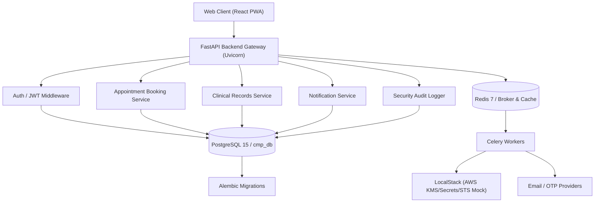

# Technical Specification

## 1. Summary
The Clinical Management Platform (CMP) is a brownfield healthcare appointment and clinical records management system built with FastAPI (Python 3.12), PostgreSQL 15, Redis 7, Celery, and a React (Vite + Tailwind) frontend. It provides patient registration, email verification, JWT authentication, concurrency-safe appointment booking, application-level column-level encryption for clinical records, multi-channel notifications with failover, and immutable security audit logging. The system is containerized with Docker Compose and uses LocalStack for AWS service emulation in development and CI.

## 2. Goals
- Enable patients to self-register, verify email, and authenticate into a clinical portal.
- Allow patients to book, view, and manage appointments with concurrency-safe scheduling.
- Persist clinical records with application-level column-level encryption for sensitive health data.
- Provide reliable, multi-channel notifications (email, OTP) with failover capability.
- Maintain immutable security audit trails for access and data changes.
- Support local development and CI/CD via Docker Compose with PostgreSQL, Redis, and LocalStack.

## 3. Non-Goals
- Payment processing or insurance billing.
- Multi-tenancy or organization-level isolation.
- Real-time video telehealth.
- Mobile native applications.

## 4. Architecture Overview
Decoupled backend/frontend architecture. Backend: FastAPI (Python 3.12) on Uvicorn ASGI server, SQLAlchemy/asyncpg ORM with Alembic migrations, PostgreSQL 15 database. Async task queue: Celery 5.3.6 with Redis 7 broker and cache. Authentication: python-jose JWT with audience enforcement, passlib/bcrypt password hashing. Encryption: cryptography 41.0.7 for application-level column encryption, AWS KMS (LocalStack in dev, AWS KMS in prod) for key management. Notifications: pluggable providers with failover, logged to notifications_log. Frontend: React PWA (Vite + Tailwind) consuming REST/JSON. Infrastructure: Docker Compose orchestration with health checks for PostgreSQL and Redis before backend accepts traffic.



> **Diagram Options & Compatible Viewers for *Architecture Flowchart*:**
> - **Online Interactive View:** [Open Diagram in Mermaid Live Editor](https://mermaid.live/edit#base64:eyJjb2RlIjogImZsb3djaGFydCBURFxuICAgIGNsaWVudFtcIldlYiBDbGllbnQgKFJlYWN0IFBXQSlcIl0gLS0-IGFwaVtcIkZhc3RBUEkgQmFja2VuZCBHYXRld2F5IChVdmljb3JuKVwiXVxuICAgIGFwaSAtLT4gYXV0aFtcIkF1dGggLyBKV1QgTWlkZGxld2FyZVwiXVxuICAgIGFwaSAtLT4gYm9va2luZ1tcIkFwcG9pbnRtZW50IEJvb2tpbmcgU2VydmljZVwiXVxuICAgIGFwaSAtLT4gcmVjb3Jkc1tcIkNsaW5pY2FsIFJlY29yZHMgU2VydmljZVwiXVxuICAgIGFwaSAtLT4gbm90aWZpY2F0aW9uc1tcIk5vdGlmaWNhdGlvbiBTZXJ2aWNlXCJdXG4gICAgYXBpIC0tPiBhdWRpdFtcIlNlY3VyaXR5IEF1ZGl0IExvZ2dlclwiXVxuICAgIGF1dGggLS0-IGRiWyhQb3N0Z3JlU1FMIDE1IC8gY21wX2RiKV1cbiAgICBib29raW5nIC0tPiBkYlxuICAgIHJlY29yZHMgLS0-IGRiXG4gICAgbm90aWZpY2F0aW9ucyAtLT4gZGJcbiAgICBhdWRpdCAtLT4gZGJcbiAgICBhcGkgLS0-IHJlZGlzWyhSZWRpcyA3IC8gQnJva2VyICYgQ2FjaGUpXVxuICAgIHJlZGlzIC0tPiBjZWxlcnlbXCJDZWxlcnkgV29ya2Vyc1wiXVxuICAgIGNlbGVyeSAtLT4gbG9jYWxzdGFja1tcIkxvY2FsU3RhY2sgKEFXUyBLTVMvU2VjcmV0cy9TVFMgTW9jaylcIl1cbiAgICBjZWxlcnkgLS0-IHNtdHBbXCJFbWFpbCAvIE9UUCBQcm92aWRlcnNcIl1cbiAgICBkYiAtLT4gbWlncmF0aW9uc1tcIkFsZW1iaWMgTWlncmF0aW9uc1wiXSIsICJtZXJtYWlkIjogIntcInRoZW1lXCI6IFwiZGVmYXVsdFwifSJ9) *(pan, zoom, export SVG/PNG)*
> - **Native Markdown Viewers:** Renders automatically in GitHub, GitLab, Obsidian, Notion, Azure DevOps.
> - **VS Code:** Render live with the [Markdown Preview Mermaid Support](https://marketplace.visualstudio.com/items?itemName=bierner.markdown-mermaid) extension.
> - **Local CLI Export:** `npx @mermaid-js/mermaid-cli -i <file>.md -o diagram.svg`

## 5. Data Model
```sql
-- Users
CREATE TABLE users (
    id UUID PRIMARY KEY DEFAULT gen_random_uuid(),
    email VARCHAR(255) NOT NULL UNIQUE,
    hashed_password VARCHAR(255) NOT NULL,
    is_verified BOOLEAN DEFAULT FALSE,
    role VARCHAR(50) DEFAULT 'patient',
    created_at TIMESTAMP WITH TIME ZONE DEFAULT NOW(),
    updated_at TIMESTAMP WITH TIME ZONE DEFAULT NOW()
);

-- Email Verification Tokens
CREATE TABLE email_verification_tokens (
    id UUID PRIMARY KEY DEFAULT gen_random_uuid(),
    user_id UUID NOT NULL REFERENCES users(id) ON DELETE CASCADE,
    token VARCHAR(255) NOT NULL UNIQUE,
    expires_at TIMESTAMP WITH TIME ZONE NOT NULL,
    used_at TIMESTAMP WITH TIME ZONE,
    created_at TIMESTAMP WITH TIME ZONE DEFAULT NOW()
);

-- Appointments / Bookings
CREATE TABLE appointments (
    id UUID PRIMARY KEY DEFAULT gen_random_uuid(),
    patient_id UUID NOT NULL REFERENCES users(id),
    clinician_id UUID REFERENCES users(id),
    starts_at TIMESTAMP WITH TIME ZONE NOT NULL,
    ends_at TIMESTAMP WITH TIME ZONE NOT NULL,
    status VARCHAR(50) DEFAULT 'scheduled',
    created_at TIMESTAMP WITH TIME ZONE DEFAULT NOW(),
    updated_at TIMESTAMP WITH TIME ZONE DEFAULT NOW(),
    CONSTRAINT no_overlap EXCLUDE USING gist (patient_id WITH =, tsrange(starts_at, ends_at) WITH &&)
);

-- Clinical Records
CREATE TABLE clinical_records (
    id UUID PRIMARY KEY DEFAULT gen_random_uuid(),
    patient_id UUID NOT NULL REFERENCES users(id),
    encounter_date TIMESTAMP WITH TIME ZONE NOT NULL,
    diagnosis_encrypted BYTEA,
    treatment_plan_encrypted BYTEA,
    notes_encrypted BYTEA,
    encryption_key_id VARCHAR(255),
    created_at TIMESTAMP WITH TIME ZONE DEFAULT NOW(),
    updated_at TIMESTAMP WITH TIME ZONE DEFAULT NOW()
);

-- Notifications Log
CREATE TABLE notifications_log (
    id UUID PRIMARY KEY DEFAULT gen_random_uuid(),
    recipient VARCHAR(255) NOT NULL,
    channel VARCHAR(50) NOT NULL,
    subject VARCHAR(255),
    body TEXT,
    status VARCHAR(50) NOT NULL,
    provider VARCHAR(100),
    created_at TIMESTAMP WITH TIME ZONE DEFAULT NOW(),
    updated_at TIMESTAMP WITH TIME ZONE DEFAULT NOW()
);

-- Security Audit Logs
CREATE TABLE security_audit_logs (
    id UUID PRIMARY KEY DEFAULT gen_random_uuid(),
    actor_id UUID REFERENCES users(id),
    action VARCHAR(100) NOT NULL,
    resource_type VARCHAR(100),
    resource_id UUID,
    timestamp TIMESTAMP WITH TIME ZONE DEFAULT NOW(),
    metadata JSONB
);
```

## 6. API Design
REST/JSON API served by FastAPI with automatic OpenAPI/Swagger documentation.

Authentication:
- POST /auth/register - patient self-registration, queues verification email
- POST /auth/verify-email - validates token, marks email verified
- POST /auth/login - JWT access token issuance with audience claim, enforces patient/staff login separation
- POST /auth/otp - generates and delivers time-limited OTP via notification provider

Appointments:
- POST /appointments - concurrency-safe booking, slot reservation, confirmation queued
- GET /appointments - list patient or staff appointments
- GET /appointments/{id} - retrieve appointment details

Clinical Records:
- POST /clinical-records - create record with application-level encrypted sensitive fields
- GET /clinical-records/{id} - retrieve record, decryption restricted to authorized roles
- PUT /clinical-records/{id} - update record, re-encrypt sensitive fields

Notifications:
- GET /notifications - list delivery attempts and statuses
- POST /notifications/test - trigger failover test between providers

System:
- GET /health - readiness check verifying PostgreSQL (pg_isready) and Redis (redis-cli ping)
- GET /metrics - operational metrics for Celery workers and API latency

## 7. Workflow Design
Patient Registration and Authentication: User submits registration via frontend; backend creates user record, generates email verification token, and queues verification email through Celery/Redis. User clicks verification link; backend validates token, marks email verified, invalidates token, and enables authenticated access. User logs in with email and password; backend verifies bcrypt hash, enforces login separation, issues python-jose JWT with audience and expiration.

Appointment Booking: Authenticated patient requests a slot; backend applies PostgreSQL exclusion constraint (gist tsrange) for concurrency-safe scheduling. On success, appointment record is created, slot marked reserved, and booking confirmation notification is queued to Celery. Concurrent duplicate requests receive a conflict error.

Clinical Record Management: Clinician or system creates/updates clinical record. Sensitive columns (diagnosis, treatment plan, notes) are encrypted at the application layer using cryptography before persistence. Encryption key ID references AWS KMS (LocalStack in dev). Only authorized roles can decrypt/view fields. Access events are written to immutable security_audit_logs.

Notification Delivery with Failover: Notification tasks are dispatched to Celery workers using Redis broker. Primary provider attempts delivery; on failure, system fails over to secondary provider per ADR-004. All attempts are logged in notifications_log with timestamps and status. Retries use exponential backoff.

Audit and Operations: Security-relevant events (login, record access, permission changes) generate immutable audit log entries containing actor, action, timestamp, and affected resource. Alembic migrations manage schema versioning. Docker Compose health checks ensure PostgreSQL and Redis are healthy before backend accepts traffic.

## 8. Failure Modes
| Failure Mode | Expected Behavior & Recovery |
|---|---|
| Primary notification provider failure | System fails over to secondary notification provider per ADR-004 pluggable failover. Delivery attempt and failover are logged in notifications_log. Celery task retries with exponential backoff if both providers fail. |
| Redis broker unavailable | Celery workers cannot distribute tasks. Notification tasks are retried with exponential backoff once Redis recovers. API remains operational for synchronous requests but async notifications are delayed. |
| PostgreSQL unhealthy or unavailable | Docker Compose condition: service_healthy and health checks (pg_isready) prevent backend from accepting traffic until database recovers. In-flight transactions are rolled back; clients receive connection errors and should retry. |
| Concurrent duplicate appointment booking | PostgreSQL exclusion constraint ensures only one booking succeeds for the same slot and time range. Second request receives HTTP 409 conflict error. No partial or duplicate bookings persist. |
| KMS key inaccessible | Application-level encryption/decryption for clinical records fails. System returns error rather than storing plaintext sensitive data. In LocalStack dev, mock KMS is used; in production, AWS KMS IAM policies and key rotation must be monitored. |

## 9. Security Considerations
- Application-level column-level encryption for sensitive clinical record fields using cryptography 41.0.7, independent of PostgreSQL native encryption.
- User passwords hashed with bcrypt via passlib; never stored in plaintext.
- JWT validation using python-jose[cryptography] with audience enforcement and expiration checks.
- Immutable security audit logging for login, record access, and permission changes.
- AWS KMS (LocalStack in dev, AWS KMS in prod) manages encryption keys; no plaintext keys in application code or logs.
- Structured JSON logging via structlog for aggregation and alerting without leaking PHI.
- Role-based access control enforcing separation between patient and staff login contexts.

## 10. Rollout Plan
- Provision Docker Compose environment with PostgreSQL 15-alpine, Redis 7, and LocalStack for AWS service emulation.
- Run Alembic migrations (0001 through 0011) to initialize cmp_db schema.
- Deploy FastAPI backend on Uvicorn with Python 3.12-slim container; configure health checks for PostgreSQL and Redis.
- Start Celery workers and beat scheduler connected to Redis broker.
- Deploy React PWA frontend (Vite + Tailwind) in Node container with Nginx; configure CORS to backend.
- Execute automated test suite (pytest, pytest-asyncio) covering auth, booking flow, clinical encryption, email registration, notifications, OTP delivery, concurrency, and load performance.
- Conduct load/performance validation targeting p95 API latency under 200 ms.
- Promote to production by replacing LocalStack with real AWS KMS/Secrets Manager/STS and updating docker-compose.prod.yml.